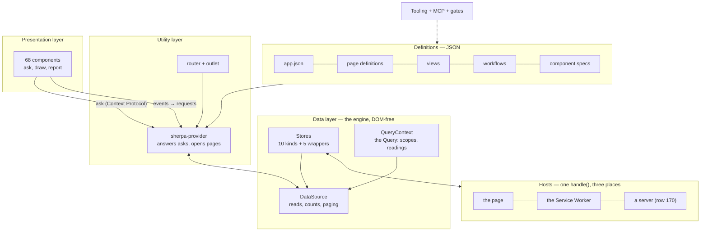
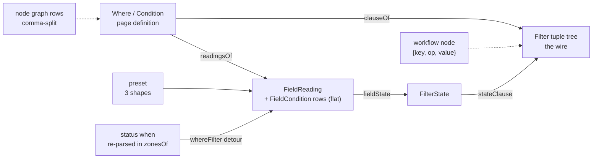
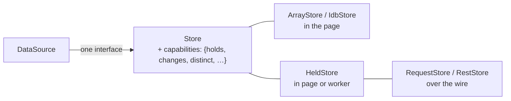
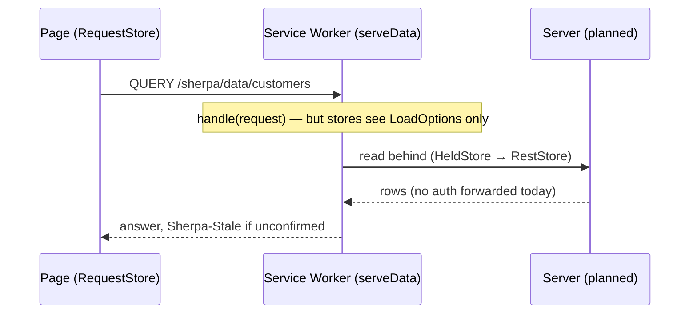
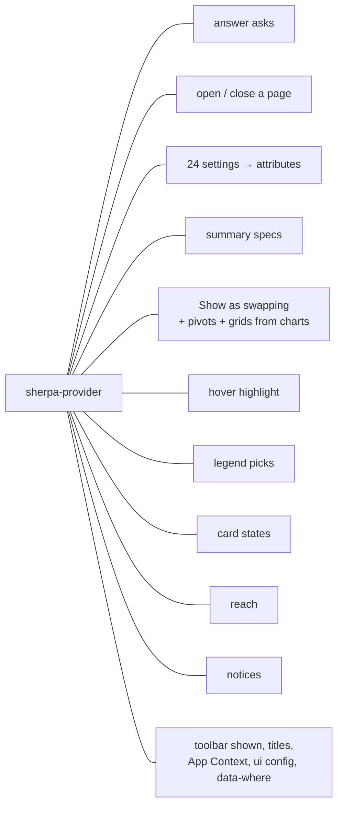
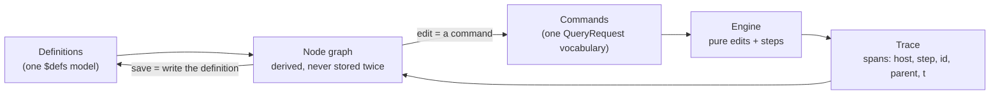
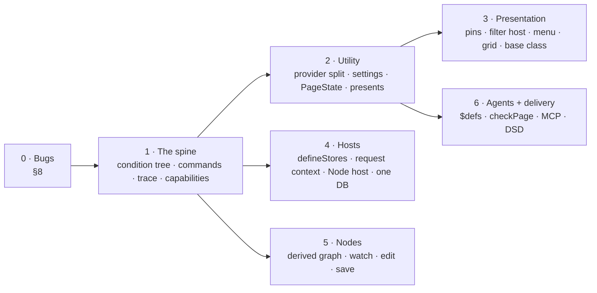

# Sherpa — architecture review

**2026-11-03, at commit `88c327c3`.** Will asked for a full review: redundancy, conflicts,
native APIs not used, and bloat, with Sherpa's goals in mind — an app ENGINE with agnostic
UI components, where rules and workflows can be seen, edited and watched as nodes.

Method: five read-only passes (data, utility, presentation, hosts, definitions and
tooling), then the main claims checked in the code, and the costs measured in the three
test engines. The raw notes, with every file and line, are in
[history/architecture-review-notes.md](history/architecture-review-notes.md).

---

## In one page

Sherpa's layering is right, and most of its parts are good. The problems are of one
kind: **one idea, said many ways.** Each time a feature was added, it added its own shape,
its own door, or its own store. Five ideas carry most of the cost:

| Idea | Said today | Should be |
|---|---|---|
| A filter condition | **9 shapes**, 6 converters | ONE condition tree (nesting, presets, status fields, saved filters and nodes all share it) |
| A command to the data | 13 steering events, 10 request kinds, direct method calls, and 4 ways to set a presentation | ONE command vocabulary, one door (`ask`), in the data layer |
| A setting | **7 delivery paths** (attributes, source properties, callbacks, `<html>` attributes, …) | ONE settings model: data settings on the Query, look settings as inherited CSS properties |
| A page's state | **9 keepers**, 3 JSON shapes | ONE page-state document, with tiers |
| What happened | errors only (`report()`), scattered events | ONE trace stream, across page, worker and server |

Fix those five, and the three goals follow: **nodes** become a view over the commands and
the trace; **local or remote** becomes a property of the store, not of the page; **agents**
get one vocabulary to read and write.

The biggest measured costs: 228 KB of state-pin CSS in every shadow root's cascade; a
2,000-line provider with ~15 jobs; four components over 1,400 lines; 93% of `TODO.md` done
rows. Bugs found: ten (§8).

---

## 1. The layers, as they are



**The data layer** holds the rows and the question. A `Store` gives rows; the `Query`
says which; a `DataSource` reads, counts and pages. It touches no DOM, so a server, a test
or the MCP imports it.

**The hosts** run the same `handle()` in three places: the page (the fallback), the
Service Worker (one held set for every tab, offline, push), and a server (planned, 170).

**The utility layer** is the app's plumbing: the router owns the URL, the outlet opens a
Context, and the provider opens a page from its definition and answers each component's
ask.

**The presentation layer** draws what it is given. A component asks for data in its own
attributes, draws the answer, and reports the reader's acts as events.

**Definitions** say what an app is: its Contexts, each page's source and fields, its
views and its workflows. **Tooling** checks and generates around them.

---

## 2. Definitions

**Today:** about 12 kinds of definition, checked three ways — JSON Schema (in tests,
`spec:check` and the MCP only), name checks (`checkApp`, at run time), and TypeScript.

- **No page check in the engine.** `page.v1.json` exists, but its name checks live in the
  MCP (`mcp-server/tools/data.js:828`). A page that names a missing field fails late.
- **Status fields are not in the schema.** They are set up in JavaScript
  (`statusFields`); `page.v1` allows a field `type` of text, number or date only.
- **The same thing, several shapes.** Per-component state by id three times
  (`PageDefinition.ui`, `SavedView.ui`, `ViewSnapshot.elements`); named condition sets four
  times (saved filter, View query, preset, status `when`).
- **The views library has no schema**, and loads unchecked.

**Proposal:** one `$defs` library — condition, query, field (status included), scope,
view, component config (`$ref` to its spec's props), node, route. A page becomes source +
views + workflows, each by `$ref`. And a `checkPage` in the engine, run at `open()`.

*Done, 695 D1 (2026-11-03):* `schemas/defs.v1.json` holds every shape a definition uses;
`page`, `app` and `workflow` define none of their own; `where` is the one "conditions by
field" shape (scope start, preset, saved filter, View, status `when`); `componentConfig`
refs `component.v1.json#/$defs/member`. `schemas/views.v1.json` checks the View files.
`checkPage` runs first in the provider's `open()`. A value is typed once by its field
(`typedValue`). Left: status fields stay with the store, and defs describes their shape.

---

## 3. The data layer — the engine

### 3.1 One condition, nine shapes



A filter condition has **nine shapes** and **six converters**. Nesting (692) would have to
be taught to every one. It is blocked in exactly two places today: `clauseConditions` gives
up on more than one group (`filter-state.ts:619`), and `where.ts:79` drops a nested
condition as unreadable — although the type and the schema both allow it.

**Proposal: ONE condition tree**, beside the wire form:

```
Condition = { and: Condition[] } | { or: Condition[] }
          | { field, op, value, off?, id? }
```

- The wire `Filter` stays the compiled form. `Where` becomes sugar, parsed once.
- A field's Advanced rows become a subtree of it — **nesting is then free (692)**.
- Presets, status `when`, saved filters, Views and the node editor all hold this one tree.
- `FieldReading` keeps only what a Simple control needs.
- Gone or shrunk: `clauseConditions`, `chainRows`, `readingRows` (a shim for old readings),
  `conditionOf`, `rowReading`, the `whereFilter` detour, `zonesOf`'s hand parsing,
  `presetTouches`' fake state.

*Done, 695 S1 (2026-11-03):* `Condition` beside `Filter` in `store.ts`, one compile
(`conditionClause`); `reading.tree`; presets and a status value's `when` hold the tree;
`Where` stays the JSON form, parsed once; the flat menu converts at one boundary
(`rowsTree`/`treeRows`) until P3 nests it. Every converter above is deleted. Left: the
workflow node's `{key, op, value}` (N1).

### 3.2 The Store — the local/remote seam

The `Store` interface is the right seam for 170. But it says what a store can do in three
different ways: 8 flags, a runtime `stale`, an in-process `history`, and 6 optional
methods. And the page still treats remote stores differently:

- `DataSource` checks `store.holds` seven times, and keeps its own held set for a remote
  store in the page — holding leaks out of the store.
- Wrappers copy the flags by hand, and drift: `statusFields` drops `holds`, `stale`,
  `recheck`, `take`, `send`, `history`; `fakeRemote` drops `totalFirst`, `holds`.
- Over the wire a store loses `distinct` (so counts download rows) and `history` (so
  "redo only what moved" never works remotely).
- No load can be cancelled: `LoadOptions` has no `signal`.



**Proposal:** one typed `capabilities` object, one `wrapStore()` that forwards it, a
`signal` on every read, and a remote store ALWAYS behind `HeldStore` — in the page or the
worker. Then `DataSource` holds nothing itself, and a store is used the same way wherever
it lives.

*Done, 695 S4 (2026-11-03):* `Store.capabilities` replaces the eight flags and goes over
the wire whole; `wrapStore()` (both `fakeRemote` and `statusFields` use it, so the drift
is gone); `heldOf()` puts a remote store behind a `HeldStore` and `DataSource` holds
nothing; a newer ask aborts the read it supersedes, down to the fetch. Left: over the wire
a store still loses `distinct` and `history`.

### 3.3 Two objects that do too much

- **`DataSource`** (2,165 lines, ~120 members): reads, paging, tickets, reach, held reads,
  compile caching, counts, view-models (`describe`), and UI toggles (`showAs`,
  `axisChips`). Seams: reads, counts (the pure halves already sit in `walk.ts` and
  `source-counts.ts`), view-model.
- **`QueryContext`** (1,450 lines): edits made in place, page declarations, fan-out to
  member sources, and references to UI elements (`BoundControl`, `bindOf(el)`). Seams:
  **pure edits `(query, command) → query`** (which undo and the node engine need),
  declarations, members.

### 3.4 One command vocabulary

`QueryRequest` is the right idea, in the wrong place: it is dispatched by `ask()` in
`ui/bind-source.ts`, and it lacks sort, group, search, page, hold and move, which go
through 13 steering events instead. Presentation alone is set four ways.

**Proposal:** complete `QueryRequest`; move `ask()` into `QueryContext`. Then the UI, the
node editor, the MCP and an agent all speak one vocabulary through one door — and every
command can be traced, undone and replayed.

*Done, 695 S2 (2026-11-03):* `QueryRequest` is one typed union (sort, group, search,
page, pageSize, hold, take, release, move, letGo, Apply, Discard, presentation); `ask()`
on `QueryContext` is the one public door, and the old doors are private; pure edits
(`editQuery`) for sort, group, search, presentation, order and move; one table, `STEERS`,
maps the 13 steering events. Left for S5: answer, Switch, solo, reset, preset, hold and
commit still change the Query in place, as members hear each step.

---

## 4. The hosts — page, worker, server



- **`handle()` drops the request.** Stores receive only `LoadOptions`, so an app's
  `Authorization` header stops at the worker, and Demos' spoof switches race between tabs
  (`sw.js:20`). Sherpa never handles auth — but it must **pass a request context through**,
  so the app can: `stores: (request) => …`.
- **The conflict rule is lost on the wire.** `RequestStore.update/remove` drop their write
  options, and the handler never reads `If-Unmodified-Since` — so "a newer write wins"
  breaks once a real server is the host. (`RestStore` sends it.)
- **No Node host yet.** Demos bridges Express to a web `Response` by hand, and mounts
  nothing at `/sherpa/data/`. A server host needs: a Node adapter, CORS, `problem+json`
  errors, POST for the acts that change state (`?recheck`, `?take`), and one version marker.
- **Demos wires its stores twice**, differently, in the page and in `sw.js`; a store name
  stands for a debug mode (`customers` vs `customers-remote`). One `defineStores()` module
  both hosts import fixes it — and is the pattern every app needs.
- **Seven places keep data in the browser** (four Sherpa IndexedDB databases, the app's,
  local and session storage, the Cache API). Two stores cannot share one database: the
  upgrade makes only the opener's object store (`idb-store.ts:145`). **Proposal:** one
  Sherpa database with a fixed schema (sets, outbox, notices, views, seeds), typed
  records; `navigator.storage.persist()` for it.
- **Sign-out** clears only the calling context's kept copy: the worker's set survives and
  writes it back; the outbox and notices are never cleared.
- **Two ways of one thing** (two notice vocabularies; two leader elections that share the
  `sherpa-feed:` namespace; five rechecks with no dedupe). The data path `/sherpa/data/`
  is written out six times.

---

## 5. The utility layer

### 5.1 The provider

The provider calls itself "a thin DOM door". It is 1,974 lines with about fifteen jobs:



It guesses what a component can do by testing for methods (`'drawScope' in el`, five
times) and by tag name. **Proposal:** the provider keeps only answering asks and opening
pages. Pivots and made tables are pure "rows in, table out" — data layer. Highlight, legend
picks, card states, notices and Show as become modules. Components DECLARE what they can do
(`static asks`, `static presents`) instead of being probed.

*Done, 695 U1 (2026-11-03):* `sherpa-provider.ts` 1,984 → 1,386 lines (about 460 of them
the settings pairs U2 replaces); reach, notices, card states, highlight, legend picks and
Show as are modules beside it; `pivotTable`/`madeTable` in `aggregate.ts`; components
declare `static takes` (read in `provider-declared.ts`), so no `in el` probe or tag test is
left in the provider; an unanswered ask travels up to the provider above.

### 5.2 Settings, seven ways

A setting reaches a component as a bar attribute, a source property, a `querySelectorAll`
write, a stored callback, an `<html>` attribute, `definition.ui`, or `session.overlay`.
Adding one setting today needs a private field, a getter and setter, an attribute line, a
Demos table row and a component prop. (This week's solo and description settings followed
the same pattern.)

**Proposal:** one typed settings schema with defaults and a scope (app, page, component),
delivered by Context Protocol subscription (`context.ts` already supports it; the provider
ignores it). Settings that change data go on the Query or the source; settings that change
the look become inherited CSS properties on the root. One `setting-change` event out.

*Done, 695 U2 (2026-11-03):* `SETTINGS` in `src/core/data/settings.ts` declares each setting
once (type, default, scope, its session pointer, and `source` or `look`); a component reads
its own through `static settings`, asked by `SETTINGS_CONTEXT`; data settings are set on
each source; looks are custom properties on `<html>` (`data-mode`, `data-density` and
`data-description-tips` stay attributes, as the tokens read them); one `setting-change`.
The provider's 28 pairs and `#offerLimit`, `followSettings`, `session.overlay` and Demos'
settings table are gone: 1,387 → 1,077 lines.

### 5.3 A page's state, nine keepers

The saved Query, per-View drafts, the reader's Views (with IndexedDB and server tiers),
shipped View files, element state, saved filter sets, the App Context, toolbar shown, and
the URL's `?view` — in three JSON shapes. "Draft" means two things.

**Proposal:** one `PageState` document — `{ view, query, draft, ui }` — with one keeper and
pluggable tiers. Saved Views and saved filters become named parts of it.

### 5.4 Presentation swapping (548)

Built, and it works. But it maps kinds to hard-coded tags (`SHOWN_BY`, `shownAs()` by
`localName`), copies attributes through lists, special-cases the gauge, the line chart and
the radial chart, and `core/ui/show-as.ts` imports components into the core — the layers
upside down.

**Proposal:** each chart declares `static presents = { kind, accepts, keeps, shape }` and
registers itself; the data layer gives one answer per shape (segments, pivot, rows); a
slot host swaps its child by kind, inside `startViewTransition`. The gauge and the line
chart become ordinary kinds.

---

## 6. The presentation layer

### 6.1 State pins: the largest sheet

`sherpa-style-modes.css` is 227,934 bytes, inlined into the base element and adopted into
**every** shadow root. 106 of its 128 rules are pins that only one component can ever
match.

| | Raw | Brotli |
|---|---|---|
| `sherpa-style-modes.css` | 227,934 B | 3,369 B |
| `sherpa-element.js` (the base, all shared CSS inlined) | 241,320 B | 11,335 B |

Over the wire it is small. The cost is the CASCADE: every pin tested in every root on every
style recalc. (And `check:weight` gates raw bytes, which overstate the wire 30–70× and say
nothing of parse or style time.)

> **Measured after step 1 (695 P1, 2026-11-03), Chromium at 4x — this guess was wrong.**
> Style recalc did not change (a toggle, a menu, a sort: within the spread). Chromium
> files each rule under its last selector's tag or class, so a root tests only the pins
> that could match it, and it parses a rule's body only when first needed. The gains are
> sheet parse −24% (about 2 ms a page) and raw bytes −96 KB; brotli rose 7.5 KB on
> `index.js` (+2.4%), as many small copies compress worse than one sheet. The case for
> step 1 is the shape (a component's pins live with it) and step 2, not speed.

**Proposal, in two steps:**

1. Now, safe everywhere: `project-tokens.mjs` writes each component's pins into its own
   generated token region; only the 22 status and look rules stay shared.
2. Next: **style queries**. A pin becomes one line — `:host([data-pending]) { --_mode:
   warning }` — and one shared `@container style(--_mode: warning) { … }` block per mode.
   **Prototyped and measured in Chromium, Firefox and WebKit:** it re-maps a component's
   inner parts. It does not reach `:host` itself, so a component paints its look on an
   inner part.

### 6.2 The big four

| Component | Lines | What falls out |
|---|---|---|
| `sherpa-quick-filter-toolbar` | 2,909 | fit-and-fold (a general utility), organise chips, actions (→ more-menu), values and readings (→ a shared controller) |
| `sherpa-data-grid` | 2,670 | its own sorting, paging, group counts, distinct values and slider ranges (→ a "column facts" ask of the DataSource); then filters, tags, find, selection, resize, sub-grids as modules |
| `sherpa-menu` | 2,525 | five components in one: the popover shell, the value list, the condition editor, the number body, the date body. Its JS placement (~170 lines) could go: anchor positioning by element reference works in all three engines. *Done, 695 P3: five modules beside it, 2,558 → 1,258 lines; the platform places it (JS kept only for `data-bounds` and a trigger off-screen); the condition editor nests (692).* |
| `sherpa-quick-filter` | 1,443 | it is the bar chip, the panel section, the legend row, and three of each grid heading. Sort and group toggles → `sherpa-button` with `aria-pressed`; the legend key → a light element |

**The filter-host contract is written twice.** The grid and the toolbar each implement the
eleven draw methods of `BoundControl`, with their own present, offered, superseded and
applied maps; the panel column adds a third partial copy. **Proposal:** one
`FilterHostController`, keyed by field.

### 6.3 The base class

- **Three small binding languages:** props `to:`, item directives, and `data-swap-on`. One
  would do.
- **Every prop is observed** (`observedAttributes` takes them all), though 319 of the
  declarations (style, visibility, behaviour metadata) do no work at run time. That
  metadata belongs to the gates and the specs.
- Doors used once (`config`, 70 lines, only the grid). A 12-line `sherpa-badge` gets a
  shadow root and nine shared sheets — it could be a look class.
- Icons: 217 per-icon JS modules (884 KB). An SVG sprite or `mask-image` needs no JS per
  icon.

### 6.4 Components no app uses yet

`sherpa-chip`, `sherpa-tag`, `sherpa-nav-section`, `sherpa-panel`, `sherpa-tabs`,
`sherpa-file-upload`, `sherpa-transfer-list`, `sherpa-progress-step-tracker`,
`sherpa-select-card` (~2,050 lines): in no Demos page and no other component — but the
Gallery has stories for them. Library stock, not dead code; see D6.

---

## 7. The engine view — nodes, local/remote, delivery, agents

### 7.1 Nodes as a foundation

Today there are two node registries (`NODE_KINDS` for workflows, `QUERY_KINDS` for the
query graph), and the word `source` means a different thing in each. The query graph is
derived from the Query — good — but the editor edits through three paths (`ask()`, direct
`setSort`, `query.present`), and on a chart slot it likely writes the rows' sort, not the
chart's. The workflow runner (`runWorkflow`) is planned, not built. The Demos Node Editor
is stand-in markup with its own operators.

With the five ideas fixed, nodes stop being a second model and become a VIEW:



- **See:** the graph is drawn from the definitions and the live Query.
- **Edit:** a node edit is a command — the same one a chip sends.
- **Watch:** the trace stream lights each node as it runs, with its row count. (`planWalk`
  already gives ordered steps with counts.)
- **Save:** an edit can be written back to the definition.
- The pure step functions exist: `compile`, `planRead`, `fieldState`, `filterRows`,
  `sortRows`, `groupRows`, `summarise`, `planWalk`. What is missing is typed sockets, the
  trace, cancelling, and edits that return a new Query.

*Done, 695 N1 (2026-11-03):* one registry, `NODE_KINDS` in `node-kinds.ts` (`QUERY_KINDS`
gone; a workflow's `source` is `store`, a row's `key` is `field`); the Query graph adds
presets, saved filters, status fields and superseded answers; every edit is an `ask()`;
Save fires `definition-save` with a checked definition (`pageWithQuery`, `workflowFaults`);
a moved node keeps its place for the tab; Demos' Node Editor is the library's alone. Left:
watch by the trace (N2) and the runner (N4).

### 7.2 Local or remote, the same way (170)

The seam is the `Store`, with its capabilities said once (§3.2), a remote store always
behind `HeldStore`, and `handle()` passing a request context through (§4). Auth stays the
app's: Sherpa forwards headers and never reads them. The Service Worker's spoofing
(`fakeRemote` under `HeldStore`) is then a real host, not a special case — and the Node
adapter is the third.

### 7.3 Delivering templates and definitions (223)

A production build inlines each template and sheet into the JS; dev fetches them. A page's
template and definition are fetched by the outlet. Declarative Shadow DOM works in all three
engines, but server rendering needs four things first: the constructor must keep an existing
shadow root (today it always attaches one); sheets must be written as `<style>` text;
`renderData` needs a DOM shim on the server; and a route must serve definitions as it serves
data. View markup checks use `DOMParser` and `document.baseURI`, so they do not run on a
server yet.

### 7.4 Agents and patterns (77)

The MCP has 19 tools: an agent can read specs and tokens, validate a page or an app, and
drive a component. It cannot compose: the pattern system was removed, there is no page
generator, no preview, `check-usage` is not a tool, and no resource serves the page, app or
workflow schemas. **Proposal:** with one `$defs` model, the MCP gains `generate_page`,
`validate_page` (against specs too), `preview_page` and `check_usage`; a small decision
model (patterns as data: when this kind of data and this task, use this layout) feeds
`generate_page`.

---

## 8. Bugs found

| # | Bug | Where | Measured |
|---|---|---|---|
| 1 | "In the last/next" by month or year overshoots at a month's end | `durationSpan`, `store.ts:160` | last 1 month on 03-31 → from **03-03**; next 1 month from 01-31 → **03-03**. TODO 694; **fixed, 694** |
| 2 | Two stores cannot share one IndexedDB database | `idb-store.ts:145` | read; **fixed, 695 H3** |
| 3 | In the worker, `seedVersion` never re-seeds (its mark lives in localStorage) | `web-storage.ts:34` | read; **fixed, 695 H3** |
| 4 | The newer-write rule is lost over the wire | `request-store.ts:152`, the handler | read; **fixed, 695 H1** |
| 5 | The node editor's sort and group skip a slot's rerouting | `node-graph.ts:436` | likely; **fixed, 695 S2** |
| 6 | A condition value with a comma breaks in the node editor | `query-graph.ts:146` | read; **fixed, 695 S1** |
| 7 | `followUpdates` and `shareFeed(…, 'updates')` take the same lock | `share-feed.ts`, `follow-updates.ts` | read; **fixed, 695 H1** |
| 8 | Each `RequestStore` opens a BroadcastChannel and never closes it | `request-store.ts:74` | read; **fixed, 695 H1** |
| 9 | A notification's click ignores its `url` | `serve-data.ts:108` | read; **fixed, 695 H1** |
| 10 | Sign-out leaves the worker's set, the outbox and notices | `cache-keep.ts:162` | read; **fixed, 695 H1** |

---

## 9. Native features — what is safe today

Probed in the repo's three test engines (Chromium 153, Firefox 155, WebKit 26.6).

| Use now, everywhere | Used? | Where it would cut code |
|---|---|---|
| Style queries `@container style(--x: y)` | no | the state pins (§6.1) — **measured by effect** |
| Anchor positioning, Popover, invokers (`commandfor`) | partly | the menu's JS placement (§6.2) |
| View Transitions | no | Show as swapping (§5.4) |
| Declarative Shadow DOM | no | server rendering (§7.3) |
| `hidden="until-found"`, `<details name>` | no | collapsed grid groups, find |
| Set methods, Iterator helpers, `Map.groupBy` | partly | ~15 hand-rolled set ops in the data layer |
| `Intl.DateTimeFormat.formatRange` | no | `format-date.ts` ranges |
| Temporal (now in WebKit 26.6 too) | via a stand-in | month math (bug 1); the iOS stand-in may go |
| `navigator.storage.persist()`, navigation preload | no | the outbox and kept sets; first loads |
| `typed attr()`, `field-sizing` (parse in all three) | no | `data-*` → CSS lengths; auto-growing inputs |

**Not yet in all three:** CSS `@function` and `if()` (not Firefox), scoped element
registries (not Firefox), customizable `<select>` (not Firefox), CSS module scripts (not
WebKit, so the inlined sheets stay), `scheduler.yield` (not WebKit), `interestfor`
(Chromium only).

---

## 10. Tooling and docs

- **No CI.** The pre-commit hook runs 15 gates; `check:weight`, `check:extensions` and
  `check:mcp-pack` run outside it. *Done, 695 T2: `.github/workflows/ci.yml`; the hook
  runs `check:weight --staged` and `check:extensions`.*
- **Generated four times over:** a component's spec is committed as `.component.json`,
  `custom-elements.json`, `vscode.html-data.json` and `docs/components/`, plus the MCP's
  `specToDef`. The round-trip is coded twice; `spec:validate` is a subset of `spec:check`;
  `check:manifest` and `check:reference` could be one `check:generated`. *Done, 695 D2:
  one round-trip, one Ajv (`scripts/lib/schema-check.mjs`), `spec:check` the one door,
  `check:generated`. The four committed forms stay; the MCP's fifth goes with 700.*
- **`check:weight` measures raw bytes.** Measure brotli bytes and parse time instead.
  *Done, 695 T2: it gates brotli bytes and reports raw bytes and V8 parse time.*
- **`TODO.md`:** 664 of 716 rows are done — 89% of its 13,844 lines. **`TRAPS.md`:** 735
  entries, ~13% in history wording, ~10 citing deleted files. A leaner shape that keeps
  every gate: TODO keeps its open rows and an archive file holds the done sections; TRAPS
  splits by the index's 11 areas, and `check-traps` scans the folder.

---

## 11. A roadmap



| Phase | What | Rows it carries |
|---|---|---|
| 0 | The ten bugs | 694 + new |
| 1 | **The spine:** one condition tree; one command vocabulary with `ask()` in the data layer; one trace stream; store capabilities said once, `wrapStore`, `signal` | **692** (nesting falls out), 518 |
| 2 | Provider down to asks and pages; one settings model; one `PageState`; `static presents` | **548**, 518 |
| 3 | Pins split, then style queries; `FilterHostController`; menu, grid and chip split; one binding language | 518 |
| 4 | `defineStores`; request context; Node host; one Sherpa database; sign-out | **170** (planned), 652 follow-ups |
| 5 | One node registry, derived; watch by the trace; edit by commands; save to the definition | **78, 555, 616, 671** |
| 6 | One `$defs` model; `checkPage`; MCP compose tools and a pattern model; DSD prerequisites | **77, 223** |

Phase 1 is the one that unlocks the rest: every later phase uses the condition tree, the
commands, or the trace. The order of execution, in waves that run in parallel:
[history/plan-695-architecture.md](history/plan-695-architecture.md).

---

## 12. Decisions for Will

**Answered, 2026-11-03: D1–D6 all A** (Will). The order of execution, its waves and
lanes: [history/plan-695-architecture.md](history/plan-695-architecture.md).

| # | Question | A (my pick) | B |
|---|---|---|---|
| D1 | The condition model | One object tree beside the wire `Filter`; `Where` becomes sugar | Extend `Where` in place |
| D2 | Commands | Complete `QueryRequest`; `ask()` moves into the data layer as the only door | Keep the steering events, add methods as needed |
| D3 | Settings | One typed settings model by Context subscription; look settings as root CSS properties | Keep one attribute per setting, generated from one table |
| D4 | State pins | Per-component regions now, style queries next | Style queries now (move host paint inward first) |
| D5 | Docs | Archive done TODO sections; split TRAPS by area | Keep both files whole |
| D6 | The nine components no app uses | Keep, as library stock with Gallery stories | Remove until an app needs one |
