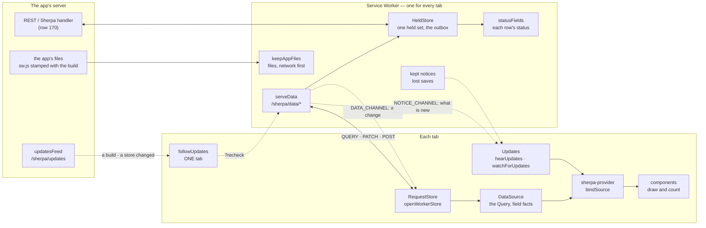
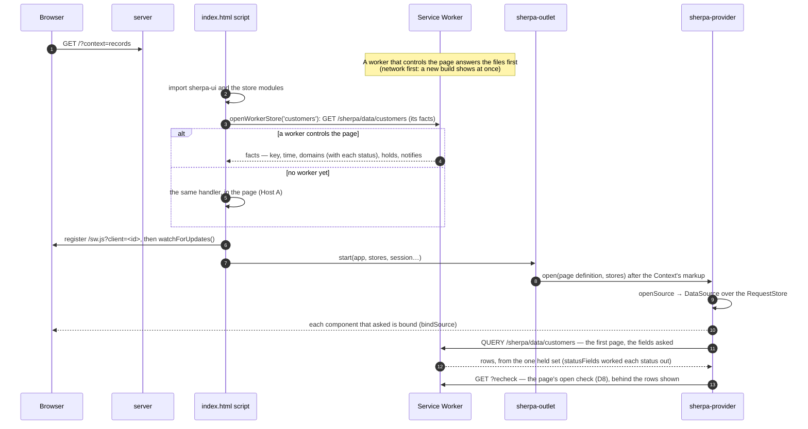

# How a Sherpa app is built, and how its data reaches the screen

Written 2026-11-02, after [plan 652](history/plan-652-service-worker.md) (the Service
Worker) and [plan 683](history/plan-683-status-field.md) S1–S4 (status fields). It
replaces, as the current picture, the runtime drafts in
`docs/history/stocktake-runtime-drafts/` (app, view, component), which stay as record.
Row 685.

Paths that start with `app/` or `server/` are in Sherpa Demos. Paths that start with
`src/` are in sherpa-ui. Where this page and the code disagree, the code wins.

---

## 1. The parts

| Part | Where it runs | What it holds | What it never does |
|---|---|---|---|
| **The data layer** — `src/core/data/` | Anywhere: a page, the worker, Node | Stores, the request protocol, held sets, the Query, field facts | Touch the DOM (rule 13) |
| **The Service Worker** — `src/core/worker/`, run by the app's `sw.js` | One per app, for every tab | The app's files; the app's stores and their one held set; the outbox; kept notices | See a component, a chip or a Query |
| **The utility layer** — router, provider, outlet | The page | The URL; which Context is open; who asks for what | Draw anything; hold rows |
| **The presentation layer** — every `sherpa-*` component | The page | What it draws, and what it counts from its answer | Reach a store; talk to another component |

The worker is the DATA's home; each tab holds its own STATE (the Query) and its own
presentation (D1). A page that has no worker — a first visit, a private window —
runs the same handler in the page, and works as before (Host A).



---

## 2. The files of an app

| File | What it is | Who reads it |
|---|---|---|
| `app/index.html` | The frame (shell, router, provider, outlet, dialogs) and its boot script | The browser, once |
| `app/sw.js` | The app's Service Worker: imports `sherpa-ui/worker` and the app's stores (a worker cannot `import()` at run time, D7) | The browser, at register and at each update check |
| `server/index.mjs` | Serves the app, `/dist`, the live feeds; stamps `/sw.js` with the build | Node |
| `app/app.json` | The app definition: Contexts, Sections, Settings pages | The server, the boot script, `outlet.start()` |
| `app/stores/*-data.js` | The app's stores, written once: rules, seed, and status fields (`statusFields`) | The page AND the worker — the same module |
| `app/templates/<context>.html` | A Context's markup: its components and where each asks | The outlet, at Context load |
| `app/view-schemas/<context>.json` | A page definition: the store's name, fields, scopes, presets | The outlet → `provider.open()` → `openSource()` |
| `app/views/<context>-views.json` | Each View: its Query and its component settings | `loadViewLibrary()` |
| `app/contexts/<context>.js` | `init(root, ctx)`: what only this Context does | The outlet, after the markup |

---

## 3. From a page load to the first rows



---

## 4. A read: a component asks, the data answers

1. **A component ASKS**, in its own attributes (`data-scope`, `data-field`…): it sends
   `context-request`. It never names a store.
2. **The provider answers** with `bindSource(source, el, …)`: it says which rows the
   component reads (a page, or all), which fields, and which scope.
3. **The DataSource compiles the Query** — every scope's readings, presets, search —
   into one filter, and asks its store.
4. **The `RequestStore` sends one `QUERY`** with that read as a body
   (`T-a-data-request-is-the-store-interface`). A server or proxy that refuses `QUERY`
   gets the same body as `POST` (`T-a-query-falls-back-to-post`).
5. **The worker answers from its one held set** (`T-a-worker-holds-the-set`): filtered,
   sorted and paged there, only the fields asked (`projectRow`). Two tabs read the
   server once.
6. **The component draws, and counts what it draws** (D6): a chart's segments, a
   chip's numbers, a highlight on hover — never asked of the worker.

| A component asks for | It is given |
|---|---|
| A page of rows — a grid, a list | The rows and the total |
| Every row, to count — a chart, a metric | The rows with only the fields it reads |
| A field's values — a chip's menu | The values in their declared order, each with its look; a field with over 200 values filters by condition alone (`T-a-list-has-a-limit`) |
| A change | A change event, then it asks again |

**A status field** (`T-a-status-is-worked-out-by-the-data`) is worked out in the data,
on the store module, so the worker's held rows carry it: Demos' Health is At risk,
Watch or Healthy from the score and open tickets. A filter on it reaches the store as
conditions on the fields it reads. The page learns its values and looks from the
store's domain; the grid draws its icon and label; a gauge over the score draws its
zones and picks its values.

---

## 5. A write, online and offline

```mermaid
sequenceDiagram
  autonumber
  participant C as a form (page)
  participant R as RequestStore
  participant W as worker: HeldStore
  participant S as the app's server

  C->>R: update(key, values)
  R->>W: PATCH /sherpa/data/customers/<key>
  alt the server answers
    W->>S: update
    S-->>W: the saved row
    W-->>R: the row; DATA_CHANNEL tells every tab
  else offline (the fetch never left)
    W->>W: the outbox keeps it (IndexedDB), laid over the held set
    W-->>R: the row as it will be; every tab shows it
    Note over W: sent in order, once, under a Web Lock:<br/>when the worker starts, before each check behind,<br/>on Chromium's Background Sync
    W->>S: update, If-Unmodified-Since <when it was made>
    alt a newer change won (412)
      W->>W: kept as a "lost" notice until a page has seen it
    end
  end
```

`T-a-write-made-offline-waits` · `T-a-newer-write-wins`

---

## 6. What is new, and who hears it

| News | Who says it | How it travels | What shows it |
|---|---|---|---|
| A change made in one tab | the worker | `DATA_CHANNEL`, to each tab's `RequestStore` | every bound component asks again |
| Newer rows the worker found behind | the worker | a `data` notice on `NOTICE_CHANNEL` | the banner that listens (`data-listens="data"`); Refresh data takes them in |
| A save made offline that lost | the worker, KEPT until seen | a `lost` notice; said again to each page that opens | a warning banner, a Notifications item |
| A new build | the app's server, on its feed (`updatesFeed`); the browser, as a new worker takes the page over | `/sherpa/updates`, followed by ONE tab (`followUpdates`), which asks for the new worker; then `controllerchange` | the "new version" banner and a Notifications item |
| A live feed (alerts) | the app's server | ONE tab holds it (`shareFeed`, a Web Lock) and passes each message on | the store it feeds |

The worker never tells a page WHAT to show: it says a fact, and an element that
asked to hear it shows (`T-a-notice-is-heard-never-ordered`). Each page holds its
news in ONE `Updates` object, the provider's `updates`: what waits, and what the
reader dismissed. Every listening element draws from it, and so does an app's own
list (Demos' Notifications). The app's server SAYS what is new on one feed,
`/sherpa/updates` (`updatesFeed`): a new build, or a store that changed. One tab
follows it (`followUpdates`) and only acts — it asks for the new worker, or has the
worker check that store behind — and what that finds reaches every tab as a notice
(`T-news-is-pushed-by-the-server`). Polling (`watchForUpdates`) stays as a fallback
until row 687's U4.

---

## 7. Things that look odd, on purpose

- **The worker holds no timer and no connection.** The browser stops it when idle;
  it hears news only when a page, a push or a sync wakes it. So a live feed is held
  by a tab (`T-one-feed-for-every-tab`), and a new build is found by asking
  (`T-a-new-build-is-a-new-worker`).
- **The page holds no rows of a store the worker holds** (`holds`): every answer is
  asked, and a page's open check reads behind, once (D8).
- **Newer server rows WAIT** (`T-a-server-change-waits`): no grid moves under its
  reader; Refresh data takes them in. A write made through the app shows at once.
- **The store modules are imported by the page and the worker alike**, by URL, as
  a worker has no import map.
- **Demos stamps `sw.js` per browser for tests** (`?client=`): a test's fake deploy
  must reach its own page alone.
