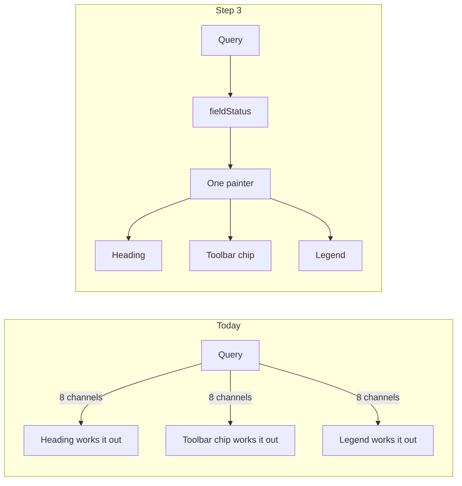

# The data layer plan

Will, 2026-10-30: get the data layer "in tip top shape", because Nodes plus the
Data Layer will become a visual rules engine for repeatable, deterministic
workflows: scripts, policies, schedules, AI harnessing, decision models. It must
be efficient and scalable, and keep every function it has now. No drastic change.

The steps below are rows 611–616 in [TODO.md](TODO.md). This file says why.

**How to read the proof marks.** RUN: we ran it and read the result. READ: we read
it in the code and did not run it. A READ item gets a failing test first; if the
test will not fail, the item goes.

---

## What Will reported

Measured in Records on 2026-10-30, at commit `4b7db9f6`.

| Will saw | Cause | Proof |
|---|---|---|
| Amber filter button on the Tickets heading, with Has open tickets on | No scope holds `openTickets`. `setPreset` writes at `scopeOf(field) ?? scope`, so in `data`. `homeOf` answers `holderOf(field) ?? VIEW`, so it reads the View and finds nothing. The heading is told "on" by `data-filter-fields` and "holds nothing" by its reading, so its chip wears `data-filters-nothing` | RUN: `current filters-nothing`, border `rgb(255,196,76)`, tip "Filter Tickets", menu not read-only. High risk and Needs attention do the same |
| No inactive look on a heading the View holds | `state-pins.yaml` has `&[data-current]:not([data-persistent])` and `&[data-superseded]`, and no rule for both. The first has the higher specificity, so an ON and held chip paints active | RUN: `current superseded` paints `rgb(242,223,255)` and `rgb(192,70,255)`. **A toolbar chip does it too**, so this is not only a heading bug |
| The same, with no answer | A heading has no fill or border at rest, so only its ink can say inactive. `inactive-content-base` is `rgb(53,53,61)` and normal ink is `rgb(12,11,17)` | RUN. Decision D2 |
| Maybe no blue info look on a heading under a preset | Half right. A field a toolbar holds is blue. A field no scope holds fails through the first bug | RUN: Enterprise trials paints Status and Plan `rgb(0,108,145)`, with tip and read-only menu |

Also found:

- View holds Status and a preset holds it too: the heading says `by-preset` and the
  toolbar chip does not, so the same field wears two looks (RUN).
- An Escape straight after a menu opened was lost, in 1 run of 3. Fixed: TODO 609.

---

## The one problem under all of it

Will's guess is right. **No one place answers "what state is this field in?"**

A control hears through eight channels: `drawReading`, `describe().state`,
`supersede`, `supersedeColumns`, `data-pending`, `data-failed`, `data-filter-fields`
and `loading`. Each says one part, some from the draft and some from the applied
Query. The control then works out the rest itself:

| State | Who writes it today |
|---|---|
| `data-current` | toolbar 7 places, grid 7, chip 6, legend 3 |
| `data-superseded` | grid 3, toolbar 1 |
| `data-by-preset` | chip 2, menu 1 |
| `data-pending` | filter-host 2, chip 1 |
| `data-unavailable` | legend 2, filter-host 1, menu 1 |
| `data-filters-nothing` | chip 3: its own guess, from its menu's inputs |

So one wave of fixes reaches the chips it was looking at and misses the rest. The
Tickets heading is that gap made visible.

---

## The steps

Each step ships alone and keeps what the app does. Each fix starts with a test that
fails.

### Step 1 (611): the three bugs — small

- **One home.** A field no scope holds, with a reading, lives where its reading is.
  `homeOf` finds it there before it falls back to the View. The preset still narrows
  only its own scope, so no rows change. Tickets then hears its reading and goes
  blue, with its tip and a read-only menu.
- **The missing pin.** ON and held is inactive, and blue while a preset holds it
  (D1). A toolbar chip does not hear a preset on a field the View holds, so it reads
  inactive where its heading reads blue. That is an honest look, and Step 3 joins them.
- **The resting ink** of a held heading (D2).

### Step 2 (612): wrong answers the engine cannot live with — done

Tests: `test/unit/one-question-one-answer.test.mjs`. Each failed first, unless it says
otherwise.

| Was wrong | Where | Now |
|---|---|---|
| A number compared with text fell to locale text: `gt "1.5"` passed 1.25, and `gt "-3"` passed -5 and failed -1. A node's Value row is text, so this was the normal case for a rule | `store.ts`, `compareValues` | Compares as the row's kind. Text that is no number stays a text compare |
| A Date row never matched `between` with ISO text | `store.ts`, `compareValues` | Compares as dates |
| "In the last 0": chip on, nothing filters | `filter-state.ts`, `rowAnswered` | Answers nothing, so the chip is off |
| `#fetchedKeys` was never cleared, so a Refresh kept a server field's old keys | `data-source.ts`, `#letGo` | Let go with the set, and asked again |
| `setQuery` rehomed the draft and not the applied Query. In a waiting scope, the chip and the rows disagreed | `query-context.ts` | Rehomed before the copy |
| A search while the Switch was off destroyed the kept sort and group | `query-context.ts`, `#arrange` | Kept |
| The grid had its own test of "answered" | `sherpa-data-grid.ts` | Gone: it uses `readingAnswered` |

Checked, and not bugs:

- **Export losing a second source's sort.** It does not lose it. The test stays, as a
  guard.
- **A half-built Between.** A heading and a toolbar held it differently, but the menu
  draws only finished rows in both, so nothing a reader sees changed. Two tests of
  "answered" stay, because they ask two questions: `readingAnswered`, does the Query
  keep this; `rowAnswered`, does this row narrow anything.

Moved to Step 3: after a remote raise, bars read the draft and headings read the
applied Query, until Apply. One status ends that.

### Step 3 (613): one answer for a field's state — medium

The heart of it, and what Will asked for. Two small pieces:

1. **`fieldStatus(field, scope)`**, a pure function in the data layer: home, held
   here, held above, answer, in the filter, pending, failed, loading, locked by what.
   It has one test matrix, every state by every scope.
2. **One painter** in `core/ui/filter-host.ts`, beside `markField`: status in,
   attributes out, for any chip-like control. The order of looks lives in one place.

The source tells every bound control the status of its fields whenever a field
changes. Controls never hear from each other (Will, 2026-10-30): a preset chip and a
View chip know nothing of one another, and each simply draws what the Query says. So
a toolbar chip hears `byPreset` on a field the View holds as its heading does, where
today `supersede` hands a bar only field names and `supersedeColumns` hands a grid
the readings. Those two doors go. The hierarchy already says who holds a field (View
scope, then local scope, then the component), so "held above" is one part of one
status, for every control (Will, 2026-10-30).

Then move one control at a time, deleting what each replaces: heading, toolbar chip,
panel value chip, cell chip, tag, legend key, menu row. A gate then blocks a
component writing these attributes itself. If a control is left half moved, the app
still works, because old and new paint the same attributes.

### Step 4 (614): same input, same output — small

What a rules engine needs. READ unless marked.

- **The clock.** `new Date()` is at `store.ts:152`, `store.ts:167` and
  `data-source.ts:1783`, and nothing can pin it. Add `now` to `filterTest` and
  `LoadOptions`. The day also goes in the cache keys, or counts and rows disagree
  after midnight.
- **The locale.** `Intl.Collator(undefined)` makes `z` and `ä` swap between German
  and Swedish (RUN), which moves sort and `lt`/`gt`. Pass it in.
- **Tick every value** compiles to no filter, so a new value passes until a reload.
  Right for a reader, wrong for a rule. Add a literal compile flag for the engine.
- **`report`** is one global sink, and `checkWorkflow` returns only a boolean. Return
  the problems.
- **A replay test:** one Query, one set of rows, one clock, byte-equal rows.

### Step 5 (615): scale — small first, then medium

The data layer's own time, from the bench's acts on one machine. Drawing is not
counted; that is TODO 350.

| Act, rows in the browser | 10k | 100k | 1M |
|---|---|---|---|
| Open a page | 27 ms | 156 ms | 1,970 ms |
| Open, with tiered fields | 32 ms | 225 ms | 4,908 ms |
| Pick a filter value | 9 ms | 41 ms | 562 ms |
| Sort | 6 ms | 21 ms | 323 ms |
| Search | 6 ms | 28 ms | 297 ms |
| Turn a page | 4 ms | 11 ms | 157 ms |

It grows in a straight line, which is good. But at 1M it stops the page for over
half a second per act, because it all runs on the main thread.

**Remote is the first weak spot.** Over 50,000 rows the set is not held, and every
question asks the store. At 100k through `fakeRemote`, one act made up to 62 passes
over the rows (Apply with a fetched field, 641 ms). The first read fetches 50,001
rows and throws them away (`store-cache.ts:356`). `RestStore` has no `totalCount` or
`distinct`, so counts download the matches (`base-store.ts:88`).

Small fixes: remember validated rows; memoise tiered facts; coalesce a burst of store
changes; a count asks `take: 0`; tallies ask only their fields; a 100k bench row, as
the bench's 10k hides all this. It counts and never times
(`T-the-bench-counts-and-never-times`), and that stays.

Medium: a cached ordered set, so a page turn is a slice and not a filter and a sort.
The target is 100k rows in the browser (D3). A Web Worker is for much later.

### Step 6 (616): the node engine — medium

`runWorkflow`, `workflow-edits.ts` and `NodeKind.run` exist only in
[the workflow plan](history/plan-78-workflow-data.md): only W1 is built. Build W5 over
the pure functions (`compile`, `filterRows`, `sortRows`, `groupRows`, `aggregate`),
not over `DataSource`, which needs bound controls. It needs a trace, a `signal` to
cancel, a dry run, batch writes, and typed sockets beyond value or object.

Step 4 comes first: an engine built on a clock it cannot pin gives answers that
cannot be checked.

Also: `describe()` in `data-source.ts:467-579` is the one split of the big files that
pays. The rest of their size is not worth moving.

---

## What is sound: leave it alone

From the read: `compile`'s purity given its facts; `planRead`, `HeldSet` and
`StoreCache`'s one shared read; the `Latest` tickets (the async races traced are
guarded); the history-gated rewalks; the DOM-free gate; `QueryRequest` as the Node
Editor's door; clause order. No import cycles, and almost no dead code.

---

## Not in this plan

- A rewrite, or a new architecture.
- Row 170, the client/server split: only on Will's word. Steps 4 and 6 prepare for it.
- Drawing speed: TODO 350.

---

## Decisions for Will

Will decided all five on 2026-10-30.

| # | Question | Decision |
|---|---|---|
| D1 | The View holds a field and a preset holds it too. Which look? | **Blue** |
| D2 | A held heading with no answer looks almost normal: its ink is `rgb(53,53,61)`, and normal ink is `rgb(12,11,17)` | **Lighter** |
| D3 | How many rows must the browser hold? | **100k.** "We can look at web workers for apps much later" |
| D4 | Chip counts ignore the search box, so they can differ from the rows | **Keep** |
| D5 | Row 555, the Node Editor for Queries, waits on 548, and Presentation is parked | **Lift the wait.** "Presentation switching isn't key to building graphs with presentation nodes" |
