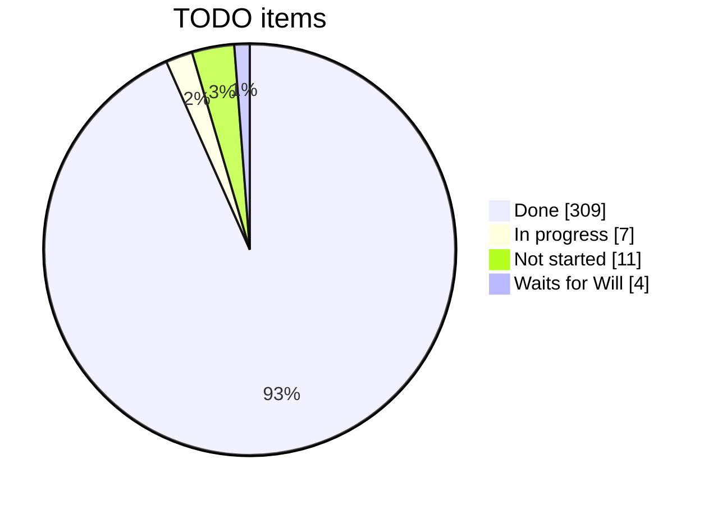
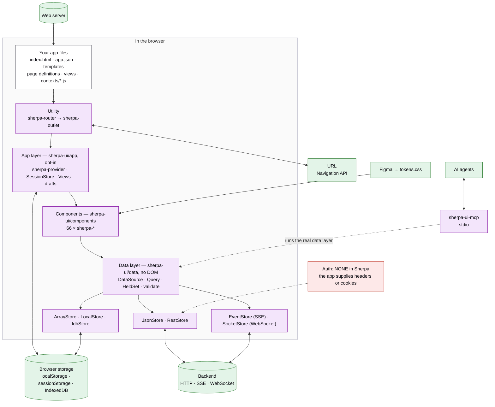
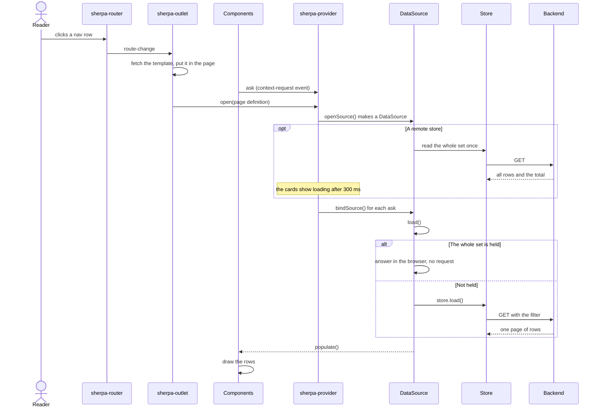
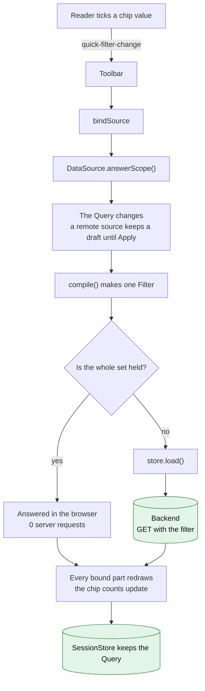
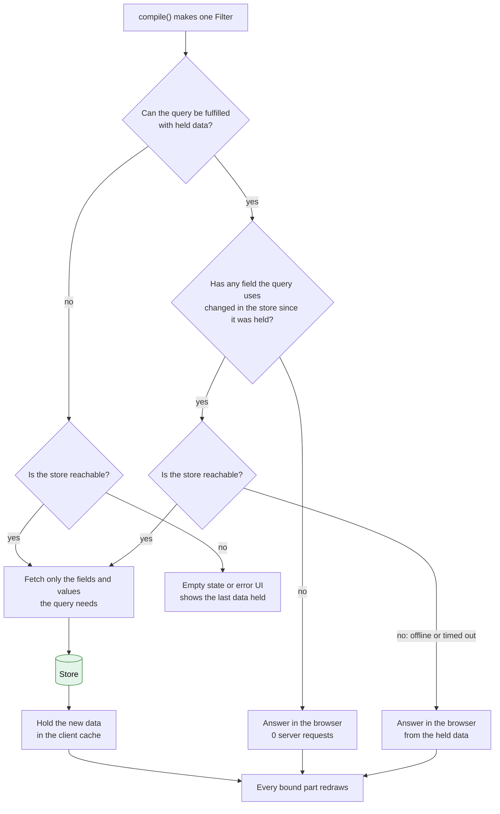
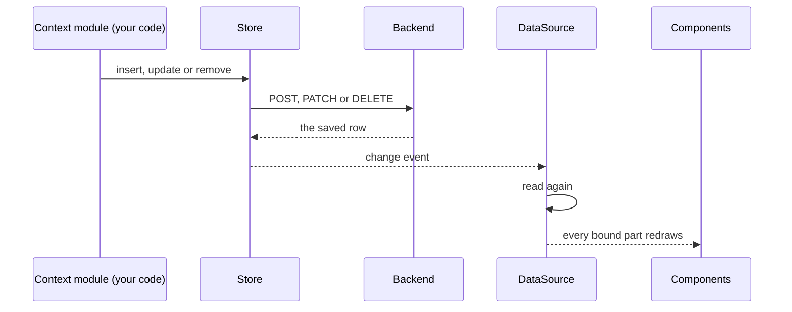
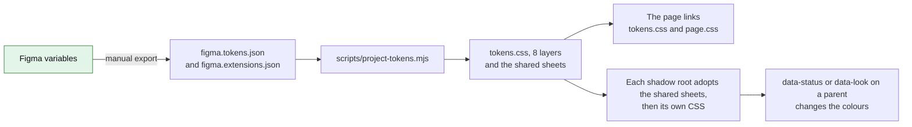
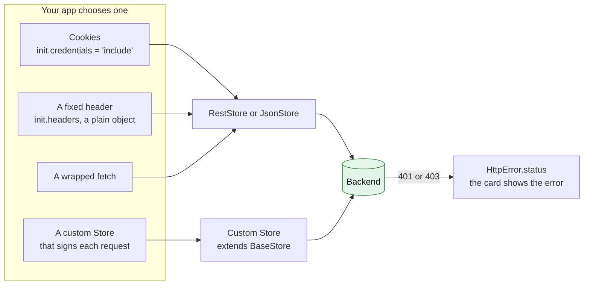

# Sherpa stock-take — 2026-10-19

A snapshot: what is done, what is still to do, and how Sherpa works with the
rest of a tech stack. It is dated, so it goes stale. The live list of work is
[docs/TODO.md](../TODO.md).

---

## Where we are

- **Done:** 309 TODO items.
- **Open:** 22 items. 7 are in progress, 11 are not started, and 4 wait for Will's answer.
- **Not pushed:** `sherpa-data-layer` has 2 commits that are not on GitHub (342 and 343).
- **Size:** 66 components, 14 checks before each commit, 1,339 commits since 1 September.

---

## What is done

| Area | Main results |
|---|---|
| Components | 66 components. Each has a spec, which is its full contract, and an example. They fetch nothing: the HTML and CSS are inside the JS. Shared logic is in the `SherpaElement` base class. |
| Tokens and Figma | Figma variables become 8 CSS layers. Components use the same Style names as Figma. There is one Button look, which a native `<button>` can use too. |
| Data layer | `sherpa-ui/data` has no DOM, so it also runs on a server. A remote source reads its whole data set once, so a toggle, a sort or a group makes no server request. A gate counts what each click costs. |
| App layer | Provider, router, outlet, session, saved Views, drafts and favourites. One `app.json` defines the whole app. |
| Filters | Simple and Advanced modes, filter sets, Save filters, Reset and "Return to X". Each chip shows a count. The data bar has a Switch, hidden by default. |
| Accessibility | An axe check on every component (WCAG 2.1 AA), with no known failures. Tabs, charts and radios are one tab stop each. |
| Tooling | 14 checks before each commit. The component reference, `custom-elements.json` and the VS Code data are made from the specs. Each import's size is checked. |
| MCP server | `sherpa-ui-mcp` has 19 tools and the guides, and can drive a live page. |
| Other projects | Sherpa Demos (the example app), Sherpa Gallery (stories) and Sherpa Starter (`create-sherpa-ui`). |

---

## What is still to do

### Your decision (it waits for you)

| Item | The question | My pick |
|---|---|---|
| 305 | Should a grid column's menu follow "Hide unmatching filters"? | A: yes |
| 319 | A saved filter keeps the caller's object, so the caller can change it. | A: copy it when it comes in |
| 321 | Saved Views use two keys: the Context's name and the page's id. | A: one key (Views saved under the old key are then not found) |
| 327 | There is no LICENSE file. | Need the copyright holder and the year |
| 338 | Two choices for the Switch: 1, while it is off, the chips are grey and do not work. 2, the panel turns the Switch back on. | Both are built as written |
| 293 | Cut CLAUDE.md (now 839 lines) down, or keep it. Remove the old `generate-sherpa-component` skill, or not. | — |
| 339 | Clean up the Figma file, or leave it. | — |
| 290 | Rename `spoofRemote` to `fakeRemote`? | — |
| Look by eye | 323 (sparkline gaps), 313 (panel footer), 324 (app header), 340 (toggles feel instant on `?remote`). | — |

### Needs a test run you allow

- **Data layer:** 287 step 5b, 288 steps 8b–10, 291 steps 7–8.
- **Filter family:** 302 (remove the frame waits), 311 (`clone()` everywhere), 320.
- **Keyboard:** 315 (calendar keys), 318 (arrow keys on 3 toolbars).
- **Button:** 4 hand-made copies of the Button look move to the shared class.

### Later or large (your word first)

- **170:** the data layer on the client, the server, or both.
- **223:** server rendering.
- **76:** WebMCP.
- **77:** UX patterns as a contract.
- **78:** node components.
- **341:** component words out of the data layer. This one can be measured and planned now.

### New: found by reading on 2026-10-19, not in the TODO yet

1. The outlet puts Context markup in with a plain `innerHTML`. Under a strict Trusted Types policy (CSP), that will stop the page.
2. If one Context's views file is missing, every Context fails to load, and nothing reports it.
3. The Starter template asks npm for `sherpa-ui@^2.1.0-beta.0`. On npm, that name is another person's package.
4. `RestStore` loses headers that come as a `Headers` object. It also cannot cancel a request.
5. Three plan items have no TODO row:
   - prompt-composer sets its height in JS.
   - The toast stack uses inline `z-index`.
   - 3 component sheets still read the old `--_status-*` names.
6. Doc clean-up: about 20 sections still say "Not run yet", and 2 headings do not agree with the ledger.

---

## How Sherpa works

### 1. The layers, and where they touch the rest of the stack

Purple boxes are Sherpa. Green boxes are outside Sherpa. The red box is a gap:
Sherpa has no auth.

Not in the page: the `sherpa-ui` CLI (`serve`, `check-usage`), and Node code
that imports `sherpa-ui/data` on a server.

### 2. A page opens (the read flow)

### 3. A reader changes a filter

Today the check reads "Is the whole set held?" (TODO 340). TODO 345 makes it a
series of checks. That is the next diagram.

### 3b. Planned (TODO 345): fast or current

Will, 2026-10-19: *"It's not just a binary scenario but a series of
considerations on when to be performant versus current in working with data."*
Not built yet.

Open questions in 345: what the cache keys on, and how the reader sees that an
answer came from held data. For "has a field changed?", Will's sketch: the
store keeps a History table (a delta time and a bitmap of the changed fields
per update), and the data layer compares it with the session start and View
update times. See TODO 345.

### 4. A write (add, edit, delete)

### 5. Style

### 6. Where an app plugs in auth

Sherpa has no auth. An app picks one of these four.

---

## Where you must plug things in

| Part | What Sherpa gives | What your app gives | Gap |
|---|---|---|---|
| **Backend (REST)** | `RestStore` options: `url`, `rowsPath`, `totalPath`, `init`, `timeout`, `buildQuery`. Writes use POST, PATCH and DELETE. | The endpoint. A server that reads Sherpa's filter parameters, or a `buildQuery` that translates them. A `totalPath`, so the whole set can be held. | No retry, no cancel. No GraphQL store, no polling. |
| **Backend (live)** | `EventStore` (SSE, it only receives). `SocketStore` (WebSocket, you call `send()`). | The endpoints, and a call to `connect()`. | Nothing shows "reconnecting". |
| **Other backend** | The `Store` interface, or `BaseStore` to extend. | All of it, auth too. | — |
| **Auth** ⚠ | **None.** Only fixed settings: `init` (headers, `credentials`), `withCredentials`, WebSocket `protocols`. | Cookies, a fixed header, a custom store that signs each request, or a wrapped `fetch`. Handle a 401 from `HttpError.status`. | No token hook, no refresh, no 401 handler. A `Headers` object is dropped. |
| **User and permissions** ⚠ | **None.** | Who the user is, and what they may do. Row security on the server: the held set is all that the server sends. | — |
| **Browser storage** | `SessionStore` (`sherpa:session:*`), saved Views, filters, drafts, `IdbStore`. | Which values to `persist()`. | Saved Views stay on one browser. `syncViews` exists, but nothing uses it. |
| **URL** | `sherpa-router` (Navigation API). | The parameter names. A server that serves `?context=` URLs. | — |
| **App files** | The outlet fetches the templates, definitions and views. | The files and a web server. | It sends no credentials. One missing views file stops every Context. |
| **Forms** | The form controls take part in a native `<form>`. The `.sherpa-button` look works on a native submit button. | The form action or a submit handler. | File upload sends nothing by itself. |
| **Security** | A strict CSP and Trusted Types policies. | A CSP header that names `sherpa-ui` and `sherpa-ui-view`. | The outlet's `innerHTML` does not use the policy. |
| **Design** | Figma becomes `tokens.css`. | Links to `tokens.css` and `page.css`, and the Inter font. | The Figma export is manual. Clean-up is TODO 339. |
| **AI agents** | `sherpa-ui-mcp`: 19 tools, over stdio. | The MCP client settings. | stdio only, no HTTP. |
| **Server / Node** | `sherpa-ui/data` runs in Node. Components load but define nothing there. | Node 22 or later. | No server rendering (TODO 223). |
| **Getting Sherpa** | A link to the repo: `"sherpa-ui": "file:../sherpa-ui"`. | A clone, a build, and an import map or a bundler. | It is not on npm. The Starter still names npm versions. |
| **Language** | `Intl` and `Temporal`. | — | English text only. The browser's language only. |
