# Sherpa stock-take — 2026-10-19

A snapshot: what is done, what is still to do, and how Sherpa works with the
rest of a tech stack. It is dated, so it goes stale. The live list of work is
[docs/TODO.md](../TODO.md).

**Updated after TODO 344** (markup, default variants and text come from the
`.html` and `.css`), with a new part: how an app, a View and a component are
made at run time.

---

## Where we are

- **Done:** 310 TODO items (344 is the newest).
- **Open:** 27 items. 7 are in progress, 16 are not started, and 4 wait for Will's answer. New since the first stock-take: 345 to 349.
- **Size:** 66 components, 14 checks before each commit, about 1,360 commits since 1 September.

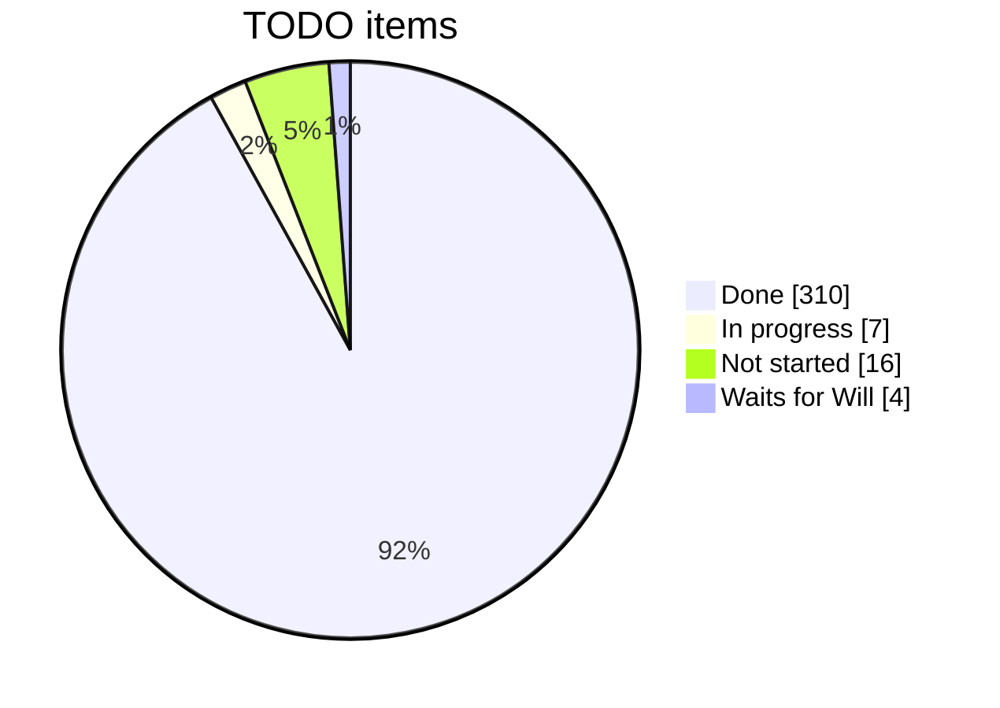

---

## What is done

| Area | Main results |
|---|---|
| Components | 66 components. Each has a spec, which is its full contract, and an example. They fetch nothing: the build puts the HTML and CSS text inside the JS. Shared logic is in the `SherpaElement` base class. |
| Markup out of TS (344) | A component's markup, default variants and fixed words live in its `.html` and `.css`, never in TS. The base class gives five ways to do that — see "How a UI component is made" below. |
| Tokens and Figma | Figma variables become 8 CSS layers. Components use the same Style names as Figma. There is one Button look, which a native `<button>` can use too. |
| Data layer | `sherpa-ui/data` has no DOM, so it also runs on a server. A remote source reads its whole data set once, so a toggle, a sort or a group makes no server request (345 explores fetching each field's values on demand instead). A gate counts what each click costs. |
| App layer | Provider, router, outlet, session, saved Views, drafts and favourites. One `app.json` defines the whole app. |
| Filters | Simple and Advanced modes, filter sets, Save filters, Reset and "Return to X". Each chip shows a count. The data bar has a Switch, hidden by default. |
| Accessibility | An axe check on every component (WCAG 2.1 AA), with no known failures. Tabs, charts and radios are one tab stop each. |
| Tooling | 14 checks before each commit. The component reference, `custom-elements.json` and the VS Code data are made from the specs. Each import's size is checked. |
| MCP server | `sherpa-ui-mcp` has 19 tools and the guides, and can drive a live page. |
| Other projects | Sherpa Demos (the example app), Sherpa Gallery (stories) and Sherpa Starter (`create-sherpa-ui`). |

---

## What is still to do

### Your decision (it waits for you)

| Item | The question | My pick |
|---|---|---|
| 305 | Should a grid column's menu follow "Hide unmatching filters"? | A: yes |
| 319 | A saved filter keeps the caller's object, so the caller can change it. | A: copy it when it comes in |
| 321 | Saved Views use two keys: the Context's name and the page's id. | A: one key (Views saved under the old key are then not found) |
| 327 | There is no LICENSE file. | Need the copyright holder and the year |
| 338 | Two choices for the Switch: 1, while it is off, the chips are grey and do not work. 2, the panel turns the Switch back on. | Both are built as written |
| 293 | Cut CLAUDE.md (now 839 lines) down, or keep it. Remove the old `generate-sherpa-component` skill, or not. | — |
| 339 | Clean up the Figma file, or leave it. | — |
| 290 | Rename `spoofRemote` to `fakeRemote`? | — |
| Look by eye | 323 (sparkline gaps), 313 (panel footer), 324 (app header), 340 (toggles feel instant on `?remote`). | — |

### Needs a test run you allow

- **Data layer:** 287 step 5b, 288 steps 8b–10, 291 steps 7–8.
- **Filter family:** 302 (remove the frame waits), 311 (`clone()` everywhere), 320.
- **Keyboard:** 315 (calendar keys), 318 (arrow keys on 3 toolbars).
- **Button:** 4 hand-made copies of the Button look move to the shared class.

### Later or large (your word first)

- **170:** the data layer on the client, the server, or both.
- **223:** server rendering.
- **76:** WebMCP.
- **77:** UX patterns as a contract.
- **78:** node components.
- **341:** component words out of the data layer. This one can be measured and planned now.

### Next, from Will's notes on 2026-10-19

- **345:** fetch each field's values on demand, and cache them, instead of the whole set. A History table of field bitmaps says what changed; it starts again each session. Plan with Will first.
- **346:** one "Send to <component>" on a View field.
- **347:** the View scope first; a component scope only within its subset.
- **348 and 349:** a chip's count, and a menu's viable fields and values, from that subset: its scopes and the filters before it.

### New: found by reading on 2026-10-19, not in the TODO yet

1. The outlet puts Context markup in with a plain `innerHTML`. Under a strict Trusted Types policy (CSP), that will stop the page.
2. If one Context's views file is missing, every Context fails to load, and nothing reports it.
3. The Starter template asks npm for `sherpa-ui@^2.1.0-beta.0`. On npm, that name is another person's package.
4. `RestStore` loses headers that come as a `Headers` object. It also cannot cancel a request.
5. Plan items with no TODO row:
   - prompt-composer sets its height in JS.
   - 3 component sheets still read the old `--_status-*` names.
   - (Fixed in 344: the toast stack's inline styles are now a CSS sheet. It is still `z-index: 1000`, not a popover.)
6. Doc clean-up: about 20 sections still say "Not run yet", and 2 headings do not agree with the ledger.

---

## How Sherpa works

### 1. The layers, and where they touch the rest of the stack

Purple boxes are Sherpa. Green boxes are outside Sherpa. The red box is a gap:
Sherpa has no auth.

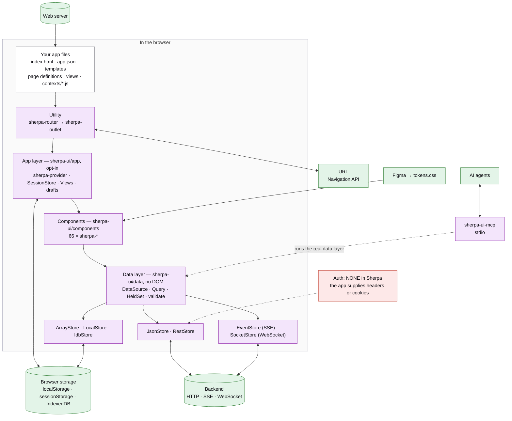

Not in the page: the `sherpa-ui` CLI (`serve`, `check-usage`), and Node code
that imports `sherpa-ui/data` on a server.

### 2. A page opens (the read flow)

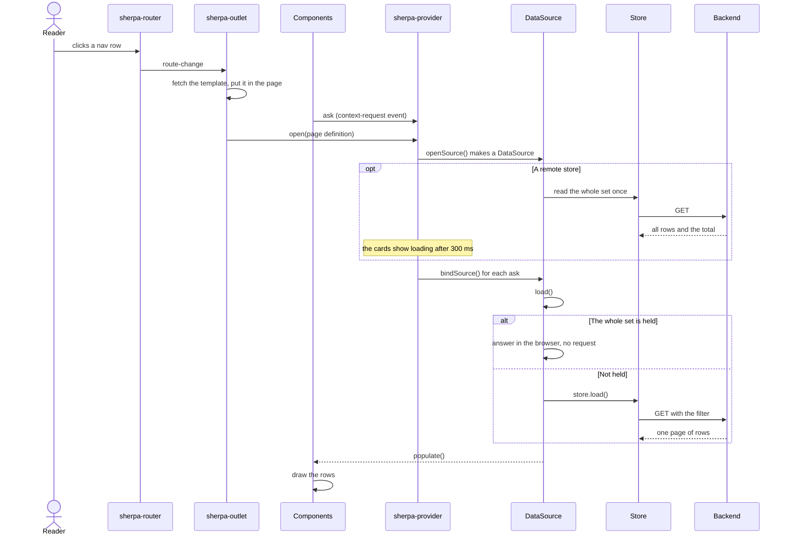

### 3. A reader changes a filter

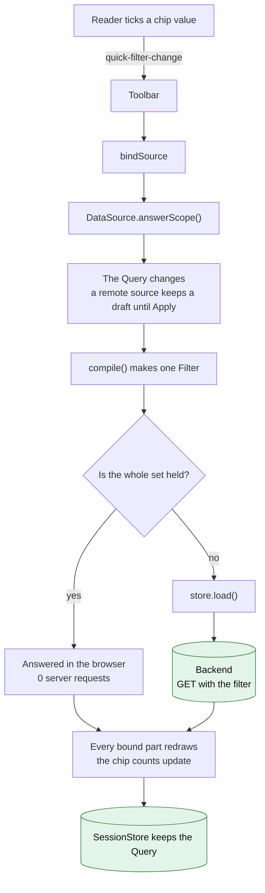

Today the check reads "Is the whole set held?" (TODO 340). TODO 345 makes it a
series of checks. That is the next diagram.

### 3b. Planned (TODO 345): fast or current

Will, 2026-10-19: *"It's not just a binary scenario but a series of
considerations on when to be performant versus current in working with data."*
Not built yet.

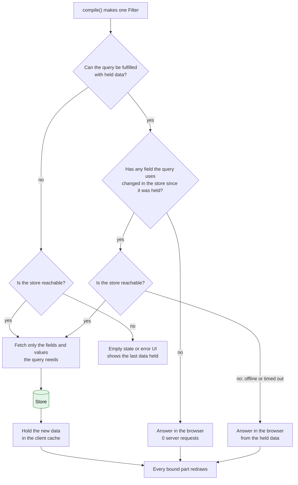

Open questions in 345: what the cache keys on, and how the reader sees that an
answer came from held data. For "has a field changed?", Will's sketch: the
store keeps a History table (a delta time and a bitmap of the changed fields
per update), and the data layer compares it with the session start and View
update times. See TODO 345.

### 4. A write (add, edit, delete)

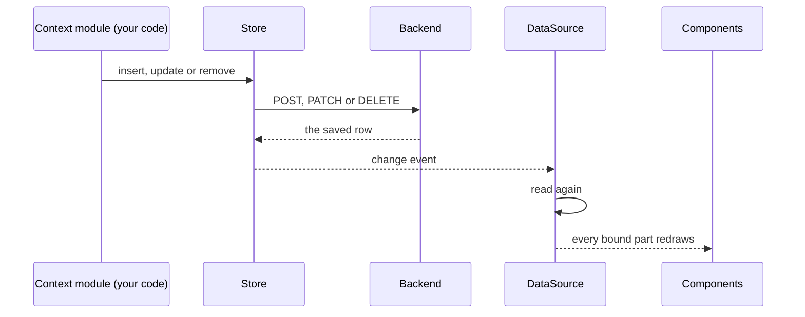

### 5. Style

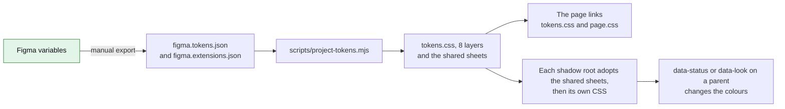

### 6. Where an app plugs in auth

Sherpa has no auth. An app picks one of these four.

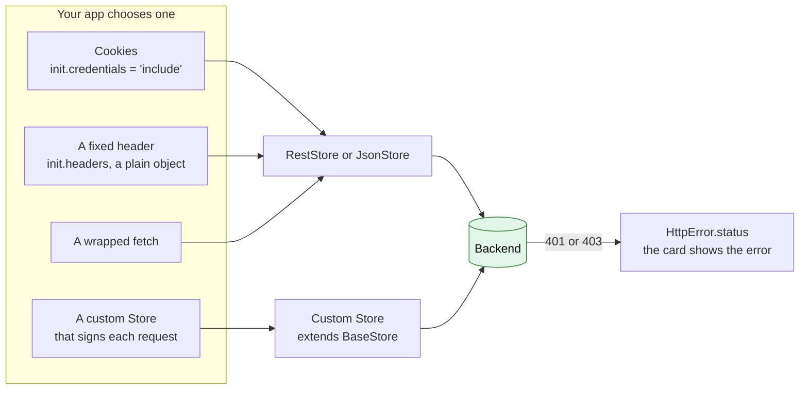

---

## How each part is made at run time

Added after TODO 344. Each part was drafted by one agent and checked against the
code by a second. Worked examples come from Sherpa Demos.

### 7. The kinds of file, and how they work together

Every file is one of six kinds. The colours are the same in every diagram below.

| Kind | What it is | Examples | Written by | Read by, and when |
|---|---|---|---|---|
| **DEFINITION** (JSON) 🟨 | Data that sets something up | `app.json`; a page definition (`view-schemas/records.json`); a Views file (`views/records-views.json`); a component's `.example.json` | a person | `app.json` and every Views file: once, when the app starts. A page definition: each time its Context opens. An example: only tools and the Gallery. |
| **SCHEMA** (JSON) ⬜ | Checks the SHAPE of a definition or a contract | `schemas/app.v1.json`, `page.v1.json`, `component.v1.json`, `example.v1.json` | sherpa-ui | The editor, the MCP and the tests. **Never the browser.** At run time `checkApp()` checks only the NAMES, and reports a problem. |
| **CONTRACT** (JSON) 🟨 | What a component is, made from its code | `sherpa-x.component.json`; `custom-elements.json`; `docs/components/` | the spec generator, never a person | The commit checks, the MCP, editors and the Gallery. **No app reads it.** |
| **TEMPLATE** (HTML) 🟩 | Markup that is stamped or cloned | A component's `.html`; a Context's `templates/records.html`; a family file (`src/core/sherpa-filter-menu.html`); a View's own markup (`views/dashboard-views.html`) | a person | A component's: put inside its JS at build time, stamped by the base class. A Context's: each time it opens, into the outlet. |
| **SHEET** (CSS) 🟦 | Styles | `tokens.css` and `page.css` (the page links them); shared, family and own sheets (adopted into each shadow root); a page sheet (`sherpa-toast-stack.css`) | Figma (through `project-tokens.mjs`) and a person | `tokens.css` and `page.css`: at page load. The rest: inside the JS, adopted when an element first connects. |
| **CODE** (JS/TS) 🟪 | Behaviour | a component's `.ts`; a Context's module (`contexts/records.js`); the stores | a person | sherpa-ui: at page load. A Context's module: each time it opens. |

**Where the text of a component lives, after 344.** The TS holds behaviour only.
Everything you can see or read is in the `.html` or `.css`, and the base class
carries it:

| You want | Write it in the markup as | The base class |
|---|---|---|
| A default variant | the bare `:host`, or `:host(:not([data-x]))`, in the `.css` | writes nothing |
| A prop's default text | the text inside its `to` target, in the `.html` | writes it back whenever the attribute is absent |
| A label that follows state (Expand/Collapse) | `data-swap-on="data-collapsed" data-swap-aria-label="Expand"` | applies the swap on each change |
| A word the code hands on as data ("Presets") | `<template class="words">Presets</template>` | `this.word('presets')` reads it |
| One item per data row | a `<template class="row-tpl">` prototype | `clone()`, `renderItems()` copy it |
| Markup a shared helper needs | a family file, listed first in `static html` | stamps it after the component's own body |
| Styles for what it puts in the PAGE | a page sheet, named by `static pageCss` | adopts it into the document |

### 8. How an app is made

How the files relate:

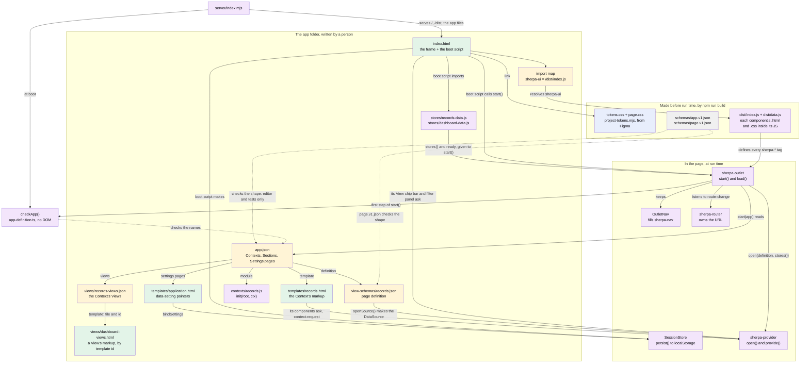

The order, from a page load to the first Context on screen:

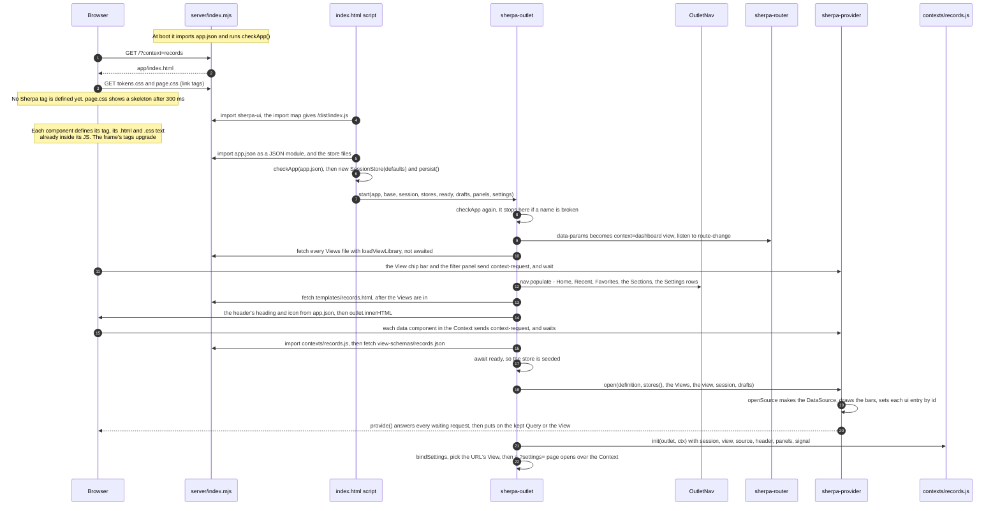

On purpose, though it looks odd:

- **`checkApp()` runs three times** (server boot, the boot script, `start()`), and the JSON Schema never runs in the browser. `checkApp()` checks names; the schema checks shape, in the editor and the tests.
- **The markup has no default Context and no header title.** `start()` writes the default Context from `app.json`, and the outlet writes the header from each Context's `label` and `icon`.
- **`stores` is a function.** The outlet calls it at each load, so a debug flag can wrap a store. It waits for `ready` just before `open()`, because `openSource()` reads the store's rows.
- **A Context's markup goes into the outlet's light DOM**, not a shadow root, so each component's ask reaches the provider above it.

### 9. How a Context page and a View are made

A Context opens (the reader picks the Records row):

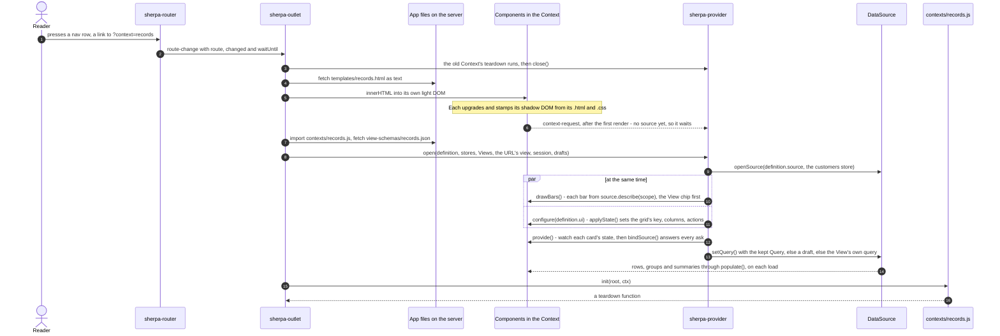

Which JSON field drives what, for a View:

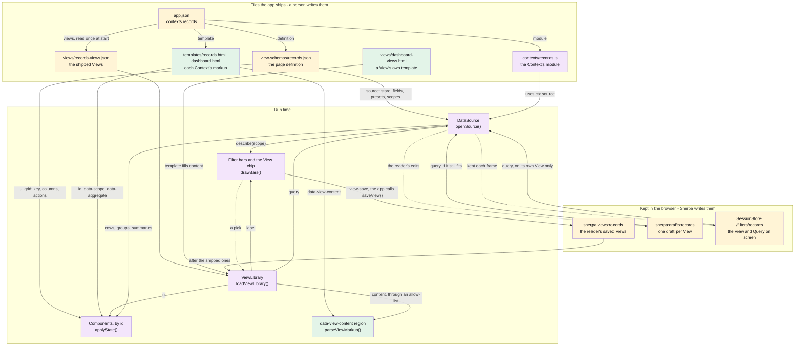

What each field does:

- **Page definition, `source`:** `store` picks the store. `fields` declares each field's type and label; no field lists its values, they are read from the rows. `presets` are saved filters. `scopes` go to the SOURCE, which draws each bar.
- **Page definition, `ui.<id>`:** sets that element through its own API (the grid's `columns`), before it gets data.
- **Page definition, `id`:** names the source and every storage key for the page.
- **A View's `label`:** the View chip's option, and its nav row when "Show full view hierarchy" is on.
- **A View's `query`:** what the source puts on when the View is picked (a draft wins if it still fits).
- **A View's `ui` and `content`:** set elements by id, and fill `[data-view-content]` through an allow-list.

On purpose, though it looks odd:

- **A Context's markup goes in with plain `innerHTML`, but a View's goes through an allow-list.** The template ships with the app; a View's content can come from storage or a server.
- **The first View's own query is not put on at open: the page definition IS the first View.** A kept Query or a draft can still go on it.
- **The View chip owns the View, not the URL.** A pick goes to the URL by `replace`, so Back does not step through picks.
- **Known gap (TODO 321):** the outlet reads saved Views under the Context's name, the provider writes them under the definition's `id`. Equal in Demos, but nothing makes them equal.

### 10. How a UI component is made

At build time — how its files relate:

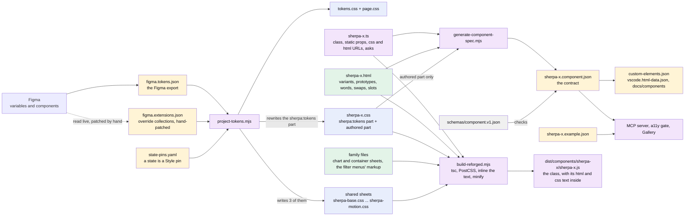

In an app, only `DIST`, `tokens.css` and `page.css` reach the browser. The
shared, family and own sheets travel inside the JS.

At run time — how one element is drawn (`sherpa-metric`, a data tile; the
button stops at step 15):

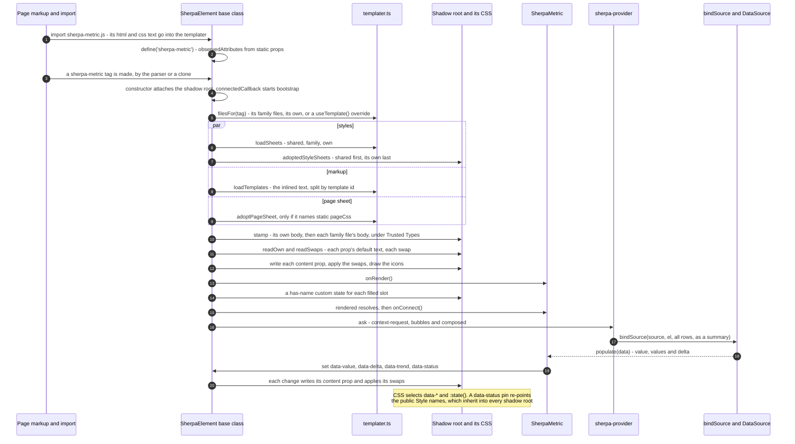

On purpose, though it looks odd:

- **The source says `new URL('./sherpa-x.html', import.meta.url)`, but a built page fetches nothing.** The build puts the text inside the JS. A dev build keeps the fetch, so live reload works.
- **The `Public API:` and `Fires:` comments, and every `data-accepts`, are only for the spec.** The build strips them; no app reads the spec or the example.
- **Most `static props` do nothing at run time.** Only a `content` prop with a `to` target is written, and its default is the template's own text. The rest are declared so the contract knows them.
- **A prototype is a `<template class>` with no `id`.** Only a top-level `<template id>` is a variant.
- **A family file's markup is stamped into every member's root**, so a shared helper (`menuFor()`, the ⋮ menu) clones from the host it works for.

---

## Where you must plug things in

| Part | What Sherpa gives | What your app gives | Gap |
|---|---|---|---|
| **Backend (REST)** | `RestStore` options: `url`, `rowsPath`, `totalPath`, `init`, `timeout`, `buildQuery`. Writes use POST, PATCH and DELETE. | The endpoint. A server that reads Sherpa's filter parameters, or a `buildQuery` that translates them. A `totalPath`, so the whole set can be held. | No retry, no cancel. No GraphQL store, no polling. |
| **Backend (live)** | `EventStore` (SSE, it only receives). `SocketStore` (WebSocket, you call `send()`). | The endpoints, and a call to `connect()`. | Nothing shows "reconnecting". |
| **Other backend** | The `Store` interface, or `BaseStore` to extend. | All of it, auth too. | — |
| **Auth** ⚠ | **None.** Only fixed settings: `init` (headers, `credentials`), `withCredentials`, WebSocket `protocols`. | Cookies, a fixed header, a custom store that signs each request, or a wrapped `fetch`. Handle a 401 from `HttpError.status`. | No token hook, no refresh, no 401 handler. A `Headers` object is dropped. |
| **User and permissions** ⚠ | **None.** | Who the user is, and what they may do. Row security on the server: the held set is all that the server sends. | — |
| **Browser storage** | `SessionStore` (`sherpa:session:*`), saved Views, filters, drafts, `IdbStore`. | Which values to `persist()`. | Saved Views stay on one browser. `syncViews` exists, but nothing uses it. |
| **URL** | `sherpa-router` (Navigation API). | The parameter names. A server that serves `?context=` URLs. | — |
| **App files** | The outlet fetches the templates, definitions and views. | The files and a web server. | It sends no credentials. One missing views file stops every Context. |
| **Forms** | The form controls take part in a native `<form>`. The `.sherpa-button` look works on a native submit button. | The form action or a submit handler. | File upload sends nothing by itself. |
| **Security** | A strict CSP and Trusted Types policies. | A CSP header that names `sherpa-ui` and `sherpa-ui-view`. | The outlet's `innerHTML` does not use the policy. |
| **Design** | Figma becomes `tokens.css`. | Links to `tokens.css` and `page.css`, and the Inter font. | The Figma export is manual. Clean-up is TODO 339. |
| **AI agents** | `sherpa-ui-mcp`: 19 tools, over stdio. | The MCP client settings. | stdio only, no HTTP. |
| **Server / Node** | `sherpa-ui/data` runs in Node. Components load but define nothing there. | Node 22 or later. | No server rendering (TODO 223). |
| **Getting Sherpa** | A link to the repo: `"sherpa-ui": "file:../sherpa-ui"`. | A clone, a build, and an import map or a bundler. | It is not on npm. The Starter still names npm versions. |
| **Language** | `Intl` and `Temporal`. | — | English text only. The browser's language only. |
