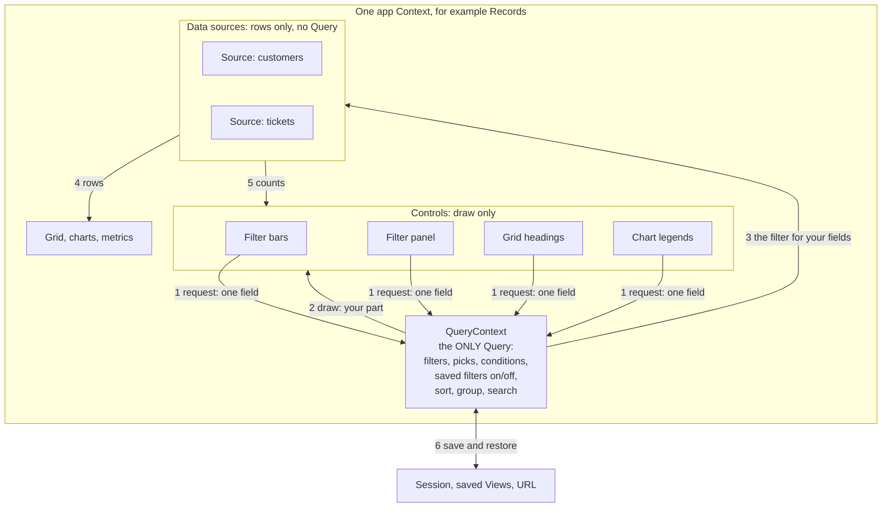
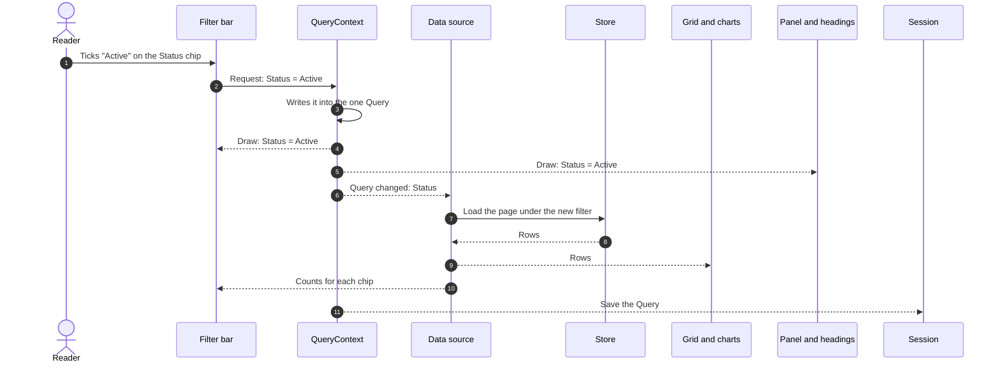

# Plan 366 — one QueryContext per app Context

Will, 2026-10-20, chose **B**: one QueryContext per app Context holds the ONLY
Query. A data source keeps no Query of its own. It reads its filter from the
QueryContext and loads rows. Controls read their part there too, and send
one-field requests.

This page is the picture of the idea. The detailed design (names, where it
lives, the commits) comes from a read-only design workflow and is added below
when it is done. The map it starts from is
[plan-366-query-context-map.md](plan-366-query-context-map.md).

## 1. Who holds what

1. **Request.** A control never sends its whole answer. It sends one small
   request, for example "Status = Active".
2. **Draw.** The QueryContext tells each control what to show for its own
   fields. A control keeps nothing of its own.
3. **Filter.** Each source reads the Query and uses only the fields it has. A
   source with no "Status" field ignores Status.
4. **Rows.** The source loads the rows and gives them to the grid and the charts.
5. **Counts.** The source counts the matches and gives the numbers to the chips.
6. **Save.** The session, saved Views and the URL save and restore the
   QueryContext. They no longer save each source.

## 2. One click, step by step

1. The reader ticks "Active".
2. The bar sends one request. It does not send its other chips.
3. The QueryContext writes the change. This is the only place a filter changes.
4. and 5. Every control that shows Status draws it, the sender too. This is
   safe: no control ever sends a whole answer back, so nothing is cleared by
   accident.
6. Each source hears what changed. A source that does not use Status does
   nothing.
7. and 8. The source loads the new page of rows.
9. The grid and the charts show the new rows.
10. The chips show their new counts.
11. The session keeps the new Query for the next reload.

## 3. What goes away

- Each source's own copy of the Query.
- The bar sending its whole answer, and the source clearing each field the bar
  did not name.
- The guards that exist only for that loop: the panel's echo check (`#said`),
  the bar's "edited after" check (`#editedAt`, `#pendingAnswers`) and the
  provider's two-frame mute.
- Sort, group and search kept apart from the Query.

## 4. Not decided yet

The design workflow answers these:

- Where the QueryContext lives. Likely the provider, which already holds one
  Context.
- Where the saved-filter library sits.
- How remote Apply and Discard work. Likely the QueryContext holds the draft and
  the applied Query, and the sources load the applied one.
