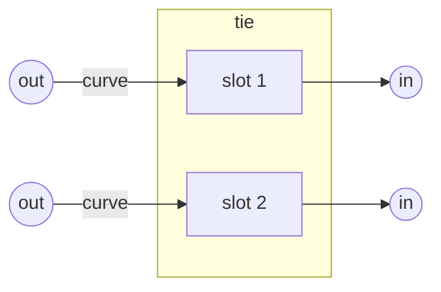

# Plan 562 — the zip tie

Will, 2026-10-29: a ZIP TIE tool in the toolbar (560). A line dragged across
connectors adds a tie at right angles to them. It funnels them through one place,
a small gap between each. A dragged tie moves, and its connectors route through it.
It never goes past the horizontal place of the nodes its SHORTEST tied connector
joins. A connector may pass through any number of ties.

## 1. What a tie IS in the definition

A tie is a saved part of the workflow, in its own list: `ties`, beside `routes`.

```json
"ties": [ { "id": "tie-1", "x": 520, "y": 140,
            "routes": [ {"from":"a/rows","to":"c"}, {"from":"b/rows","to":"d"} ] } ]
```

- `id`: free among ties. `x`, `y`: the middle of the tie, in plane px.
- `routes`: the connectors it ties, in order, top to bottom. A route is named by its
  own `from` and `to`, as a cut names it. No route gets an id.

Why `ties` and not a `via` list on each route: one tie holds MANY routes in an
order, and has its own place. A `via` would repeat that place on every route, and
a moved tie would be many edits. With `ties` it is one row, one edit (one step in
the journal). A route needs no change to pass through a tie: ties find their routes.

- **Save / read.** `schemas/workflow.v2.json` gets `ties` (`defs.v1.json#/$defs/tie`).
  A v1 has none; `readWorkflow` keeps a `ties` it meets in a v2 and adds none to a v1.
- **Undo / redo.** Each edit is a pure function on the draft, so a tie is part of the
  step's snapshot, with no new code in the journal. A drag is one step (tag `tie:id`).
- **Custom Nodes.** `NodeDefinition.ties` holds them in a body, the same shape; `innerOf`
  gives the body its ties; the editor writes them back with the routes. They are NOT in the
  version hash, the diff or `was`: a tie changes no data, so no use goes stale for one.
  Group: a tie keeps only its routes that stay on the outside; ungroup does the same.
- **N4 ignores ties.** A runner reads `nodes` and `routes`. A tie holds only a place and
  a list of routes already there. Dropping `ties` from a workflow changes no run.
- **Faults.** A tie of a route that is not there, a tie with no routes, two ties of one id:
  each is a fault in words (`workflowFaults`).

## 2. Edits (pure, `editWorkflow`)

| edit | does |
|---|---|
| `{ tie: { id?, routes, x, y } }` | adds a tie; `id` free if none; a route already there twice is kept once. Its x is clamped by the limit. A missing route is NOT dropped: `take()` refuses it with the fault. |
| `{ untie: id }` | removes the tie. Its routes stay. |
| `{ moveTie: { id, x?, y? } }` | moves it; x is clamped to the limit. |

`cut`, `remove` and a `route` that replaces one drop the gone routes from every tie.
A tie left with no route goes. A node moved does NOT move a tie; the tie is clamped
the next time it is drawn or moved (see §3).

## 3. The limit, in numbers

`tieLimit(workflow, tie) → { min, max }`. Each tied route spans from its source node
to its target node. Source node's place = `x + NODE_WIDTH` (its right edge, 240), target's
place = its `x` (its left edge). The SHORTEST tied route is the one with the least
`to.x − (from.x + 240)`. The tie's x stays in `[from.x + 240, to.x]` of that route.
Where that span is negative (a target left of its source) the range is the one point
halfway between them. Planted: nodes at x=0 and x=600, 300 and 500 → spans 360 and −40 →
the shortest is the second: range is the point 410 → a tie at 520 clamps to 410.

Drawn, a tie whose node moved past its limit is DRAWN at the clamp; the saved x is
corrected the next time it is edited. (Drawing never writes.)

## 4. How routes are DRAWN



A tie is a vertical bar at `x`, centred on `y`. Its n routes pass through n slots at
`x`, `y + (i − (n−1)/2) × 12` (12px gap, on the 4px grid). A route with ties is one path,
cubic pieces joined at each slot, flat there: `curve(out, slot₁) curve(slot₁, slot₂) …
curve(slotₙ, in)`. Its ties are taken left to right (by tie x). The connectors fan out
of the sockets to the slots, and from the slots to their inputs. The hit line follows it.
The tie is an SVG `rect` (`.graph-tie`), the only other part of the lines that takes the pointer.

## 5. Add and remove

**Toolbar.** A fourth button, `Tie` (`data-action="tie"`, icon `zip-tie`), a toggle:
it emits `toolbar-select {action:'tie'}`; the editor owns the tool and writes
`data-tie` on the toolbar (it sets `aria-pressed`). The toolbar knows nothing else.

**Pointer.** With the tool on, a drag on the blank canvas draws a dashed line (the view
does not pan). On release, every route whose line the drag crosses is tied, in order of
where the line crosses, top to bottom; the tie sits at the mean of the crossings. Nothing
crossed: nothing made. A drag on a tie moves it (always, tool on or off). A click on a
tie picks it; Delete or Backspace removes it (`untie`). Each is ONE step.

**No pointer (PRINCIPLES 21).** Keys on the canvas:
- `T` ties the routes between the picked nodes (Space picks several; with one, the
  routes into it). If they are already all tied together, `T` unties that tie.
- A picked tie moves with the arrow keys (8px; Shift 32).
- Delete removes a picked tie.
- The node inspector's routes (Cut route) gain "Tie routes" when it holds several.

## 6. When things change

- A tied route cut, or its node removed: it leaves the tie; an empty tie goes.
- A node moved: routes redraw through the same ties. A tie never moves with a node.
- A route rerouted (end dragged to another input): it is a new route, so it leaves its ties.
- Undo restores ties with the draft.

## 7. Tests

Node: save/read v2 round trip; undo/redo; limit in numbers; missing route is a named
fault; a Custom Node body's tie and the hash ignoring it; cut drops from a tie, empty tie
goes. Specs: toggle, drag across 3 connectors, points through the slots in order with
gaps, drag the tie, clamp at the limit, undo; keyboard add/remove; a11y.
