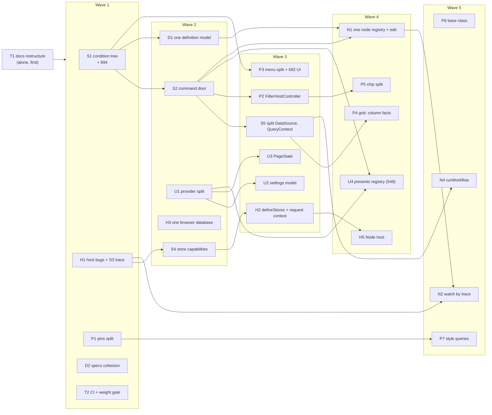

# Plan 695 — the architecture refactor: one shape per idea

From [the review](../ARCHITECTURE-REVIEW.md). Will, 2026-11-03: *"the one shape mentality
is what I've been striving for this whole project."* **D1–D6 all A.** The MCP is old: it is
rebuilt from scratch AFTER the node engine and this refactor (row 700). The nine unused
components stay: valid library stock.

**The rule for every workstream:** it ends with the old shapes DELETED, not wrapped. A
workstream is done when its old converters, doors and keepers are gone, every gate is
green, and its full suites pass.

---

## How we run in parallel

| | |
|---|---|
| **A lane** | One agent, one worktree pair (`scratchpad/wt-<lane>` + `demos-<lane>`, Demos linked to it), its OWN `dist`, its OWN test ports |
| **Ports** | the integrator 4174 / 4360; lanes 4180–4189 (sherpa-ui) and 4370–4379 (Demos), one each |
| **Owns files** | Each lane owns the files in its row below. Two lanes never edit one file in the same wave |
| **Shared files** | `docs/TODO.md`, `docs/traps/*`, the baselines and the generated files: written by the INTEGRATOR only, at merge |
| **The integrator** | Merges lanes one at a time onto the tip, runs the gates and the lane's specs; full suites at the end of each workstream; builds main `dist` (the peer told first) |
| **The peer** (`sherpa-ui-77`) | Sent the lane map; works outside the files of the lanes in flight |

Without parallel building (D7 B), the same waves run one lane at a time, in the same order.

---

## The order

### T1 — first, alone (D5) ✅

**Done 2026-11-03:** `TODO.md` 13,868 → 600 lines — 55 open rows and 12 open sections stay;
615 done rows and 469 done sections moved to `docs/history/TODO-ARCHIVE.md`, links rebased,
nothing lost (every row, section and line checked). `TRAPS.md` is a pointer page; the 735
entries live in 11 files in `docs/traps/`, each in its first Site's area, which
`check-traps` now holds (a misplaced entry fails, with the file to move it to).
**Deferred to a docs pass (T3):** the editorial trim — history wording, the stale entry,
the duplicate pair — as it changes citations in code.

Every lane writes `TODO.md` and `TRAPS.md`, so they change shape BEFORE any lane starts.
`TODO.md` keeps its open rows; done sections move to `docs/history/TODO-ARCHIVE.md`.
`TRAPS.md` splits by the index's 11 areas into `docs/traps/<area>.md`; `check-traps` scans
the folder; history wording is cut; the stale and duplicate entries go. Size: M.

### Wave 1 — as each lane lands

- **D2 ✅ (`076b1838`).** `spec:check` is the one door (`spec:validate` and
  `validate-component.mjs` folded in; a token ref that names no token is now an error).
  One Ajv, `scripts/lib/schema-check.mjs`. One round-trip, the generator's;
  `roundtrip-component.mjs` (14 of 68 failing on a stale reader) and `compile-def.mjs`
  deleted. `check:generated` replaces `check:manifest` + `check:reference`. Kept as manual
  Figma tools: `check-tokens`, `figma-harvest-colours`, `figma-extract-component.js` (270 A)
  and `resync-figma`. `tokens.config.json` is read by the figma-console MCP, so it stays.
  Lane picks taken: `manifest` and `reference` stay two writers.
  **Carried:** five unit tests compile Ajv themselves → `schemaCheck` in D1 (wave 2).
  ❓ Will: `tokens.config.json` also points the figma-console export at a CSS-variables
  file in `src/styles/tokens/`, so an export with no arguments could overwrite the
  projected `tokens.css`. A: leave it. B: drop that CSS output (pick B).
- **T2 ✅ (`54e9d05b`, `523c4adf`, `5b6890ad`).** `.github/workflows/ci.yml`: the hook's
  gates, the build with `check:weight` and `test:node`, Chromium e2e. `check:weight`
  gates brotli bytes per import, reports raw and V8 parse time; the hook runs it
  `--staged` (1.5 s) and `check:extensions` (0.1 s). Lane picks taken: a dist that cannot
  be weighed passes with a note (CI weighs it); Node 24 floats, no `.nvmrc`.
  **Carried:** the first CI run comes with Will's push; e2e has never run on Linux.

### The waves

| Wave | Lane | Workstream | Owns | Done when | Size |
|---|---|---|---|---|---|
| 1 | Data | **S1 — one condition tree** (D1), and **694** (month-end) | `store.ts` (types, `durationSpan`), `where.ts`, `filter-state.ts`, `query.ts` readings, `status-field.ts` `when`, `page-definition.ts`, `field-catalogue.ts` `zonesOf`, `query-graph.ts` conditions, `schemas/page.v1.json` `$defs/condition` | One tree; `Where` is sugar parsed once; `clauseConditions`, `chainRows`, `readingRows`, `conditionOf`, `rowReading`, `whereFilter`'s detour gone; a nested condition kept end to end (692's data half) | L |
| 1 | Hosts | **H1 — host bugs** (the conflict rule on the wire, a `RequestStore`'s channel, a notification's `url`, the feed lock, sign-out) and **S3 — the trace** | `request-store.ts`, `data-handler.ts`, `serve-data.ts`, `follow-updates.ts`, `share-feed.ts`, `cache-keep.ts`, a new `trace.ts` | Bugs 4, 7–10 fixed with a test each; one `onTrace`; spans `{host, step, store, id, parent, t}`; a `traceparent` set by `RequestStore` and echoed by `handle()` | M |
| 1 | CSS | **P1 — pins split** (D4 step 1) | `scripts/project-tokens.mjs`, `state-pins.yaml`, `sherpa-style-modes.css`, each component's generated token region | Only the 22 status and look rules stay shared; each component carries its own pins; no visual change (a screenshot per component, before and after) | M |
| 1 | Specs | **D2 — specs cohesion** | `scripts/generate-component-spec.mjs`, `write-manifest.mjs`, `write-reference.mjs`, `roundtrip-component.mjs`, `check-*.mjs` for specs | One spec source; ONE round-trip; ONE Ajv; `check:manifest` + `check:reference` = `check:generated`; `spec:validate` folded in | M |
| 1 | Tooling | **T2 — CI and the weight gate** | `.github/` (new), `scripts/check-weight.mjs` | The gates and Node tests in CI (pushing stays Will's); weight in brotli bytes and parse time | S |
| 2 | Data | **S2 — the command door** (D2) | `query.ts` `QueryRequest`, `query-context.ts`, `query-edits.ts`, `ui/bind-source.ts`, `ui/node-graph.ts` edits | `QueryRequest` complete (sort, group, search, page, hold, move); `ask()` in `QueryContext`; pure edits `(query, command) → query`; the 13 steering events map to commands; the node editor edits through `ask()` only (bug 5 fixed) | L |
| 2 | Hosts | **S4 — store capabilities** | `store.ts` `Store` interface, `stores.ts`, `held-store.ts`, `fake-remote.ts`, `status-field.ts` wrapper, `data-source.ts` holding paths | One typed `capabilities`; `wrapStore()`; a `signal` on every read; a remote store always behind `HeldStore`; `DataSource`'s seven `holds` checks gone | M |
| 2 | Utility | **U1 — the provider split** | `sherpa-provider/*` | The provider answers asks and opens pages; highlight, legend picks, card states, notices and Show as become modules; pivots and made tables move to `aggregate.ts`; components DECLARE (`static asks`), no duck typing | L |
| 2 | Browser | **H3 — one browser database** | `idb-store.ts`, `cache-keep.ts` storage, `outbox`, notices, `view-sync.ts`, `web-storage.ts` | One Sherpa database, a fixed schema, typed records; bugs 2, 3 fixed; `navigator.storage.persist()` | M |
| 2 | Specs | **D1 — one definition model** | `schemas/*`, a new `schemas/defs.v1.json`, `page-definition.ts`, `app-definition.ts`, `view-files.ts` | One `$defs` library (condition, query, field with status, scope, view, component config by `$ref` to its spec, node, route); `checkPage` runs at `open()`; the views library has a schema | M |
| 3 | Data | **S5 — split `DataSource` and `QueryContext`** | `data-source.ts`, `query-context.ts` | Reads, counts and view-models apart; declarations and members apart; no UI element references in the data layer | L |
| 3 | Utility | **U2 — the settings model** (D3) | a new settings module, provider settings, Demos' settings table | One typed schema with scope (app, page, component), by Context subscription; look settings as root CSS properties; one `setting-change`; the 24 provider pairs gone | M |
| 3 | Utility-2 | **U3 — `PageState`** | `persist-view.ts`, `view-drafts.ts`, `provider-page.ts`, `saved-filters.ts`, `session.ts` keys | One document `{view, query, draft, ui}`, one keeper, tiers; nine keepers → one | M |
| 3 | Filters | **P2 — `FilterHostController`** | `filter-host.ts`, the toolbar's and the grid's draw doors, `toolbar-column.ts` | One controller keyed by field; the toolbar and the grid only place chips and menus | L |
| 3 | Menu | **P3 — the menu split, and 692's UI** | `sherpa-menu/*`, `filter-menu.ts` | Shell, list, condition editor, number body, date body apart; anchor positioning by element reference; nested groups in the condition editor and a section's Advanced content | L |
| 3 | Hosts | **H2 — `defineStores` and the request context** | worker and page wiring, `DATA_BASE`, Demos' stores | One store module both hosts import; `stores: (request) => …` passes headers through, never read | M |
| 4 | Utility | **U4 — the presents registry** (548) | `show-as.ts`, the charts' `static presents`, the slot host | Kinds registered, not tag names; one answer per shape; `startViewTransition`; the gauge and line chart ordinary kinds | M |
| 4 | Grid | **P4 — column facts** | `sherpa-data-grid/*` | The grid asks the DataSource for sorted, paged, counted facts; its own sorting and paging gone; modules split; its heading's Sort and Group toggles become `sherpa-button`s (P5's half in the grid) | L |
| 4 | Filters | **P5 — the chip split** | `sherpa-quick-filter/*`, `sherpa-chart-legend/*` | The chip loses its Sort and Group kinds (the grid's heading moves in P4); the legend key a light element | M |
| 4 | Nodes | **N1 — one node registry, edit by commands** | `workflow.ts`, `query-graph.ts`, `node-graph.ts`, Demos' Node Editor | One registry; the graph derived from definitions and the live Query (presets, saved filters, status fields too); an edit is a command; save writes the definition; positions kept (551) | L |
| 4 | Hosts | **H5 — the Node host** | a new `sherpa-ui/server` entry | `createDataHandler` on Node; `problem+json`; CORS; POST for acts; one version marker; the worker-script build stamp and `updatesFeed` as Sherpa's server half (170's plan, not its whole) | M |
| 5 | Base | **P6 — the base class** | `sherpa-element.ts`, `swap.ts`, `templater.ts`, tooltip markup, icons | One binding language; only behaviour and content props observed; `config` door reviewed; `sherpa-badge` a look class; one tooltip family file; an icon sprite | L |
| 5 | Nodes | **N2 — watch by the trace** | the node graph's live view | A node lights as it runs, with its row count (`planWalk`) | M |
| 5 | Nodes | **N4 — `runWorkflow`** (616) | `workflow.ts` runner | Typed sockets, cancel, dry run, batch writes, a trace | L |
| 5 | CSS | **P7 — style queries** (D4 step 2) | pins, components that paint on `:host` | Host paint moved to an inner part; one line per pin; ~8 mode blocks | M |

P6 runs when no component lane is in flight: it touches every component.

---

## Deferred, and planned

| Row | What | When |
|---|---|---|
| **700** | Rebuild the MCP from scratch, on the new spine: compose tools (`generate_page`, `validate_page` against specs, `preview_page`, `check_usage`) and a pattern decision model (77) | After N1–N4 and the refactor |
| **701** | Platform waits: CSS `@function` and `if()`, scoped element registries, customizable `<select>` (all wait on Firefox); CSS module scripts — drop the inlined sheets (WebKit); `scheduler.yield` (WebKit); `interestfor` (Firefox, WebKit); the Temporal stand-in removed (the support floor) | Checked each quarter by the native probe |
| **223** | Server rendering: the constructor keeps a declarative root; `<style>` text; a DOM shim for `renderData`; a definitions route | After D1 and P6 |
| **170** | The data layer on the server, or both | After H5; when Will says |
| **77** | UX patterns by contract — with 700 | With 700 |
| **556–562, 569, 671** | Node editor features; AI nodes; observing a workflow as it runs | After N2, N4 |

---

## Decision for Will

**Answered, 2026-11-03: D7 A** — lanes build in parallel. And the peer keeps its own
rows, outside the files of the lanes in flight (Will: A).

| # | Question | A (my pick) | B |
|---|---|---|---|
| D7 | Parallel lanes | Agents BUILD in parallel, each in its own worktree with its own `dist` and ports, on disjoint files; one integrator merges and builds main | Agents plan and explore in parallel; ONE builds, lane after lane — slower, the same order |
