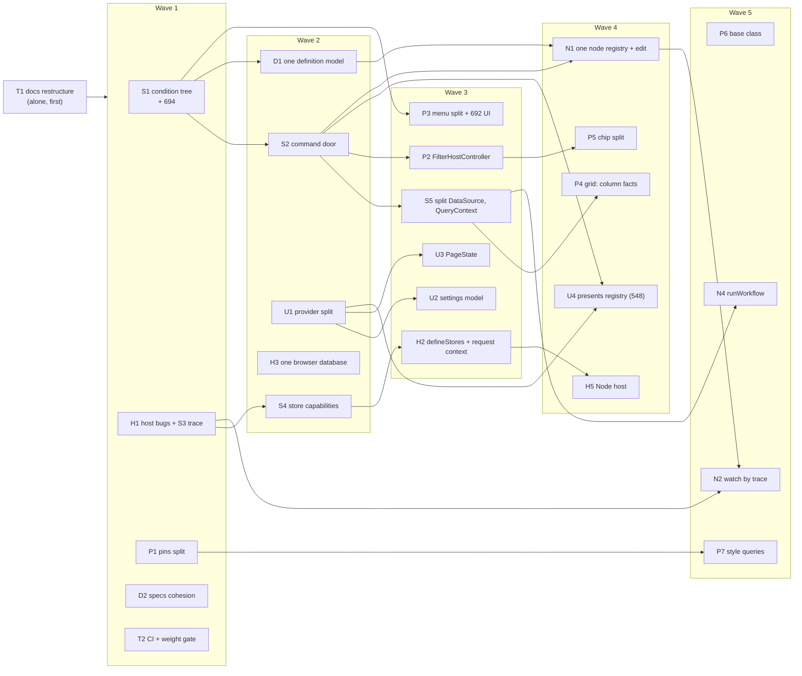

# Plan 695 — the architecture refactor: one shape per idea

From [the review](../ARCHITECTURE-REVIEW.md). Will, 2026-11-03: *"the one shape mentality
is what I've been striving for this whole project."* **D1–D6 all A.** The MCP is old: it is
rebuilt from scratch AFTER the node engine and this refactor (row 700). The nine unused
components stay: valid library stock.

**The rule for every workstream:** it ends with the old shapes DELETED, not wrapped. A
workstream is done when its old converters, doors and keepers are gone, every gate is
green, and its full suites pass.

---

## How we run in parallel

| | |
|---|---|
| **A lane** | One agent, one worktree pair (`scratchpad/wt-<lane>` + `demos-<lane>`, Demos linked to it), its OWN `dist`, its OWN test ports |
| **Ports** | the integrator 4174 / 4360; lanes 4180–4189 (sherpa-ui) and 4370–4379 (Demos), one each |
| **Owns files** | Each lane owns the files in its row below. Two lanes never edit one file in the same wave |
| **Shared files** | `docs/TODO.md`, `docs/traps/*`, the baselines and the generated files: written by the INTEGRATOR only, at merge |
| **The integrator** | Merges lanes one at a time onto the tip, runs the gates and the lane's specs; full suites at the end of each workstream; builds main `dist` (the peer told first) |
| **The peer** (`sherpa-ui-77`) | Sent the lane map; works outside the files of the lanes in flight |

Without parallel building (D7 B), the same waves run one lane at a time, in the same order.

---

## The order

### T1 — first, alone (D5) ✅

**Done 2026-11-03:** `TODO.md` 13,868 → 600 lines — 55 open rows and 12 open sections stay;
615 done rows and 469 done sections moved to `docs/history/TODO-ARCHIVE.md`, links rebased,
nothing lost (every row, section and line checked). `TRAPS.md` is a pointer page; the 735
entries live in 11 files in `docs/traps/`, each in its first Site's area, which
`check-traps` now holds (a misplaced entry fails, with the file to move it to).
**Deferred to a docs pass (T3):** the editorial trim — history wording, the stale entry,
the duplicate pair — as it changes citations in code.

Every lane writes `TODO.md` and `TRAPS.md`, so they change shape BEFORE any lane starts.
`TODO.md` keeps its open rows; done sections move to `docs/history/TODO-ARCHIVE.md`.
`TRAPS.md` splits by the index's 11 areas into `docs/traps/<area>.md`; `check-traps` scans
the folder; history wording is cut; the stale and duplicate entries go. Size: M.

### Wave 1 — as each lane lands (all landed 2026-11-03)

- **S1 + 694 ✅ (`80fbca0a`, `fe1a71bd`, `379400e9`; Demos `0089814`).** One tree:
  `Condition = {and} | {or} | {field?, op, value, off?, id?}` beside `Filter`;
  `conditionClause` the one compile; `reading.conditions` → `reading.tree`,
  `FilterState.rows`/`heldRows` → `answer`/`held`; the sugar type is `WhereCondition`. A
  status value's `when` is parsed once and its domain carries the tree; `zonesOf` reads it.
  Deleted: `clauseConditions` (and its one-group limit), `chainRows`, `readingRows`,
  `asRows`, `conditionOf`, `rowReading`, `clauseReading`, `whereFilter` + `kindOf`,
  `zonesOf`'s parsing, `presetTouches`' fake state, the `unreadable-condition` report, the
  menu's op-over-picks shim. Bug 6 (a comma in a node-editor value) fixed. `$defs/condition`
  describes nesting and `all`. 694: a month or a year clamps to the month's last day. Lane
  picks taken: a text field's other ops from JSON (`ne`, `contains`…) are its Advanced
  tree; JSON keeps the plain `where` form, the tree lives in memory; a tree the flat menu
  cannot draw stays whole until the reader edits a row. Edited outside its list (minimal):
  `data-source.ts`, `data-source-types.ts`, `bind-selection.ts`, `filter-face.ts`, the menu,
  the chip, the toolbar, the grid, `node-graph.ts`, `check-bench.mjs`.
  **Carried:** P3 removes the menu's `#unsaid` and the `treeRows` limit (692's UI half).
  `ViewScope.superseded` takes two types; the workflow node keeps `{key, op, value}` → N1.
  A preset from a number's Simple reading keeps a string value (cast at compile) → D1.
  Demos `reforged-saved-filter.spec.ts:353` fails in WebKit, on `41b368f9` too (old).

- **D2 ✅ (`076b1838`).** `spec:check` is the one door (`spec:validate` and
  `validate-component.mjs` folded in; a token ref that names no token is now an error).
  One Ajv, `scripts/lib/schema-check.mjs`. One round-trip, the generator's;
  `roundtrip-component.mjs` (14 of 68 failing on a stale reader) and `compile-def.mjs`
  deleted. `check:generated` replaces `check:manifest` + `check:reference`. Kept as manual
  Figma tools: `check-tokens`, `figma-harvest-colours`, `figma-extract-component.js` (270 A)
  and `resync-figma`. `tokens.config.json` is read by the figma-console MCP, so it stays.
  Lane picks taken: `manifest` and `reference` stay two writers.
  **Carried:** five unit tests compile Ajv themselves → `schemaCheck` in D1 (wave 2).
  Will, B: `tokens.config.json` no longer points the figma-console export at a
  CSS-variables file in `src/styles/tokens/`, which an export with no arguments wrote
  over the projected `tokens.css`; with no `generated` formats it writes the token JSON
  only.
- **T2 ✅ (`54e9d05b`, `523c4adf`, `5b6890ad`).** `.github/workflows/ci.yml`: the hook's
  gates, the build with `check:weight` and `test:node`, Chromium e2e. `check:weight`
  gates brotli bytes per import, reports raw and V8 parse time; the hook runs it
  `--staged` (1.5 s) and `check:extensions` (0.1 s). Lane picks taken: a dist that cannot
  be weighed passes with a note (CI weighs it); Node 24 floats, no `.nvmrc`.
  **Carried:** the first CI run comes with Will's push; e2e has never run on Linux.
- **H1 + S3 ✅ (`d919d1a7`, `ce6c6ba8`; Demos `4776077`).** Bugs 4, 7–10 fixed, each with
  a test that fails on the old build. `writeHeaders` is the one `If-Unmodified-Since`
  encoding (`RestStore`'s own is gone); a 412 answers `conflict`. `oneTab()`
  (`browser/one-tab.ts`) is the one leader election; the news feed leads under
  `sherpa-news`. `RequestStore.close()`. A notification press focuses the tab at its
  url, else opens it. `clearKept()` asks the worker to forget (`askWorker`): the held
  set, the outbox and the kept notices. `src/core/data/trace.ts`: `onTrace`, spans
  `{host, step, store?, trace, id, parent?, t, ms?, detail?}` on `sherpa-trace`; a
  `traceparent` only while someone listens. Lane picks taken: a sign-out DROPS writes
  still waiting (the app checks `pending` first). `check:traps` now writes and holds the
  area counts in `TRAPS.md`.
  **Carried:** a DataSource load's requests start their own traces (a span cannot
  cross an `await`) → S5. After a sign-out, the worker holds no new set until it
  restarts → H3. `serve-data`'s `instanceof HeldStore` → S4's capabilities.
- **P1 ✅, in part (`ba772348`, `01ff5578`).** The 46 part pins and 11 default pins live in
  their own component's generated region (31 components); the shared sheet is 128 → 71
  rules, 227,946 → 131,723 B raw. A probe of 1,008 readings per engine: no change in
  Chromium, Firefox or WebKit. A dead pin went (`sherpa-code-block[data-copied]`; the
  component sets `:state(copied)`). **Measured:** no change in style recalc; sheet parse
  −24%; brotli +7.5 KB on `index.js` (see the review, 6.1). Lane picks taken: the 48
  HOST state pins stay shared — moved as `:host(…)`, 162 of 993 readings changed, since a
  host's own status or look wins inside its root; and the brotli rise is accepted for P7.
  **Carried to P7:** the 48 host state pins; retire the old `--_status-*` door (only the
  gauge, sparkline, tag and `sherpa-base.css`'s card read it), which cuts every pin by
  about 44%; `sherpa-nav-item.css` has an old navigation region nothing regenerates, and
  it differs from `sherpa-nav`'s (`320` vs `320px`, mode blocks missing). P7's proof is the
  same probe: mount each component in every state `state-pins.yaml` names — in the page,
  nested in a shadow root with and without its own status and look — read
  `getComputedStyle` of each part (fills, borders, ink, the resolved `--_status-*` and
  `--sherpa-style-*`) in three engines, before and after; the diff must be empty. Recalc
  by CDP `Performance.getMetrics` at 4x, 5 runs, the median.
- **The Wave 1 full run** (on `512572ae`, load ~50): sherpa-ui 3678 passed; one spec in
  three engines broke — a host's column filter reads back typed, `70` not `'70'` (fixed in
  the test, `d73e593e`; D1 types a reader's typed value once). Node 914/914. Demos 899
  passed, 5 flaky; 2 WebKit failures: the old `saved-filter:353` (TODO 702) and a timing
  bound that passes alone.

### Wave 2 — as each lane lands

- **U1 ✅, started early (`a72dc470`, `6869e01b`, `8f76eff3`).** The provider answers asks
  and opens pages: 1,984 → 1,386 lines. Modules beside it: `provider-reach`, `-news`,
  `-cards`, `-highlight`, `-legends`, `-show-as` (moved as it was), `-declared`.
  `pivotTable`/`madeTable` → `aggregate.ts`, with a Node test. Components declare
  `static takes` (typed once, `Take` in `context.ts`): the toolbar, the grid, the container;
  a filter bar is "what asks for a `scope`". Every `in el` probe and tag test is gone from
  the provider. An ask a provider above gives travels up (a test, both orders). Lane picks
  taken: `static takes` beside `asks` (the container asks for nothing); the pivots in
  `aggregate.ts` (the grid +571 B brotli, as it imports it); an ask answered above stays
  there. 390 provider-related tests pass in three engines on the tip.
  **Carried:** U4 takes the tags that moved with Show as (`SHOWN_BY`, `shownAs`,
  `#madeColumns`, `#retitle`); U2 the settings pairs and `#offerLimit`; D1's open-time check
  is one line in the provider, added at D1's merge.
- **D1 ✅ (`1c03c86d`, `d903468d`, `34173798`; Demos `8b6aeee`).** One `$defs` library,
  `schemas/defs.v1.json`; every `$id` is its file name, so relative `$ref`s resolve.
  `schemas/views.v1.json`; `loadViewLibrary` leaves out a View with no label.
  `schemaCheck` loads all of `schemas/` and takes a shape by pointer; the five tests use
  it. `checkPage(page)`: one DOM-free pass, run first in `open()` (the integrator's line);
  `openSource` and `savedFiltersOf` no longer report, so nothing is said twice. Values
  typed once: `typedValue(type, value)` and `typedTree` (the old `cast`/`castTree` gone);
  `rowLeaf` types a reader's value as it enters the tree, `presetReadings` a preset's
  (`lt 60` holds 60), and the compile no longer casts. A bug fixed on the way: a date
  preset's two ends became `in [a, b]`, two days, not a range. Lane picks taken: a saved
  filter's scopes take `holds` and `where` only; a View's `settings` is typed on
  `SavedView` (U2 may move it); status fields stay with the store. Edited outside its
  list: `mcp-server/tools/data.js` (Ajv loads defs; `pageNames` calls `checkPage`),
  `check-mcp-pack.mjs`, `where.ts`, the menu's `#valueType`, `persist-view.ts`.
  **Carried:** `rangeClause` still `Number()`s a range's ends to sort them; S2's
  node-editor edits call `typedValue`; `setPreset` reads with no field facts; a status
  `when` parses with no field types; a stored old tree is typed only as it is read; on a
  number field null stays null (the old compile made it 0). APP-GUIDE §8 could name
  `views.v1` (U2 holds the guide). Demos `test:node` has 3 failures that are older than
  D1 (`e2e-fixture` ×2, usage `data-listens`) → TODO 702.
- **S2 ✅ (`e71d6aa5`, `b2f8f33b`, `afa2c739`, `e4e952cf`, `e8ed414e`; Demos `ce70a93`).**
  `QueryRequest` one typed union; `QueryContext.ask()` the one public door — `setReading`,
  `setSort`, `setPreset`, `hold`, `commit`, `batch`, `present` private; `resumeSort` and
  `DataSource.setPage`/`setPageSize` gone. Pure edits, `editQuery(query, edit, facts)`, for
  sort, group, search, presentation, order and move; a slot's Sort and Group reroute to its
  chart inside the edit, so bug 5 (the node editor) is fixed for every caller, with a test.
  `STEERS` in bind-source.ts maps the 13 steering events; their names stay.
  `grid-pages-change` and `select-all-request` are not edits. At merge: U1 had moved three
  of the provider's edits into `provider-show-as.ts` (ported to `ask()`), and D1's new test
  called `setPreset` (ported). 1074 tests in the shared areas pass in three engines. Lane
  picks taken: `resumeSort` dropped (a resume is the sort asked again); a preset's commit
  applies only the fields it moved; the `steered` WeakSet stays (stopping at each binding
  would hide public events from ancestors — measured, it broke two summary tests); a page
  command with no scope goes to every source in the context.
  **Carried → S5:** answer, Switch, solo, reset, preset, hold, take, release, letGo, commit
  and discard still change the Query in place (members hear each step); the reading command
  carries `only?: BoundControl`, an element (make it a bind id). **→ N1:** export
  `editQuery` from `sherpa-ui/data`; node-editor edits call `typedValue`. The bench baseline
  is stale on the tip (acts cost less than recorded) — re-record it on purpose.
- **H3 ✅ (`79a8b785`, `8436fad3`; Demos `aa56815`).** One database, `sherpa-ui`
  (`src/core/browser/database.ts`): one version, one upgrade, typed records; object stores
  `rows` [store, key] with one multiEntry `seek` index, `seeds`, `sets`, `outbox`
  [outbox, id], `notices`, `views` [page, id]; all access through `transact`, `readAll`,
  `readOne`, `write`, `erase`, `clearStores`. `IdbStore`'s own open and upgrade, its
  `database`/`version`/`close()` options and the localStorage seed mark are gone. Bug 2
  fixed (two stores share the database); bug 3 fixed (the seed mark lives in `seeds`, one
  transaction with the rows, so a worker re-seeds). `cache-keep`, `outbox-keep`,
  `notice-keep` and `view-sync` use it; `clearOutboxes` gone; sign-out clears sets, outbox
  and notices in one transaction. `persist()` once per page, at the first open (❓ Will:
  A this, or B an app call). Lane pick taken: old databases are not migrated (D4: no
  stored-data shims) — left on the device, unread: writes still waiting in
  `sherpa-outbox`, rows an app kept in `sherpa`/`sherpa-examples`, and Views kept only in
  IndexedDB; saved filters and current Views are in localStorage, untouched. Demos'
  customers store dropped its five text `indexes` (a text index never narrows a read).
  **Carried:** after a sign-out the worker holds no new set until it restarts — in S4's
  brief; if S4 leaves it, H2.
- **S4 ✅ (`2e802221`, `dcd7cc71`; Demos `b53826d`). Wave 2 is whole.** One
  `Store.capabilities` (the eight loose flags gone; sent whole over the wire; `DataSource`
  reads it once, and a store without it throws). One `wrapStore()`: `fakeRemote` and
  `statusFields` use it, so `statusFields` keeps holding and `fakeRemote` keeps
  `totalFirst`. `heldOf()`: a remote store is read through its own `HeldStore`; the
  `holds` checks in `DataSource` and `serve-data`'s `instanceof HeldStore` are gone. A
  signal on every read: a newer ask aborts the one it supersedes, down to `RequestStore`'s
  and `RestStore`'s fetch. H1's carried sign-out bug fixed: the worker keeps the next
  reader's set on the device with no restart. Lane picks taken: the protocol stays v1
  (page and worker ship together); `capabilities` is required; a page's own Refresh
  re-reads its whole set. 946 Node tests; 92 store specs in three engines.
  **Carried:** over the wire a store still loses `distinct` and `history` → H2/H5; a
  `HeldStore` recheck can hang if a change lands during its whole read (older) → H2.
- **The Wave 2 full run** (on `dcd7cc71`, load 50–75): sherpa-ui 3705 passed, none
  failed; Node 946/946. Demos 890 passed; one spec broke in three engines —
  `filter-coordination:23` read a number's range as text (D1 types it: fixed in the spec,
  Demos `fed4aa9`); the other 10 failures pass alone (Firefox under load),
  but the old `saved-filter:353` (WebKit) and the 800 ms `reopen` bound (TODO 702).

### Wave 3 — as each lane lands

- **U2 ✅, started early (`8125295d`, `b4fbcc8c`, `38298aab`; Demos `09062c9`,
  `4eb0e75`).** One settings model, `src/core/data/settings.ts`: `SETTINGS` (type, default,
  scope, session pointer `at`, `source` or `look`), the `Settings` class (a page layer
  `lay()`, the app's kept value, the default; one `change`) and `fitsSetting`.
  `provider-look.ts` puts look settings on the root and takes off only its own.
  SherpaElement gains `static settings` and `onSettings` (+44 lines): the toolbar and the
  grid read their settings that way. Data settings (`limitOptions`, `countEveryValue`,
  `showAs`, `axisChips`) are set on each source. A reader's change reports one
  `setting-change`; the app's own writes report nothing. Deleted: the 28 pairs,
  `#offerLimit`, the `settings`/`headings` takes, `filter-mode-change`, `followSettings`,
  `session.overlay`, three `html[data-*]` look rules (in `project-tokens.mjs`'s template),
  Demos' settings table and its `<html>` writers. A probe of 10 look states: 30 of 30
  readings the same in three engines. Provider 1,387 → 1,077 lines. Lane picks taken: the
  nearest provider answers with its own settings and only the top one writes the root;
  `definition.ui` stays component configuration. 774 settings-area tests pass in three
  engines on the tip.
  **Carried → U3:** `drafts` still reaches the provider as the outlet's callback. The
  outlet reads its nav settings from the session, not from Settings, so a page cannot lay
  them.
- **P3 ✅, started early (`a331a47f`, `634f12ea`, `977b5b7a`, `fbf47859`; Demos
  `db9b75a`).** The menu is `sherpa-menu.ts` (2,558 → 1,258 lines) plus `menu-shell`,
  `menu-list`, `menu-conditions`, `menu-number` and `menu-date` (2,037 lines); +3.1 KB brotli
  per menu import (1.5 KB of it the six files compressing apart). Placement measured, 192
  cases per engine: in three engines each card is inside the viewport and within 4px of
  the old JS, and follows its trigger on a scroll; `#place`, the scroll listener and the
  card's ResizeObserver are gone. Measuring stays for `data-bounds` (no engine gives a
  top-layer card a box but the viewport; the box is now found through shadow roots) and
  a trigger off-screen (a folded chip at x = −9950). 692's UI half: the condition editor
  nests; `menu.condition` is the tree; `rowsTree`, `treeRows`, `rowLeaf`, `leafRow`,
  `rowAnswered`, `rowsFromPicks`, `FieldCondition`, the menu's `conditions`, `#unsaid` and
  the flat-row limit are gone; values still enter through `typedValue`. The axe gate:
  70/70 at or under baseline. Lane picks taken (❓ Will may change them when he looks): a
  group is indented one join column with a subtle 0.5px rule; one join per group; a new
  group joins the other way from its parent; an `in` leaf is one row per value; an `off`
  part is drawn greyed and kept off.
  **Carried:** `show()` on a card that is already open keeps its first anchor.
- **N1 ✅, started early (`ee9be4ca`; Demos `a541b9e`).** One registry: `NODE_KINDS` in
  `src/core/data/node-kinds.ts`, each kind once with its `model` and the `graphs` it is in;
  `QUERY_KINDS`, `WorkflowRoute` and `RowField` gone; one meaning per word (a workflow's
  `source` → `store`; a row's `key` → `field`; a Filter node's rows are one condition
  leaf). `workflowFaults`, `workflowGraph`, pure `editWorkflow`. The Query graph also draws
  presets, saved filters, status fields and superseded answers; `graphRequest` and
  `routeRequest` type values with `typedValue`. `bindQueryEditor` asks only through
  `ask()`; a new `bindWorkflow`; both return `{save, stop}`, and Save fires
  `definition-save` with the checked definition (`pageWithQuery`). A moved node keeps its
  place for the tab; nodes not moved follow the layout. `editQuery` exported. Demos' Node
  Editor runs `bindWorkflow` on `app/workflows/active-customers.json`; its stand-in
  connectors and ops are gone. Lane picks taken: a preset, saved filter and status field
  are each a node (a status node between Store and Source); a page graph's places are kept
  for the session only, and page Save writes the Query's edits; Save in the beta overlay
  waits for TODO 560's canvas toolbar. 234 node and provider tests pass in three engines.
  **Seams:** N2 lights a node by its graph id (`when-<scope>-<field>`, `preset-…`;
  `GraphNode.ref` names the scope and field) from a trace span. N4: `NodeKind.model` names
  the function a kind runs by; a run hooks into `bindWorkflow`'s `write()`.
  **Carried → S5:** `QueryContext.presetOn` should call the pure `presetHeld`.
  `ViewScope.superseded` still takes two types.
- **P2 ✅ (`fa1495ab`, `583cc91f`, `eb573ea2`, `dd3ef25a`).** One `FilterHostController`
  (`src/core/ui/filter-host-controller.ts`, 368 lines): by field, the limits present and
  offered, the fields a scope above holds and its name, results and value counts, each
  reading as drawn, a reading waiting for its chip to stamp — and one copy of each draw.
  The grid's `#columnFilters`, `#present`, `#offered`, `#superseded`, `#supersededAt`,
  `#markPresent`, `#heldAbove` and the toolbar's sixteen like fields are gone; the column
  keeps one controller per scope. `BoundControl` is unchanged. Toolbar 2,933 → 2,808, grid
  2,683 → 2,651. Measured (Demos Records, Chromium, 4x, median of 6): open the Status menu
  104 → 72 ms; tick a value 272 → 264; a chip off 168 → 160; on 248 → 224. Lane picks
  taken: the hosts keep their public draw methods as one-line doors to the controller; the
  grid's `#drawn` stays in the grid.
  **Carried → P4 (a lead):** the grid draws its body twice per act — the new reading
  (~65 ms), then the rows (~89 ms, ~50 of it a forced style read in `#readBounds`); one draw
  for reading and rows is the fix. A one-frame wait measured worse.
- **H2 ✅ (`1e95aa16`, `4e24129a`, `fa2aa960`, `bc4d4b90`, `77353bed`; Demos `7f4b72b`,
  `e0c7acd`, `b6cb3c4`).** `defineStores(() => ({ name: store | { stores, pick } }))`
  (`src/core/data/define-stores.ts`): made at a host's first ask; the app's `pick(request)`
  names the store; Sherpa reads only its own protocol headers (a test watches every header
  read). `DATA_BASE` the one data path. Each change goes out tagged with its store's name
  and which of its stores changed; `?recheck` on a name checks every store under it; the
  change and waiting-rows relays moved from `serveData` into the handler. The recheck hang
  fixed (`HeldStore.recheck` waits on the read itself), and one recheck in flight per store
  (an ask after the read is out waits for one more). A `distinct` query crosses the wire
  for a remote store; `StoreFacts` gains `distinct`, `history` and `as`. `UpdateNotice` and
  `FeedNotice` are two ideas (a cause one tab acts on; an effect shown to the reader), now
  said so. Demos: one `customers` name in `app/stores/stores.js`, its debug mode the
  `Demos-Debug` header; `app/stores/page-stores.js` opens the page's stores once. Lane
  picks taken: Demos' `fail` is the fake network's one state, said by each request;
  `distinct` is not offered for a local store over the wire (measured: two extra reads).
  **Carried → H5:** a store made per request (a server wrapping each request's auth);
  `problem+json` (an offline failure crosses as a 500); POST for `?recheck` and the other
  acts; one name for `/sherpa/updates`. History is not sent apart: a request store builds
  its own from the changes it hears.

### The waves

| Wave | Lane | Workstream | Owns | Done when | Size |
|---|---|---|---|---|---|
| 1 | Data | **S1 — one condition tree** (D1), and **694** (month-end) | `store.ts` (types, `durationSpan`), `where.ts`, `filter-state.ts`, `query.ts` readings, `status-field.ts` `when`, `page-definition.ts`, `field-catalogue.ts` `zonesOf`, `query-graph.ts` conditions, `schemas/page.v1.json` `$defs/condition` | One tree; `Where` is sugar parsed once; `clauseConditions`, `chainRows`, `readingRows`, `conditionOf`, `rowReading`, `whereFilter`'s detour gone; a nested condition kept end to end (692's data half) | L |
| 1 | Hosts | **H1 — host bugs** (the conflict rule on the wire, a `RequestStore`'s channel, a notification's `url`, the feed lock, sign-out) and **S3 — the trace** | `request-store.ts`, `data-handler.ts`, `serve-data.ts`, `follow-updates.ts`, `share-feed.ts`, `cache-keep.ts`, a new `trace.ts` | Bugs 4, 7–10 fixed with a test each; one `onTrace`; spans `{host, step, store, id, parent, t}`; a `traceparent` set by `RequestStore` and echoed by `handle()` | M |
| 1 | CSS | **P1 — pins split** (D4 step 1) | `scripts/project-tokens.mjs`, `state-pins.yaml`, `sherpa-style-modes.css`, each component's generated token region | Only the 22 status and look rules stay shared; each component carries its own pins; no visual change (a screenshot per component, before and after) | M |
| 1 | Specs | **D2 — specs cohesion** | `scripts/generate-component-spec.mjs`, `write-manifest.mjs`, `write-reference.mjs`, `roundtrip-component.mjs`, `check-*.mjs` for specs | One spec source; ONE round-trip; ONE Ajv; `check:manifest` + `check:reference` = `check:generated`; `spec:validate` folded in | M |
| 1 | Tooling | **T2 — CI and the weight gate** | `.github/` (new), `scripts/check-weight.mjs` | The gates and Node tests in CI (pushing stays Will's); weight in brotli bytes and parse time | S |
| 2 | Data | **S2 — the command door** (D2) | `query.ts` `QueryRequest`, `query-context.ts`, `query-edits.ts`, `ui/bind-source.ts`, `ui/node-graph.ts` edits | `QueryRequest` complete (sort, group, search, page, hold, move); `ask()` in `QueryContext`; pure edits `(query, command) → query`; the 13 steering events map to commands; the node editor edits through `ask()` only (bug 5 fixed) | L |
| 2 | Hosts | **S4 — store capabilities** | `store.ts` `Store` interface, `stores.ts`, `held-store.ts`, `fake-remote.ts`, `status-field.ts` wrapper, `data-source.ts` holding paths | One typed `capabilities`; `wrapStore()`; a `signal` on every read; a remote store always behind `HeldStore`; `DataSource`'s seven `holds` checks gone | M |
| 2 | Utility | **U1 — the provider split** | `sherpa-provider/*` | The provider answers asks and opens pages; highlight, legend picks, card states, notices and Show as become modules; pivots and made tables move to `aggregate.ts`; components DECLARE (`static asks`), no duck typing | L |
| 2 | Browser | **H3 — one browser database** | `idb-store.ts`, `cache-keep.ts` storage, `outbox`, notices, `view-sync.ts`, `web-storage.ts` | One Sherpa database, a fixed schema, typed records; bugs 2, 3 fixed; `navigator.storage.persist()` | M |
| 2 | Specs | **D1 — one definition model** | `schemas/*`, a new `schemas/defs.v1.json`, `page-definition.ts`, `app-definition.ts`, `view-files.ts` | One `$defs` library (condition, query, field with status, scope, view, component config by `$ref` to its spec, node, route); `checkPage` runs at `open()`; the views library has a schema | M |
| 3 | Data | **S5 — split `DataSource` and `QueryContext`** | `data-source.ts`, `query-context.ts` | Reads, counts and view-models apart; declarations and members apart; no UI element references in the data layer | L |
| 3 | Utility | **U2 — the settings model** (D3) | a new settings module, provider settings, Demos' settings table | One typed schema with scope (app, page, component), by Context subscription; look settings as root CSS properties; one `setting-change`; the 24 provider pairs gone | M |
| 3 | Utility-2 | **U3 — `PageState`** | `persist-view.ts`, `view-drafts.ts`, `provider-page.ts`, `saved-filters.ts`, `session.ts` keys | One document `{view, query, draft, ui}`, one keeper, tiers; nine keepers → one | M |
| 3 | Filters | **P2 — `FilterHostController`** | `filter-host.ts`, the toolbar's and the grid's draw doors, `toolbar-column.ts` | One controller keyed by field; the toolbar and the grid only place chips and menus | L |
| 3 | Menu | **P3 — the menu split, and 692's UI** | `sherpa-menu/*`, `filter-menu.ts` | Shell, list, condition editor, number body, date body apart; anchor positioning by element reference; nested groups in the condition editor and a section's Advanced content | L |
| 3 | Hosts | **H2 — `defineStores` and the request context** | worker and page wiring, `DATA_BASE`, Demos' stores | One store module both hosts import; `stores: (request) => …` passes headers through, never read | M |
| 4 | Utility | **U4 — the presents registry** (548) | `show-as.ts`, the charts' `static presents`, the slot host | Kinds registered, not tag names; one answer per shape; `startViewTransition`; the gauge and line chart ordinary kinds | M |
| 4 | Grid | **P4 — column facts** | `sherpa-data-grid/*` | The grid asks the DataSource for sorted, paged, counted facts; its own sorting and paging gone; modules split; its heading's Sort and Group toggles become `sherpa-button`s (P5's half in the grid) | L |
| 4 | Filters | **P5 — the chip split** | `sherpa-quick-filter/*`, `sherpa-chart-legend/*` | The chip loses its Sort and Group kinds (the grid's heading moves in P4); the legend key a light element | M |
| 4 | Nodes | **N1 — one node registry, edit by commands** | `workflow.ts`, `query-graph.ts`, `node-graph.ts`, Demos' Node Editor | One registry; the graph derived from definitions and the live Query (presets, saved filters, status fields too); an edit is a command; save writes the definition; positions kept (551) | L |
| 4 | Hosts | **H5 — the Node host** | a new `sherpa-ui/server` entry | `createDataHandler` on Node; `problem+json`; CORS; POST for acts; one version marker; the worker-script build stamp and `updatesFeed` as Sherpa's server half (170's plan, not its whole) | M |
| 5 | Base | **P6 — the base class** | `sherpa-element.ts`, `swap.ts`, `templater.ts`, tooltip markup, icons | One binding language; only behaviour and content props observed; `config` door reviewed; `sherpa-badge` a look class; one tooltip family file; an icon sprite | L |
| 5 | Nodes | **N2 — watch by the trace** | the node graph's live view | A node lights as it runs, with its row count (`planWalk`) | M |
| 5 | Nodes | **N4 — `runWorkflow`** (616) | `workflow.ts` runner | Typed sockets, cancel, dry run, batch writes, a trace | L |
| 5 | CSS | **P7 — style queries** (D4 step 2) | pins, components that paint on `:host` | Host paint moved to an inner part; one line per pin; ~8 mode blocks | M |

P6 runs when no component lane is in flight: it touches every component.

---

## Deferred, and planned

| Row | What | When |
|---|---|---|
| **700** | Rebuild the MCP from scratch, on the new spine: compose tools (`generate_page`, `validate_page` against specs, `preview_page`, `check_usage`) and a pattern decision model (77) | After N1–N4 and the refactor |
| **701** | Platform waits: CSS `@function` and `if()`, scoped element registries, customizable `<select>` (all wait on Firefox); CSS module scripts — drop the inlined sheets (WebKit); `scheduler.yield` (WebKit); `interestfor` (Firefox, WebKit); the Temporal stand-in removed (the support floor) | Checked each quarter by the native probe |
| **223** | Server rendering: the constructor keeps a declarative root; `<style>` text; a DOM shim for `renderData`; a definitions route | After D1 and P6 |
| **170** | The data layer on the server, or both | After H5; when Will says |
| **77** | UX patterns by contract — with 700 | With 700 |
| **556–562, 569, 671** | Node editor features; AI nodes; observing a workflow as it runs | After N2, N4 |

---

## Decision for Will

**Answered, 2026-11-03: D7 A** — lanes build in parallel. And the peer keeps its own
rows, outside the files of the lanes in flight (Will: A).

| # | Question | A (my pick) | B |
|---|---|---|---|
| D7 | Parallel lanes | Agents BUILD in parallel, each in its own worktree with its own `dist` and ports, on disjoint files; one integrator merges and builds main | Agents plan and explore in parallel; ONE builds, lane after lane — slower, the same order |
