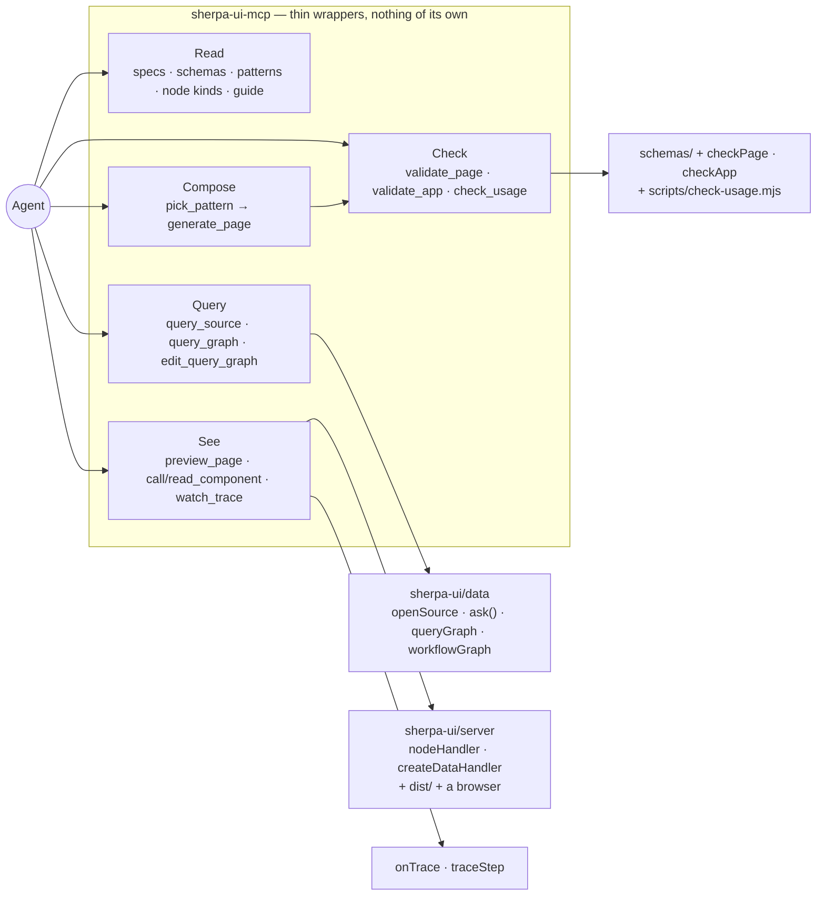
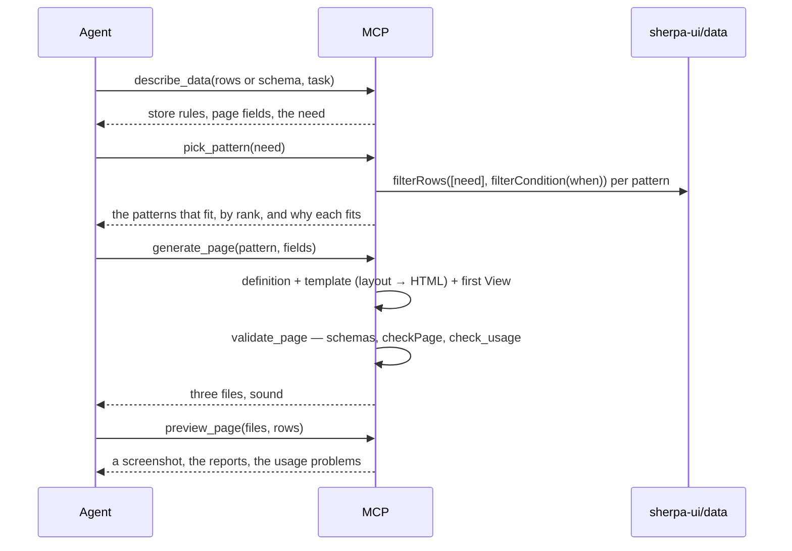
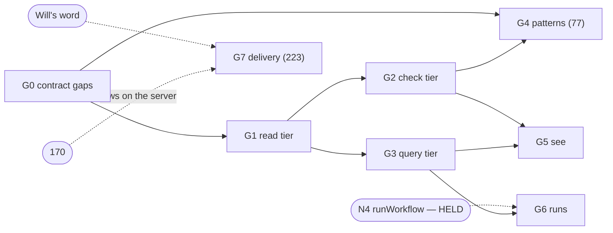

# Plan 700 — how agents get Sherpa: the MCP, patterns and delivery

**2026-11-04, at `44ee1350`.** Rows [700](../TODO.md) (the MCP rebuild), 77 (UX patterns)
and 223 (how templates and definitions reach the browser). A PLAN: nothing here is built
until Will says. It follows [plan 695](plan-695-architecture.md), which is done but N4,
and [the review](../ARCHITECTURE-REVIEW.md) §7.3–7.4. The old MCP:
[mcp-server/README.md](../../mcp-server/README.md).

Will's words:

- **700:** *"The existing MCP is outdated: rebuild it from scratch after the node engine
  and the refactor. It's a tool we provide later."* It ships NO Figma build tooling.
- **77:** *"I feel like these will be best suited to a lightweight decision model, and MCP
  tools, skills, etc. for Agents to build UI to regular pattern, and layout, specs."* A
  pattern is defined by a contract, so a consumer adds its own. Never baked into Sherpa.
- **223:** *"We can do this later. Need to look at how we deliver templates and
  definitions to be processed."*
- **N4** (`runWorkflow`, TODO 616) is HELD. §5 says what of 700 waits on it.

---

## In one page

| | Today | The plan |
|---|---|---|
| **The MCP** | 19 tools, 7 resources, 3 prompts. It reads and checks. It cannot compose | 21 tools on the new spine (a 22nd with N4): read, check, query, compose, preview, watch |
| **Patterns (77)** | None. The old `patterns/` (a 606-line schema in prose) was removed on 2026-08-14 | A small JSON contract. A pattern says: *for this need, this layout and these components*. Its `when` is the data layer's own condition shape |
| **Delivery (223)** | The outlet fetches each Context's template, definition and module | Keep fetching. The MCP writes the same files, so delivery can change later without the MCP |



---

## 1. Where it stands

Measured 2026-11-04 by registering every module against a capturing stub (the README's
own method). About 2,600 lines of code, in five tool modules.

| Module | Tool | What it does | Against the new spine |
|---|---|---|---|
| Discover | `list_components` | Every component, with its Figma name | Figma name leaves; no `asks`, `presents` |
| | `get_component` | Def, example, code, Figma binding (`name-map.yaml`) | The def is a 5th form of a spec; Figma half leaves |
| | `find_token` | Token names in `tokens.css` | Keep: `tokens.css` ships |
| Generate | `scaffold_def` · `validate_def` · `compile_def` | Author a new component through the def form | Sherpa's own work, not a consumer's (Q2) |
| | `token_for` | The token for a Figma pixel value | Figma build tooling — leaves |
| | `scaffold_app` | The Starter's files | Keep |
| Verify | `audit_component` · `check_bindings` | Rule 8 over Figma bindings (`scripts/audit-bindings.mjs`) | Figma build tooling — leaves |
| Data | `run_query` | Rows + a `filter` or a `where` → a bare `DataSource` | Never opens a page; no scopes, presets, counts or trace |
| | `validate_page` | page.v1 or app.v1, then `checkPage` / `checkApp` | Its own Ajv; no views, workflows, `ui` or template |
| | `scaffold_schema` · `import_schema` · `validate_schema` | Store rules from rows or a JSON Schema; rows against rules | Keep the idea; also make the page's `fields` |
| Drive | `component_api` | Methods, properties, events from a spec | Fold into `get_component` |
| | `call_component` · `read_component` · `browser_close` | Act on a live element, localhost only | Points at the Gallery (:4500), which a consumer has not got |

Resources: `sherpa://def/{name}`, `sherpa://component/{name}/{ts,html,css}`,
`sherpa://rules`, `sherpa://data-rules`, `sherpa://app-guide`. Prompts:
`generate_component`, `review_component_usage`, `debug_component`.

**What is stale.** No call it makes is gone: 695's D1 and S2 ported the two that moved
(`checkPage`; a page through `ask({ page })`), and the 695 final run (Node 1014/1014)
includes its tests. It is stale in its MODEL, not its calls:

- **The def form.** `sherpa://def` and the def tools serve `specToDef`'s output, the 5th
  form of a spec (review §10). `compile_def` knows none of 695 P6a's directives (`data-text`,
  `data-attr-*`, `data-when-*`) and none of `static asks`, `takes`, `presents`, `settings`.
  (The spec generator keeps `specToDef` and `compileDef` for its round-trip; only the
  MCP's use goes.)
- **Figma.** `name-map.yaml`, `figmaName`, `token_for`, the two audits, the `sherpa://rules`
  Figma half, and the `build-figma-component` step in `generate_component`.
- **The old data shape.** `run_query` takes the store's `[field, op, value]` grammar, and
  sets the agent's query with `setQuery` (a restore door), not commands through `ask()`.
  `get_component` teaches a page to fill a component by hand (`populate`); a page asks.
- **One check, many ways.** `validate_page` builds its own Ajv, not
  `scripts/lib/schema-check.mjs`. `review_component_usage` reads markup by hand, while
  `check-usage` exists and is not a tool.
- **The package.** It vendors `scripts/lib/generation/*` and `audit-bindings.mjs` at pack
  time (`mcp-server/scripts/vendor.mjs`). It says Node 20; sherpa-ui needs 22.
- **What it lacks** (review §7.4): no compose (pattern, generate, preview), no schema
  resource, no node registry, no graph, no trace.

**A gap in the specs, found here.** The specs do NOT say what a component asks for or
draws: of 68 specs, none has `asks` or `presents` (both are in the classes, as
`static asks` and `static presents`). An agent that composes a page needs both. This is
G0 (§5).

---

## 2. The new MCP

**Rules for every tool.**

1. **A thin wrapper over what ships**: `sherpa-ui/data`, `sherpa-ui/server`, `schemas/`,
   the specs and `scripts/check-usage.mjs`. Nothing vendored. No second implementation.
2. **One vocabulary.** An agent's act is a `QueryRequest` through `QueryContext.ask()` —
   the same one a chip sends. A graph edit is `graphRequest`. A save is `pageWithQuery`.
3. **Checked before it is returned.** `generate_page` runs `validate_page` on its output.
4. **Localhost only, no arbitrary script** (kept from the old drive tier). A preview
   listens on a port the OS picks, never :4200 or :4000.
5. **The README is made from the registrations**, and `check:mcp` gates it. The old one
   once listed 19 tools that never existed.
6. **No Figma.** `scripts/figma-data/name-map.yaml` leaves the package's `files`.
7. **Problems are the data layer's own reports** (`onReport`), in its own words.

### Tools

| Tool | On the spine | Replaces |
|---|---|---|
| `list_components` | The specs: category, slots and their `data-accepts`, `asks`, `presents` | `list_components` |
| `get_component` | One spec, its example, its callable surface | `get_component`, `component_api` |
| `find_token` | Token names in `tokens.css` | `find_token` |
| `describe_data` | Rows or a JSON Schema → store rules, a page's `fields`, and the NEED (§3) | `scaffold_schema`, `import_schema` |
| `validate_rows` | Rows against store rules (`validate`) | `validate_schema` |
| `validate_page` | A Context's three files: definition (page.v1 + `checkPage`), Views (views.v1), template (`check_usage`); `ui` against the specs; one Ajv | `validate_page` |
| `validate_app` | `app.json` (app.v1 + `checkApp`), then `validate_page` on each Context it names | `validate_page` (app half) |
| `check_usage` | Markup against the specs (`markupProblems`) | `review_component_usage`, by hand |
| `query_source` | A page definition + rows (or a localhost data path through `openRequestStore`) → `openSource` → `ask()` each command → rows, total, groups, field state | `run_query` |
| `query_graph` | `queryGraph(query, page)`: the Query as nodes, as JSON | new |
| `edit_query_graph` | A node edit → `graphRequest` / `routeRequest` → `ask()` → the new Query and its saved definition (`pageWithQuery`) | new |
| `workflow_graph` | `workflowFaults` + `workflowGraph` over a workflow, with `NODE_KINDS` | new |
| `edit_workflow` | `editWorkflow` → the new definition, checked | new |
| `pick_pattern` | A need → the patterns that fit, ranked, with each `when` that matched (§3) | new |
| `generate_page` | A pattern + the data → definition, template and Views, validated | new |
| `preview_page` | Serve a Context with `nodeHandler` over sample rows + `dist/`, open it in a browser, wait for `settled`; give a screenshot, the reports and the usage problems | the Gallery dependency |
| `call_component` · `read_component` | As now, on the preview (or any localhost page) | the same |
| `preview_close` | End the preview and its browser | `browser_close` |
| `watch_trace` | The spans of the last act — the MCP's own and the preview's — by node (`traceQuerySteps`, N2) | new |
| `scaffold_app` | The Starter's files, as now | `scaffold_app` |
| `run_workflow` | `runWorkflow`: dry run first, then a run, its trace, cancel | **waits on N4** |

**Dropped:** `scaffold_def`, `validate_def`, `compile_def` (Q2), `token_for`,
`audit_component`, `check_bindings` (Figma), `run_query`, `validate_schema`,
`scaffold_schema`, `import_schema`, `component_api`, `browser_close` (each replaced above).

### Resources

| URI | Is | Replaces |
|---|---|---|
| `sherpa://schemas/{name}` | app, page, views, workflow, defs, component, example, pattern | new: none served them |
| `sherpa://spec/{name}` | A component's spec as on disk (with `asks`, `presents` after G0) | `sherpa://def/{name}` |
| `sherpa://example/{name}` | Its shipped example | part of `get_component` |
| `sherpa://component/{name}/{ts,html,css}` | Its source, for `useTemplate` and for debugging | kept |
| `sherpa://node-kinds` | `NODE_KINDS` as JSON: each kind, its rows and sockets | new |
| `sherpa://patterns` · `sherpa://pattern/{id}` | Sherpa's patterns and the app's (§3) | new |
| `sherpa://app-guide` · `sherpa://data-rules` | As now | kept |

`sherpa://rules` is dropped: its Figma half is never served, and the rest is for Sherpa's
own authors (Q2). `docs/DEF-TO-FIGMA-BUILD-RULES.md` leaves the package's `files` with it.

### Prompts (and skills, Q8)

| Prompt | Steps | Replaces |
|---|---|---|
| `build_page` | describe_data → pick_pattern → generate_page → validate_page → preview_page | `generate_component` |
| `review_page` | validate_page → check_usage → preview_page's reports | `review_component_usage` |
| `explain_page` | query_graph → a `query_source` act → watch_trace | `debug_component` |

---

## 3. The pattern decision model (77)

**What it is.** A pattern is a JSON document under one contract,
`schemas/pattern.v1.json`. It says what it is for, when it fits, and what it composes.
An agent picks one. It never invents a layout. Sherpa's own patterns are examples under
the same contract, not the only ones (Q3); an app adds its own (Q4).

**It reuses shapes that exist.** No new matcher and no new tree:

- **`when`** is a `where` from `defs.v1.json` — conditions by field — run over ONE row,
  the NEED, with the data layer's own `filterCondition` and `filterRows`.
- **`layout`** is the component spec's anatomy node (`el`, `attrs`, `slot`, `children`),
  from `component.v1.json`.
- **`page`** is a fragment of a page definition (scopes, `ui`), checked by page.v1.

**The need** is one plain row. `describe_data` makes it from the rows or the page's
fields; the agent adds the task word:

```json
{ "task": "triage", "rows": 4200, "fields": 9, "dateFields": 1, "numberFields": 3,
  "statusFields": 1, "childFields": 0, "writes": true }
```

**A pattern:**

```json
{
  "$schema": "../node_modules/sherpa-ui/schemas/pattern.v1.json",
  "v": 1, "id": "records-list", "label": "Find and act on records",
  "use": "Many rows of one kind, which a reader narrows, sorts and acts on.",
  "when": { "task": { "in": ["browse", "find", "triage"] }, "rows": { "gt": 50 } },
  "rank": 10,
  "layout": { "el": "sherpa-layout-grid", "children": [
    { "role": "summary", "el": "sherpa-metric", "each": "statusField", "max": 4 },
    { "role": "filters", "el": "sherpa-quick-filter-toolbar", "attrs": { "data-scope": "data" } },
    { "role": "rows", "el": "sherpa-data-grid", "attrs": { "data-scope": "data" } }
  ] },
  "page": { "scopes": { "view": {}, "data": { "offers": "all" } } },
  "states": ["loading", "empty", "unreached", "down"],
  "agent": { "may": ["columns", "presets", "summary"], "keeps": ["filters", "rows"] }
}
```

**The checks on a pattern** (`checkPattern`), all from contracts that exist:

- each `el` is a component with a spec, or a native element;
- each `attrs` key is a prop that component declares (rule 9's `static props`);
- a child placed in a slot fits that slot's `data-accepts` (rule 12's vocabulary);
- a `role` that draws data names a component whose `asks` and `presents` fit the need
  (a chart kind from the presents registry, U4) — this needs G0;
- `page` checks against page.v1; `agent.keeps` names roles the layout has.

**How an agent uses it:**



**Where it lives.** The contract (`pattern.v1.json`) ships in sherpa-ui's `schemas/`,
beside page.v1. The two pure functions (`pickPattern`, `checkPattern`) and the layout →
HTML writer live in the MCP (Q5). Sherpa's first three patterns are the three row 77
already names in prose: a records list with its CRUD flow (row actions, a form, a
toast), a Settings page as a form, and the filter scopes (a View bar over a data bar).
The lesson of the old `patterns/`: keep the contract small; the checks, not the prose,
hold it.

---

## 4. Delivery (223)

**Today** (measured in the code):

| What | How it reaches the browser |
|---|---|
| A component's template and sheets | Inlined into the JS at build (208 ✅); a dev build fetches them |
| The icons | One sprite, fetched once (P6b); a page's CSP `connect-src` must allow it |
| A Context's template, definition and module | The outlet fetches them at each open (`sherpa-outlet.ts`, `#file`), sets the template as its light DOM, runs `checkPage` in `provider.open()`, then imports the module |
| Each Context's Views | Read once, at `outlet.start()` (`loadViewLibrary`) |
| Offline | The worker serves them from its cache, network first |

**The options:**

| | What | What it needs | What is measured |
|---|---|---|---|
| **A. Keep fetching** | As now | Nothing | Up to 3 requests per Context open; offline through the worker; any static server serves them |
| **B. Inline at build** | The app's files in one bundle; the outlet fetches none | A generic `files` option on the outlet; the app's own build script (sherpa-ui knows no app) | 429 built it (`files`, `fileText()`), then Will had it reverted: Demos as one 1.6 MB file; from disk it works in Chrome and Firefox; Safari loads the page again on each route change |
| **C. Server render** | The Node host sends each Context with its shadow roots already in the markup (declarative shadow DOM) | (1) the constructor keeps a declarative root; (2) sheets as links or text; (3) a way to render; (4) a route that serves definitions as it serves data; (5) `:state()`s made again at upgrade | Below |

**Measured for C, 2026-11-04,** in Chromium 153, Firefox 155 and WebKit 26.6 (a probe page,
not in the repo):

- `attachShadow()` on an element that has a declarative root gives back THAT root,
  **emptied**, with no error, in all three. Today's constructor calls it
  (`sherpa-element.ts:419`), so it throws the server's markup away silently.
- `attachInternals().shadowRoot` gives the declarative root in the constructor, and its
  `<style>` text applies. Keeping the root is a small change in one place. The harder half
  is the first stamp: the directives (P6a) must bind to the nodes already there. Not
  measured yet.
- `getHTML({ serializableShadowRoots: true })` writes a live element's shadow tree in all
  three, but **not** its adopted sheets and **not** its `:state()`s. So a page rendered in a
  headless browser (a prerender) needs no DOM shim on the server. It must add the sheets
  and make the states again.
- Every shadow root adopts nine shared sheets (`SherpaElement.sharedStyles`), about
  121 KB of source CSS before its own. As `<style>` text in every root, a page of a few
  hundred elements is megabytes. So C links its sheets — and a production build deletes
  those files from `dist/` (208). Not measured: whether a linked sheet in a declarative
  root paints before it loads (a flash).
- On a server, `define()` does nothing; the templater and view markup use `DOMParser` and
  `document.baseURI` (`templater.ts`, `view-markup.ts`). Rendering there needs a DOM shim —
  a first runtime dependency — or the prerender above.
- **A data component's rows need a source on the server.** That is 170. Without it, C
  draws the frame and the skeletons only (state first, then render: TODO 113).

**Pick: A now** (Will: later). When 223 starts, make the constructor keep a declarative
root first: it is small, and it makes B and C possible. B when a shareable build is
wanted again (429). C only when SEO or pages with no JS are asked for (223's own words).
**The MCP is not tied to this:** `generate_page` writes the same three files the outlet
fetches, whatever carries them.

---

## 5. The order of work

Phases are G0–G7 and questions Q1–Q9, so they are not read as 695's P1–P7 and D1–D7.
Sizes as plan 695: S (a day or less), M (a few days), L (a week). Lanes run as 695 ran them
(its D7 A): one worktree pair each, own `dist` and ports, disjoint files; one integrator.

| Phase | What | Size | Waits on |
|---|---|---|---|
| **G0 — contract gaps** (sherpa-ui) | The spec generator writes `asks`, `takes`, `presents` and `settings` into each spec (`check:generated` follows); `schemas/pattern.v1.json`, reusing `where` and the anatomy node | M | nothing |
| **G1 — the read tier** | The new `mcp-server/` from scratch, the old one DELETED in the same change; the resources; `list_components`, `get_component`, `find_token`; `check:mcp` and `check:mcp-pack` rewritten; the README from the registrations; `name-map.yaml` and the rules doc leave `files` | M | G0's spec half |
| **G2 — the check tier** | `validate_page`, `validate_app`, `check_usage`, `describe_data`, `validate_rows`; one Ajv | M | G1 |
| **G3 — the query tier** | `query_source`, `query_graph`, `edit_query_graph`, `workflow_graph`, `edit_workflow` | M | G1 |
| **G4 — patterns (77)** | Three Sherpa patterns; `checkPattern`, `pickPattern`; `generate_page`; the `build_page` prompt and skill | L | G0, G2 |
| **G5 — see** | `preview_page`, `call_component`, `read_component`, `preview_close`; `watch_trace` for a Query's walk; `review_page`, `explain_page` | M | G2 (G3 for `explain_page`) |
| **G6 — runs** | `run_workflow` (a dry run first), cancel, `watch_trace` for a run | M | **N4** |
| **G7 — delivery (223)** | The constructor keeps a declarative root; then B or C on Will's word | S, then L | Will; C with rows waits on **170** |



**Parallel lanes.** G0 alone, first (it changes every spec). Then G1. Then two lanes:
**Check** (G2) and **Query** (G3). Then two lanes: **Patterns** (G4) and **See** (G5).
G7's constructor change touches every component, so it runs when no component lane is in
flight, as 695's P6 did, and never beside G0. It does not touch the MCP, so it may run
beside G2–G5.

**What waits on N4:** only `run_workflow`, cancel, and the run half of `watch_trace`. A
workflow can be read, edited and checked without it (`workflowFaults`, `editWorkflow`).
Everything else in 700 ships without N4.

**What waits on 170:** nothing in 700. `query_source` already runs a page's Query in
Node, so it is the first test bed for 170's source handler
([ARCHITECTURE.md §8](../ARCHITECTURE.md)). Only C in 223, with rows, waits on it.

**Out of scope:** WebMCP (row 76, deferred by Will): its vocabulary would be this one,
`ask()` and the specs. Framework adapters (never).

---

## 6. Decisions for Will

**Will, 2026-11-04: A for all nine** (Q1–Q9, the picks below). G0 starts first, alone in
the spec generator.

| # | Question | A (my pick) | B |
|---|---|---|---|
| Q1 | Where the new MCP lives | `mcp-server/`, rewritten in place; package `sherpa-ui-mcp` (the Starter's `.mcp.json` names it); gated in this repo | A sibling project, like the Starter |
| Q2 | Component authoring (`scaffold_def`, `compile_def`, `validate_def`) | Drop it from the shipped MCP: it is Sherpa's own work, with the repo's gates | Keep one `scaffold_component`, on the spec |
| Q3 | Sherpa's own patterns | Three ship as data in sherpa-ui `patterns/`, examples under the same contract | Ship the contract only; the examples live in the Starter |
| Q4 | Where an app's patterns are | A `patterns/` folder beside `app.json`; the same id replaces Sherpa's | A `patterns` key in `app.json` (the runtime ignores it) |
| Q5 | Where the pick code lives | In the MCP: only agents need it | In `sherpa-ui/data`, so a page's agent (row 76) can use it later |
| Q6 | How a preview runs | The MCP serves it: the Node host + `dist/` + a browser, on a port the OS picks | It points at the app's own running server |
| Q7 | Delivery (223) | Keep fetching; when 223 starts, first make the constructor keep a declarative root | Start server render through the Node host now |
| Q8 | Skills | One `SKILL.md` per workflow in the MCP package, also served as its prompt | Prompts only |
| Q9 | N4 | Ship 700 without runs; add `run_workflow` when N4 lands | Hold every node tool until N4 |
