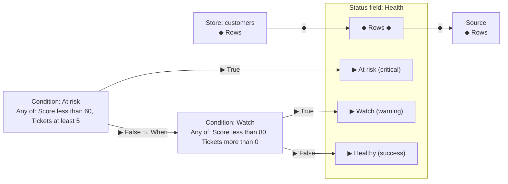
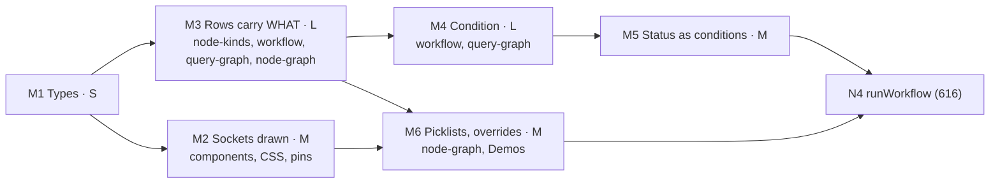
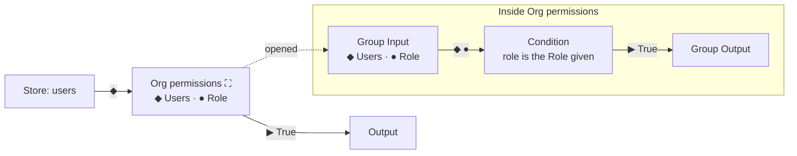

# Plan 713 — the node model: typed sockets, True and False, the Condition node

Will, 2026-11-04 (TODO 713), in short: a **Condition** node that picks a field,
compares its values with given parameters, and passes the output on. Nodes output
a **value**, an **object** or a **true/false boolean**. A row has an output socket
for a value or an object; the **header** has one for **True**; a new **footer** has
one for **False**. Inputs take a value, an object, a boolean, or **any**. Each
type has its own **colour and shape**. A socket may take or send **several
connections**. A row that shows a text field where a **picklist** is wanted gets
one, and a **text Value node** plugged into it overrides the pick.

**Status: PLAN, 2026-11-04.** It is the base for N4 (`runWorkflow`, TODO 616).
Nothing here is built until Will says: 616's hold covers it.

Earlier rulings this plan keeps: one registry, `NODE_KINDS` (plan-695 N1); the
Query graph is derived, and every edit is an `ask()`
([plan-78-query-editor](plan-78-query-editor.md)); a routed input MIRRORS what
comes in, read only ([plan-78-workflow-data](plan-78-workflow-data.md) §5);
`traceStep` lights a node by its id ([plan-695](plan-695-architecture.md) N2).

## The idea in one line

**Rows carry WHAT** (a value or an object). **The header and the footer carry
WHETHER** (True or False).

```text
             When ▶ ┌──────────────────────────────────┐ ▶ True        HEADER: When in, True out
                    │  ƒ  At risk          (Condition) │
                    ├──────────────────────────────────┤
             Rows ◆ │  Rows                            │               a ROW: the data rows come in
                    │  Join      [ Any of          ▾ ] │               a picklist
                  ● │  Field     [ Score           ▾ ] │ ●             a row may send its value on
                  ● │  Operator  [ Less than       ▾ ] │
                  ● │  Value     [ 60                ] │
                    │  · · · · · · · · · · · · · · · · │               the next condition of the group
                  ● │  Field     [ Tickets         ▾ ] │
                  ▶ │  Group                           │               a nested group's True (many)
                    │  Matches: 43                     │ ●
                    ├──────────────────────────────────┤
                    │  + Condition                     │ ▶ False       FOOTER: False out
                    └──────────────────────────────────┘
  ● value (circle)   ◆ object (diamond)   ▶ boolean (triangle)   ■ any (square, inputs only)
```

---

## 1. Where it stands

Measured 2026-11-04: `queryGraph` on Demos' Records definition and
`workflowGraph` on Demos' `app/workflows/active-customers.json`, run in Node.

**Sixteen kinds, two socket types.** `SocketCarries` is `'value' | 'object'`: a
circle or a diamond, both in one grey (`--sherpa-style-content-secondary`). Only an
output takes the pointer. An input takes one route. The data rows go header to
header.

| Kind | Graph | Header in → out | Its rows (control; sockets) |
|---|---|---|---|
| store | both | — → ◆ | Store (store) |
| status | query | ◆ → ◆ | one row per value: words only, no control |
| source | query | ◆ → ◆ | Page size (number), Search fields (text), Apply on (text) |
| scope | query | ◆ → ◆ | Filters (switch); one row per preset and held field, ● in |
| condition | query | — → ● | Field (field), Condition (op), Value (text, or ticks) |
| preset, saved | query | — → ● | On (switch); each field it writes: words only |
| arrange | query | ◆ → ◆ | Sort (field), Direction, Group (field), Search (text) |
| presentation | query | ◆ → ◆ | Show as, Primary, Secondary, Group, Sort |
| component | query | ◆ → — | none |
| value | workflow | — | Value (text) ● out |
| pick | workflow | ◆ → — | Field (field) ● out |
| filter | workflow | ◆ → ◆ | Field, Condition (op), Value (text, ● in), Matches (● out) |
| sort, group | workflow | ◆ → ◆ | Field, Direction / Field |
| count | workflow | ◆ → — | Count (● out) |
| output | workflow | ◆ → — | none |

**Rows that show a text field where a picklist is wanted:**

1. Query › **Store** › Store: a read-only TEXT field. `queryGraph` gives it no choices.
2. Query › **Source** › Search fields: text, "name, email, owner". Wanted: ticks of the fields.
3. Query › **Source** › Apply on: text, "change". Wanted: Change or Input (the page.v1 enum).
4. Query › **Condition** › Value, where the field's values are not known. "In the
   last" is typed as "7 day" in one field: wanted, a number and a Unit picklist.
   "Between" is typed as "a, b": wanted, From and To.
5. Query › **Condition** on a nested reading: read-only text, "2 conditions". Wanted: the tree itself (§4).
6. Query › **Presentation** on the View: every row is read-only text. Wanted: the same picklists, read only.
7. Workflow › **Filter** › Value: text. Wanted: the field's values, from the store.
8. Workflow › **Value** › Value: text with no type. It stays text (it IS the
   override, §5), but it needs a Type picklist beside it.

And rows that are only **words**: each Status value, and each field a Preset or
Saved filter writes.

**The Health node.** In the Node Editor (beta), on Records, the node "Health"
(kind `status`) shows three rows, each a string: At risk, "Score less than 60 or
Tickets at least 5"; Watch, "Score less than 80 or Tickets greater than 0";
Healthy, "every row the values before it left".

It comes from Demos' `customerHealth` (`app/stores/records-data.js`):
`statusFields(store, { health })` puts each value's `when` into
`store.domains.health.when` as one condition tree. `queryGraph` turns each tree
into words with `said()`. It lists strings because the graph has no Condition node
for a whole tree and no boolean socket to say "this value holds when…". The
"first value that matches" rule is not drawn at all: it lives only in the word
"before".

---

## 2. The socket types

| Type | Carries | Shape | Colour: the socket pins this Style mode | Sides |
|---|---|---|---|---|
| **value** | one value: text, a number, a date, a list | ● circle | `info`, its `--sherpa-style-indicator-accent` (blue) | in, out |
| **object** | a record, or rows | ◆ diamond | `active`, its `--sherpa-style-indicator-accent` (indigo) | in, out |
| **boolean** | true or false, for each data row | ▶ triangle, pointing the way the data goes | `success`, its `--sherpa-style-indicator-accent` (green) | in, out |
| **any** | whatever comes in | ■ square, not turned | none: the body ink it has today, `--sherpa-style-content-secondary` | in only |

- A fault colour (`critical`, `warning`, `urgent`) is never a type colour. It stays free to mark a fault.
- Each pin is a part pin in `scripts/figma-data/state-pins.yaml`
  (`'&[data-input-socket="value"] .socket-in': info`). It is not a colour rule (rule 8).
- An unrouted socket is hollow: its colour on the edge. A routed one is filled.
- A route line takes the colour of its output.

**Which input takes which output:** a value input takes a value, an object input
an object, a boolean input a boolean. An `any` input takes all three. To change a
type, put a node on the route: Pick (object → value), Count (object → value),
Condition (value or object → boolean).

**The rule for any.** A kind uses `any` only where its run reads every type the
same way: an Output, or a later Log or Store write. It keeps its square and its
grey when routed. Its words say what came in.

**Many connections.** An output always sends many. An input takes many only where
its row says how they join (`many` in the registry, D4):

| Input | Many routes join as |
|---|---|
| value | a list, in route order: three Value nodes into "Is one of" give three values |
| boolean (a row) | the node's own join: All of or Any of |
| boolean (When) | any of them: a data row any branch lets through |
| object | one set, each data row once (by its key), in route order |
| any | as the type that comes in; two types at once are refused |

Any other input takes one. A new route replaces the one there, as now.

**Never colour alone.** The shape says the type. Each socket has a tip with its
name and type ("True: a boolean"). The inspector says each route in words
("From Value › Value"). In forced colours, the colours go and the shapes stay.

**Where the type is said: one place.** `NODE_KINDS` says each socket's type.
`SocketCarries` becomes `SocketType = 'value' | 'object' | 'boolean' | 'any'`; the
old name goes in the same change (it is exported from `sherpa-ui/data`). A
workflow's JSON names sockets only, never types. `workflowFaults` checks each
route with one function, `accepts(output, input)`. In `schemas/defs.v1.json`, only
the words of `route` change, and `socket` also takes `node/#false`, the footer's
(`#` marks a part that is not a row, as the Query graph's `#filters` does).

---

## 3. Outputs: the row, the header and the footer

- **A row's output** sends a value or an object: its own value (a Field row sends
  the field name), or what the node made (Matches sends a count; Rows sends the
  data rows).
- **The header** keeps its two sockets, with new meanings. Its OUTPUT is **True**.
  Its INPUT is **When** (D1): a boolean. A node whose When has a route works only
  on what that branch lets through.
- **The footer** is new. It composes `sherpa-container-footer`, as the header
  composes `sherpa-container-header`. Its output is **False**. Later it may hold
  "+ Condition" (M4), the step's time and rows (now a caption over the card), a
  failed step's message and "Run from here" (both N4).
- **The data rows move from the header to a row**, **Rows** (◆ in, ◆ out), first
  on each kind that takes or gives them. A Store's Store row sends them; Source,
  Scope, Arrange and Presentation pass them on.

**What True and False mean: a fork in the road.** Each data row goes down one road.
On a Condition, True takes the data rows that hold, and False takes the rest. With
one value or one record, only one road is taken. On a node that is not a condition
(D2): True when it gave something (data rows came out, or a value); False when it
gave nothing. A fault is neither: the run stops there, and the node lights
`failed` (N2). Output and Component have no True and no False.

---

## 4. The Condition node

**One kind for both graphs.** The Query's `condition` and the workflow's `filter`
are one idea. `condition` serves both graphs, and `filter` goes (plan-695: one
shape per idea). Its `model` is `Condition`, the one tree in `store.ts`.

**One node is one group of the tree** (D3):

| Row | Control | Sockets |
|---|---|---|
| Rows | none | ◆ in (workflow only: in the Query, its scope gives the data rows) |
| Join | picklist: All of, Any of. Shown only with two or more conditions | — |
| Field | picklist: the source's fields (`source.fields`) | ● in, ● out |
| Operator | picklist: `OPS_FOR_TYPE[type]`, read by `OP_LABELS` and `DATE_OP_LABELS`; Is one of and Is not one of where the values are known | ● in |
| Value | by `OP_TAKES`: **list**, a picklist of the field's values (ticks for Is one of); **text**, a field typed by `typedValue` (for In the last: a number and a Unit picklist); **range**, From and To | ● in (many for a list) |
| …Field, Operator, Value again | one set per condition in the group, a subtle rule between sets | |
| Group | none | ▶ in, many: each nested group's True |
| Matches | none: how many data rows hold | ● out |

- Header: When ▶ in, True ▶ out. Footer: "+ Condition" and False ▶ out.
- **Nesting, as 692 allows:** `A or (B and C)` is two nodes: "Any of: A, Group",
  and "All of: B, C", whose True goes into the first one's Group row. One join per
  node, as the condition editor has (plan-695 P3).
- **An `off` part** is drawn greyed and kept, as the menu draws it.
- **In the Query graph,** each edit asks through `graphRequest`: the edited tree,
  made into a reading by `treeReading`. Nothing is new to the data layer. The
  True of a field's Condition goes into its scope's field row, which takes a
  boolean now. Presets and saved filters send their True into their `@` rows the
  same way.

**The Health node, as Conditions.** The status node keeps its Rows row (in and
out: each data row with its Health) and one row per value, each a boolean input.
A Condition node per `when`. False chains them: Watch is tested only on the data
rows that At risk did not take, as `statusFields` works it out. Each value row
shows its look (`critical`, `warning`, `success`), from `domain.statuses`.



These nodes are **read only**: the app's store owns them (the hint stays "The
app's store works it out: statusFields()"). To edit a status in the editor, the
status must first be a definition (defs.v1 has `statusField`). That is later, and
not in this plan. Each field a preset or saved filter writes becomes a Condition
node the same way, read only where the definition owns it.

---

## 5. Picklists and overrides

**One list per control, in one place.** Today `workflowGraph` and `queryGraph`
each build their choices (`DIRECTIONS` is written twice). One function in
`node-kinds.ts`, `rowChoices(row, facts)`, gives every list. Both graphs call it.

| Row | Its list | From |
|---|---|---|
| Field, Sort, Group, Primary, Secondary | the fields | `source.fields`; the Query adds what a scope holds |
| Search fields | ticks of the fields | `source.fields` |
| Operator | the type's operators | `OPS_FOR_TYPE`, `OP_LABELS`, `DATE_OP_LABELS` |
| Value (list) | the field's values | Query: `DataSource.valuesFor`; workflow: a new `WorkflowFacts.values`, from the store's `distinct` |
| Unit (In the last, In the next) | day, week, month, year | `Duration` |
| Direction | Ascending, Descending | one list |
| Show as | Default, Bar, Donut, Pie, Grid | `PRESENTATION_KINDS` |
| Apply on | Change, Input | page.v1's enum |
| Store | the app's stores | `WorkflowFacts.stores`; the Query gets the same fact |
| Join | All of, Any of | the tree's `and`, `or` |
| Value › Type | Text, Number, Date, True/false | `FieldType`, and boolean |

**An override: plug a text Value node into a picklist.** Every picklist row gets a
● input. A Value node routed into it overrides the pick, by Will's rule of
2026-10-29: a routed row MIRRORS what comes in, read only (D7). The row shows it
so:

- its input socket is filled, and a route line comes in;
- its picklist is read only and shows the custom value, with "Custom" after it
  (`workflowGraph` already adds an own value that a list does not have);
- the line under it says "Custom value, from Value › Value", on the canvas and in the inspector;
- cut the route, and the row's own pick is back. The draft kept it: off is not gone.

A Value node's value is known when the graph is drawn, so the canvas shows it
before N4 runs. A value that a node works out waits for N4.

**To make one:** drag out of a picklist's input socket onto the bare canvas. A
Value node is made there, with the row's value, routed in. With no pointer
(rule 21), the inspector row's "Custom value" button does the same. A workflow
gets two new edits: `{ add: WorkflowNode }` and `{ remove: id }`. **In the Query
graph** a Value node has no home (the Query holds only readings), so the graph
DRAWS one: a condition value the field's values lack is a derived Value node,
routed in. Each edit to it asks the reading.

---

## 6. How it maps to the code

| File | What changes |
|---|---|
| `src/core/data/node-kinds.ts` | `SocketType` (in place of `SocketCarries`); `accepts()`; `RowKind.many`; `NodeKind.branches` (True and False); a Rows row on each data kind; `condition` for both graphs, `filter` gone; `rowChoices()` |
| `src/core/data/workflow.ts` | `workflowFaults` checks by `accepts()` and `many`; routes into `node/#false`; v2, a v1 read once (D8); `editWorkflow` adds, removes, and keeps several routes into a `many` input; `WorkflowFacts.values` |
| `src/core/data/query-graph.ts` | routes go Rows to Rows; True into boolean rows; a reading's whole tree as Condition nodes (the "2 conditions" text goes); status values, presets and saved filters as Condition nodes; derived Value nodes; `QUERY_NODE` names a status value's node |
| `src/core/ui/node-graph.ts` | draws the footer and its socket; route lines typed by colour; picklists from `rowChoices`; a routed row shows the custom value; the drag out of an input socket; the inspector's "Custom value" |
| `sherpa-node`, `sherpa-node-row`, `src/core/sherpa-node-sockets.css` | four shapes; a part pin per type; hollow or filled; the footer slot (`sherpa-container-footer`) and its False socket; a tip per socket; forced colours. `SHARED_PROPS['data-input-socket']` and `['data-output-socket']` take the new values |
| `schemas/defs.v1.json`, `schemas/workflow.v1.json` | the `socket` pattern takes `#false`; the words of `route`; workflow `v: 2` |
| Demos | `app/workflows/active-customers.json` in v2, its Filter a Condition; the Node Editor's specs |

**What of N4 this plan covers.** 616 lists "typed sockets" in N4's scope. This
plan does that part whole: the types, their checks, their look, how many routes
join, and the rules a run must follow (the fork, When, the joins). It also gives
each Condition and status value a node id for `traceStep`.

**What N4 still needs:** `runWorkflow` itself. It runs each kind by its `model`, in
route order. It carries each branch as the data rows it lets through, matched by
row key. It writes live values into the rows (Matches, a routed Value). It also
needs cancel (an `AbortSignal`), a dry run, batch writes, and a `traceStep` per
node under one trace.

---

## 7. Phases

| Phase | Builds | Proves | Size |
|---|---|---|---|
| **M1** Types | `SocketType`, `accepts()`, `many`, `branches`, the `#false` address, `rowChoices()`; the checks | node tests: each type joins only what it takes; many routes join by their row | S |
| **M2** Sockets drawn | four shapes, the part pins, hollow or filled, the footer with False, tips, forced colours, route colours; specs, examples | `reforged-node.spec.ts` reads PIXELS for each shape; the a11y gate (`npm run test:a11y`) at or under its baseline | M |
| **M3** Rows carry WHAT | every data kind's Rows row; When and True on the header; False on the footer; `queryGraph` routes; workflow v2 and the v1 read | `a-query-is-drawn-as-nodes`; `a-workflow-is-its-definition` reads a v1 file as v2; Demos' Node Editor draws as before | L |
| **M4** The Condition node | one `condition` kind; Join, conditions, Group, Matches, True and False; a reading's whole tree drawn and edited through `ask()`; `filter` goes | node tests: `A or (B and C)` is two nodes, and an edit reads back the same tree; Demos: Active and Trial ticked still gives 49 rows | L |
| **M5** Status, presets and saved filters as conditions | the Health chain of §4; the conditions of presets and saved filters; read only | node tests: Health is 3 value rows and 2 Conditions, chained by False; the trace lights At risk with its 43 rows | M |
| **M6** Picklists and overrides | the rows of §1 as picklists; the Value node's Type; the custom value drawn; add and remove a node; the drag and the inspector button | Demos: a Value node "active" into Filter › Value shows "active Custom", read only; cut the route, and the own pick is back | M |

**Lanes.** M1 goes first and alone: every lane reads its types. Then M2 (the
components and CSS) and M3 (the data files and `node-graph.ts`) build at the same
time. Then M4 and M6, at the same time: they share `rowChoices()` from M1; M4 owns
the Condition's rows, M6 every other row and the override. M5 follows M4 in its lane.



**What waits on N4:** everything that RUNS — live values in the rows, Matches as a
number, each branch lit with the data rows that took it, When that gates a run,
cancel, a dry run, batch writes (§6). M1–M6 only draw, check and edit.

---

## 8. Decisions for Will

| # | Question | A (my pick) | B |
|---|---|---|---|
| D1 | The header's input | **When**, a boolean: the header and footer say WHETHER, the rows say WHAT | It stays the data input; True and False go only into boolean rows, and cannot start a node |
| D2 | True and False on a node that is not a condition | True: it gave something (data rows, a value); False: it gave nothing; a fault stops the run | True: it ran; False: it failed (an error road) |
| D3 | A Condition node's shape | One node is one group: its join, then each condition's Field, Operator and Value; a nested group is its own node, into a Group row | One node is one condition; a separate All of / Any of node joins many |
| D4 | Many routes into one input | Only where the row says how they join: a list, All of or Any of, one set | Every input takes many, joined by its type |
| D5 | A socket's colour | It pins its type's Style mode, so a picked or running node does not change it | It follows its node's mode, as now (plan-78 node rows, decision 3) |
| D6 | The colour of True and False | Both the boolean green triangle: their place and their tips tell them apart | True green (`success`), False red (`critical`) |
| D7 | A custom value | The routed row mirrors it, read only, with "Custom"; cut the route and its own pick is back | The custom value joins the picklist, and stays after the route is cut |
| D8 | The workflows saved before this | Workflow v2: a v1 is read once into v2 (its header routes move to Rows rows) | v1 stays: a header route still means data rows (an alias) |

**Will, 2026-11-04:**

- **D1: B, but agnostic.** The header's input stays the data input, and it takes ANY type: a
  value, an object or a boolean. The node's rules and parameters decide what it does with it.
- **D2: truthy.** True is anything that is not 0, null, none, false (and the like); False is
  the rest. A node's True and False outputs follow what it gave, by that rule.
- **D3: A.** One node is one group. The type of condition is a picklist in a node row.
- **D4: per socket.** Many routes go into an input only where that socket accepts many (`many`).
- **D5: A.** A socket pins its own type's Style mode.
- **D6: B.** True is green (`success`), False is red (`critical`).
- **D7: A.** The routed row mirrors the custom value, read only; cut the route and its own
  pick is back.
- **D8: A, and convert.** Workflow v2, a v1 read once into v2; and convert the saved v1
  graphs (in Demos and the tests) when v2 is ready, so no v1 is left.

---

## 9. Grouped nodes, the node panel, saved nodes (TODO 719)

Will, 2026-11-04: group a graph into one reusable node, preset or custom; list every node by
category in a floating panel left of the canvas; save nodes as JSON, as Views and filters are.
Guide, older than the data layer: Figma `UaNDhhl1fawHB0K9KqJFxA`, "Node Graph Exploration". Held (616).

### 9.1 What the Figma designs show

`2872:32139`: 44 nodes in 10 categories. `2872:25806`: the editor and its node panel. `2872:44655`:
"Add a node" at a route's end. `2872:26757`, `2872:23374`: a group, opened. **One kind per idea;
an Operation picklist row picks what it does** (Math › Add), and the rows change with it (Round
adds Places): D3. Its sockets are this plan's: True on the header, a red False on the footer
(D6), a tall input that takes many (D4).

| Figma node (its Operation picks) | Category | What it does | In | Out | Sherpa |
|---|---|---|---|---|---|
| API, File; Database, MCP | Sources | where data comes from | — | header | have: Store |
| Check (folder icon, ⛶ opens it); Group Input, Group Output inside | Groups | a graph as one node | header, rows | header, rows | **new**: §9.2 |
| Number (Integer, Decimal), Text; Property (Category, Field) | Variables | a typed value; one field | —; header | Value; header | have: Value (its Type, M6); Pick |
| Math (Add, Subtract, Multiply, Divide, Ratio; Round, Increment; Floor, Ceiling, Average) | Math | a number from numbers | A, B, Places; or many | header | **new**: Math |
| Compare (>, ≥, <, ≤, Equals, Does not equal; And, Or); Time (Between; Duration: Within 7 Days) | Logic, Time | A against B; joins booleans; a date test | A, B; many; Start, End | True, False | have: Condition (M4): its Operator, Join, Group row; Between, In the last |
| Tag (Includes); Listen (Status); Collection (Users, Groups, Roles) | Utils, Collections | the rows that match | Value; header | header; True, False | have: Store + Condition (M4, M5) |
| Collection (Property, Value, + Add property); Modify text (Append) | Collections, Utils | an object made of values; text from text | a Value per row; A, B | header | **new**: Object, Text |
| Outcome (Return value) | Output | where the flow ends | header | — | have: Output |
| Time (Schedule); Listen (Frequency) | Time, Utils | a run by the clock; once an hour at most | header | header; True, False | **new, after N4**: triggers |
| Unified agent, Model, Ask N-zo, Delegate, Prompt, Tool, Await user, Action, Notify | Sources, AI, Calls, Utils, Output | AI, a person approves, the app's steps | header, Value | Response; True, False | not now: an app adds its kinds |

**The gaps.** No type past "a value" and "a step" (§2 adds them); no name or type for a
group's sockets, nor what a change to a group does to its uses; no Sort, Group by, Count, status
or override (§5); no fault, undo, place to save, or way with no pointer (rule 21). Not now: run
markers (N2 lights nodes, 671) and layers, rows that sort the nodes (Agentic, Identity, System…).

### 9.2 Grouped nodes

**A grouped node is a workflow body under one name.** Closed, it is one node: a header, a row
per socket it exposes, True and False. Opened (⛶ on its header, or Enter), its graph fills the
canvas under `sherpa-breadcrumbs` (Workflow › Prechecks › Org permissions). It may hold a group.

**Its sockets are Group Input and Group Output**, as Figma draws them inside: each row of one is
an input of the group, each row of the other an output. Group Input's header sends what comes
into the group's header (any type, D1); what reaches Group Output's header gives True or False
(D2). The definition says them once, in `inputs` and `outputs`; the two nodes are DRAWN from
them, and inner routes name them `#in`, `#in/<name>`, `#out`, `#out/<name>` (the `#` of `#false`).



- **Preset:** in a file, the app's (or a few generic ones, Sherpa's); read only inside, and
  "Copy to my nodes" makes a custom one (D15). **Custom:** the reader's (§9.4).
- **To make one:** pick several nodes (Space adds the focused one), then **Group**. Each route
  over the edge becomes a Group Input or Output row, typed by its socket, and one use takes
  their place with the routes. **Ungroup** undoes it.
- **A use follows its definition** (D11): edit once, and each use changes. A route to a socket
  the definition lost is a fault, in words; a group inside itself is a loop.

**How it maps.** `NODE_KINDS` stays the one registry: `nodeKindOf(definition)` makes a
`NodeKind` (a row per input and output, `model: 'graph'`), and the editor passes `{ ...NODE_KINDS,
...kindsOf(library) }` as the `kinds` that `workflowFaults`, `workflowGraph`, `editWorkflow` and
`bindWorkflow` take now. A use is a plain node whose `kind` is the definition's id (a shipped
kind's id is refused). **It runs flat** (D12): `flatten(workflow, library)` puts each use's nodes
in its place as `use.inner` (never saved), joined through `#in` and `#out`; the checks and N4 see
only simple nodes, and `traceStep` lights `use.inner` and its closed use. The Query graph gets
none: it is derived, and its named group is already a saved filter.

### 9.3 The node panel

Left of the canvas, as `2872:25806`: a search, then each category and its nodes — the workflow
kinds, the app's, the preset and custom nodes; never a query-only kind. It re-makes nothing:

| Part | Composes |
|---|---|
| The panel | `sherpa-overlay-panel` (no scrim: the canvas stays live) on a new START side, `data-collapsible` (D14). The inspector stays on the end side: "one at a time" becomes one per side |
| The search | `sherpa-input-text type="search"`: it opens each category with a match, and hides the rest |
| A category | `sherpa-accordion`, open |
| A node | `sherpa-list-item` in a `sherpa-list`: `data-icon`, `data-label`, `data-description`, `data-draggable`; a custom one adds a `sherpa-badge` "Custom" and a ⋮ `sherpa-menu` (Open, Rename, Delete) |

- **To place one:** drag it onto the canvas; or click it or press Enter: it goes to the middle
  of the view, picked, and the inspector opens (rule 21). Each is M6's `{ add }` edit.
- **"Add a node"** (`2872:44655`): a route dropped on the bare canvas opens a `sherpa-menu
  data-search` there, a child menu per category, only kinds that `accepts()` it; Value first (D16).
- **Its data is one pure function,** `paletteOf(kinds, library)` in `node-kinds.ts`. Each kind
  gets a `category`: Source, Values, Logic, Rows, Math, Text, Time, Output, or an app's own; a
  custom node picks one when saved ("My nodes" by default).
- **To test by hand:** before N4, place it, route Value nodes in, and read the drawing and the
  faults. After N4, its ⋮ "Test" does a dry run with the inputs given.

### 9.4 Saved nodes as JSON definitions

| | Saved View | Saved filter | Saved node (new) |
|---|---|---|---|
| Its shape | `defs.v1#/$defs/view` | `defs.v1#/$defs/savedFilter` | `defs.v1#/$defs/nodeDefinition` |
| Shipped in | `views.v1.json`, named by a Context | page.v1 `savedFilters` | `nodes.v1.json`, named by app.v1 `nodes` |
| The reader's | `PageState.views` | `PageState.filters` | the keeper's `nodes`, a NAMED part |
| Scope | one page | one page | the whole app (D13) |
| Kept in | every tab (local tier), the database, the app's server (`PageRemote`) | the same | the same |

```json
{ "v": 1, "label": "Org permissions", "category": "Logic", "icon": "folder", "outputs": [],
  "inputs": [{ "name": "users", "label": "Users", "type": "object" }, { "name": "role", "label": "Role", "type": "value" }],
  "nodes": [{ "id": "has-role", "kind": "condition", "x": 240, "y": 80, "values": { "field": "role", "op": "eq" } }],
  "routes": [{ "from": "#in/users", "to": "has-role/rows" }, { "from": "#in/role", "to": "has-role/value" },
             { "from": "has-role", "to": "#out" }] }
```

- Its id is its key in the library, as a View's is; `type` is §2's `SocketType`, `many` D4's. Its
  `nodes` and `routes` are `defs.v1`'s, so `workflowFaults` checks the body. `loadNodeLibrary()`
  reads `nodes.v1.json` (`https://sherpa-ui.dev/schemas/nodes.v1.json`), as `loadViewLibrary()`.
- Save writes the tab's draft (`/nodes/<id>`, as `/workflows/<id>`) to the keeper, under one
  app-wide key: a named part crosses tabs (`T-only-a-named-part-crosses-tabs`); the panel lists it.

### 9.5 Multi-select picklists

Will, 2026-11-04: "Some pick lists on node rows may need to be multi-select. Obviously this
results in object output for the set of selected values."

- **The row says it,** in the registry's row shape: `RowKind.multiple?: true`, HTML's own name
  (`<select multiple>`), beside its `control`. `rowChoices()` gives the list either way. The
  `values` control goes: ticks of the fields are `{ control: 'field', multiple: true }`.
  (`many` stays D4's word: several routes into one input.)
- **Its output:** a single-select row sends a **value** (●, the pick); a multi-select row sends
  an **object** (◆, the set of picks, in the list's order). So §2's "a list" moves from value
  to object.
- **Drawn** as today's ticks, `sherpa-select-group multiple`; read only while a route drives it.
- **Which rows:** Search fields; Condition › Value for Is one of and Is not one of; from Figma,
  Notify's Recipients and Method, Schedule's On (Mon, Wed, Fri), Tag › Includes.
- **Its override (D7):** its input is a value that takes `many` (D17). Each Value node routed in
  is one pick; together, in route order, they ARE the set. The row mirrors them, read only:
  their values ticked, "Custom" after each one the list lacks, and the line under it "Custom
  values, from Value › Value". Cut a route, and its pick goes; cut the last, and the row's own
  picks are back: the draft kept them.

### 9.6 Phases, N4 and decisions

| Phase | Builds | Proves | Size | After |
|---|---|---|---|---|
| **M7** Categories | `NodeKind.category`; `paletteOf()` | node test: the list in order, no query-only kind | S | M1 |
| **M8** The node panel | the overlay panel's start side; search, categories, items; click, Enter, drag; "Add a node" | Demos: place a Value by click and by drag; "cou" shows only Count; the a11y gate | M | M6, M7 |
| **M9** Grouped node | `nodeDefinition`, `nodes.v1.json`, `#in`, `#out`, `nodeKindOf()`, `flatten()`, its faults | node tests: a use flattens to its graph, with the same faults | L | M3 |
| **M10** Open a group | Group Input and Output drawn; breadcrumbs; a preset read only, "Copy to my nodes" | Demos: open, edit, back; each use shows the change | M | M9 |
| **M11** Make a group | multi-pick (one pick today); Group, Ungroup; edge routes become sockets | node test: Group then Ungroup gives the same workflow | M | M9 |
| **M12** Saved nodes | the keeper's `nodes`; `loadNodeLibrary()`; app.v1 `nodes`; in the panel | a saved node shows in a second tab, and after a reload | M | M8, M9 |

**§9.5 grows M1 and M6:** M1 adds `RowKind.multiple` and its object output to the types and
`accepts()`; M6 draws a multi-select row, its override by several Value nodes, and drops the
`values` control (node test: two Value nodes into Is one of give a set of two; cut one, one).
**Lanes:** M7 beside M2 and M3; M8 beside M9; then M10, M11, M12 at the same time. **Waits on
N4:** running a grouped node (flat), its steps lit through the use, "Test", the triggers.

| # | Question | A (my pick) | B |
|---|---|---|---|
| D9 | Its name | **Group** (Will's word): Group, Ungroup, a grouped node; the rows' `group` kind becomes "Group by" | **Combine**: a combined node; "group" keeps its two meanings |
| D10 | Its sockets | Group Input and Group Output nodes inside, as Figma | An "Expose" switch on each unrouted inner socket |
| D11 | A use and its definition | A use follows it: edit once, each use changes | A use is a copy, made when placed |
| D12 | How it runs | Flattened to simple nodes first: one runner, one check | Nested: the runner calls itself per use |
| D13 | A custom node's scope | The whole app, beside the reader's Views and filters | One workflow, inside its definition |
| D14 | The panel | `sherpa-overlay-panel` on a new start side, over the canvas | A fixed panel in the shell's `panel-start`: the canvas reflows |
| D15 | A preset's inside | Read only, with "Copy to my nodes" | Editable: the reader's edit kept over it |
| D16 | A route dropped on the bare canvas | "Add a node": the kinds that take its type, Value first | §5 as written: a Value node at once |
| D17 | A multi-select row's input | A value, `many`: each Value node routed in is one pick | An object: one whole set, from another multi-select row or an Object node |
