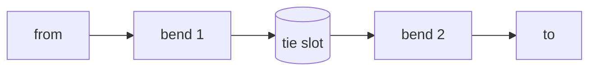

# Plan 744 — bend a connector, style a tie, drop a connector on a tie

Will, 2026-11-05. Four asks: (1) a picked zip tie has active styling and a drop shadow.
(2) Grab a connector and bend it: a mid-point handle, shown on hover; move it and each
half grows its own handle, and so on. (3) Click a handle to pick it; Delete removes it;
the only one left resets the connector. (4) Drag a connector LINE onto a tie to add it.

## 1. What a bent connector IS in the saved workflow

A route gets one optional list: BEND POINTS, in plane px, sorted by x.

```json
"routes": [ { "from": "a/rows", "to": "b", "via": [ {"x": 300, "y": 90}, {"x": 420, "y": 40} ] } ]
```

- No `via` = the default curve, drawn exactly as today. A route with `via: []` is not saved.
- Schemas: `defs.v1.json#/$defs/route` gets `via` (array of `{x,y}`, finite numbers, min 1).
  `innerRoute` gets the same, so a Custom Node body keeps its bends.
- v1 reads none: a v1 has no `via`; `readWorkflow` adds none.
- N4 ignores them (a bend changes no data). A Custom Node's version hash and diff read
  routes as `{from,to}` only, so a bend never makes a use stale (as a tie never does).
- Why on the route, not a list beside it (as `ties` is): a bend belongs to ONE route and
  moves with it; a tie owns many. Cut, reroute (a new `route`) and a node's removal drop the
  route, so its bends go with it. A rerouted or cut connector drops its bends.

## 2. Edits (pure, `editWorkflow`)

| Edit | Does |
|---|---|
| `{ bend: { route, at, x, y, insert? } }` | `insert`: a new point goes in at index `at`; else the point at `at` moves. The list is then sorted by x. |
| `{ unbend: { route, index } }` | Removes one point. The LAST one clears `via`. |

Faults, in words (the workflow is returned untouched, and `workflowFaults` reads each):
`the route "a" → "b" is not there`, `a bend point needs a finite x and y`, `the route has
no bend point at 2`. A `via` that is not sorted or not finite is a fault in the check.
`{ tieAdd: { id, route } }` (new) adds a route to a tie: refused in words when the tie is not
there, the route is not there, it is in the tie already, or `tieLimit` would leave no room
(`the tie "t" cannot take "a" → "b": its nodes leave it no place`).

Undo: each is a pure edit on the draft, so a drag is one journal step (tag `bend:<route>`),
as a tie drag is (TRAP T-an-edit-is-a-step).

## 3. The curve through the points

One list of waypoints per route: `from`, then its bend points and its ties' slots merged and
sorted by x, then `to`. Each segment is the SAME flat-tangent cubic the default uses
(`piece`), so no bend means exactly the old `d`, and a tied route is still one piece per
segment (2 for one tie). With bends, a segment's pull is `|dx| / 2` (the default's floor of
40px would overshoot on a short segment). Its midpoint is the plain middle of its two ends
(the cubic is symmetric), so the handle is exact. The curve stays a function of x: it never
loops back. A tie's slot is a fixed waypoint; `via` indexes the bends only. Which side of the
slot a bend sits on is its x, so a moved tie never needs the bends rewritten.



## 4. The handles (drawn from data, in the graph's svg)

- Each route is a `<g class="graph-route">` holding its path, its wide hit line and its
  handles. CSS shows the handles on `:hover` of the group, on a picked route, and on keyboard
  pick. A handle is a round dot (r 5) with a larger unseen hit circle.
- One MID handle per segment. Dragging it past 4px inserts a point there; the segment becomes
  two, each with its own mid handle. A handle never moved is never saved.
- A bend point is a handle too: drag moves it; click picks it (`data-selected`, accent fill and
  ring); Delete or Backspace removes it (`unbend`); the only point left clears `via` and the
  handle returns to the default middle. Escape deselects. It never starts a marquee, a node
  drag or a pan.
- Keys: with a connector picked, `B` picks its first bend point, or adds the middle one;
  arrows move the picked point 8px (Shift 32); Delete removes it.
- Query editor: a bend there is allowed, as a LAYOUT fact kept for the tab in the session, not
  in the Query (its routes are readings). Ties do not exist there, so (4) does not apply.

## 5. Ties: styling and the drop

- A picked tie: accent fill, a ring, and `filter: drop-shadow(...)` from the elevation tokens.
  Forced colours: `Highlight`.
- A press on a connector line, moved past 4px, is a drag: a ghost line follows, the tie under
  it takes `data-target`. Let go on a tie: `tieAdd` (one step). Let go elsewhere: nothing; the
  connector does not move. A press that does not move is a click and picks the route.
- Refused in words (a report, not silence): already in the tie; `tieLimit` leaves no place.

## 6. Tests

Node: curve with no points equals the default; each half yields a midpoint; unbend one of two
leaves one, the last clears `via`; schema valid and invalid; reroute and cut drop bends; a
body keeps them and the version hash ignores them; v1 reads none; `tieAdd` and its refusals.
Specs, three engines, real pointer: hover, drag, subdivide, pick (pixels), Delete, reset,
Undo, tie shadow (pixels), drop on a tie, drop on blank, a refused drop; the marquee and the
Tie tool still work. Demos: bends survive Save and reload.
