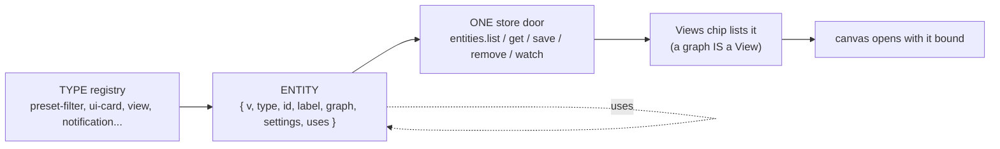
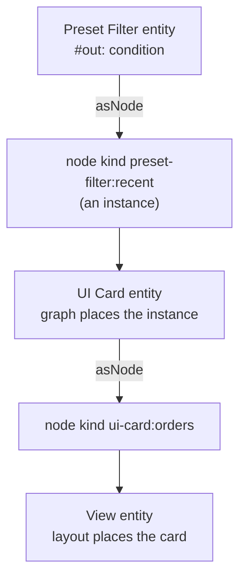
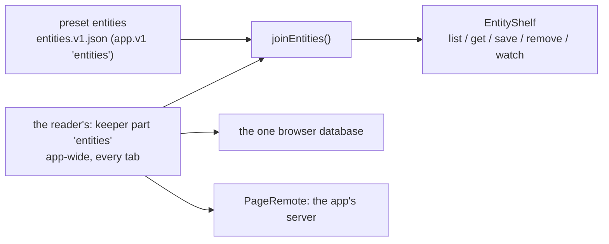
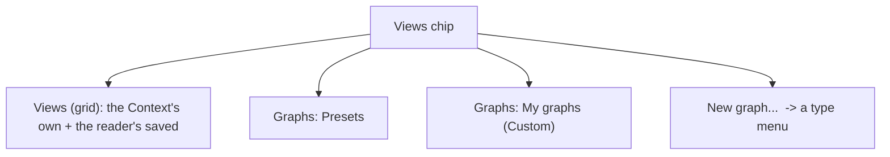
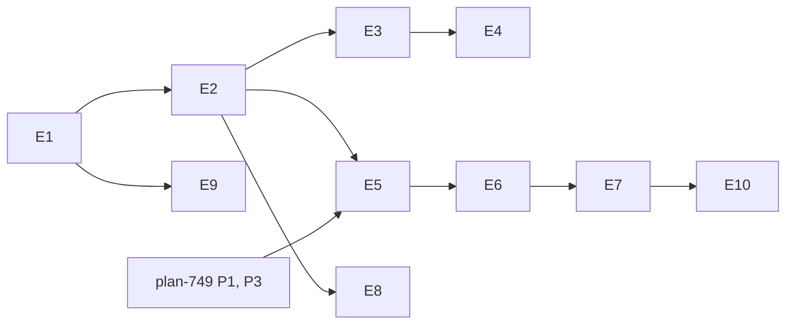

# Plan 746 + 751 — entities, and graphs as Views

Will, 2026-11-05: "We don't need the custom Save button in the App Header in the Node Editor. We can
repurpose the Save View button we already have to be 'Save' and 'Save Graph As'... repurpose the Views
chip in the app header filter toolbar to list all Preset and Custom Node Graphs. They are just views
with a canvas and node content instead of the typical layout-grid content." And the vision
([vision-entities](vision-entities.md)): node graphs build reusable, deterministic ENTITIES of a TYPE.
"Yes, let's plan it."

**Status: PLAN, 2026-11-05.** Nothing here is built until Will answers section 7. It builds on
[plan 713](plan-713-node-model.md) (M9 to M12, Custom Nodes) and [plan 749](plan-749-node-families.md)
(families, P1 to P6). Running a graph (N4, TODO 616) is held; the MCP (plan 700) is parked until nodes
are done.

## 0. The idea in one picture

A graph is a thing you SAVE under a name, LIST, OPEN and USE inside another. Sherpa already does this
five times, five ways. The plan makes it ONE way, and lets a graph be a View.



## 1. What exists

| Saved thing | Schema | Kept in | Edited by | Listed by | Referenced by |
|---|---|---|---|---|---|
| App | `app.v1` | `app.json`, a file | the author | the nav | contexts by name; `?context=` |
| Context's page definition | `page.v1` | a file named by the Context | the author | nav row | `definition` path; sources by name, `sherpa://`-style ids |
| Preset View | `defs.v1 #/view` in `views.v1` | a file named by the Context's `views` | the author | the View chip | `?view=<id>`; its `template` is `file.html#id` |
| Reader's saved View | the same `view`, with `content` markup | keeper `PageState.views`, every tab; database; `PageRemote` | the reader, Save View | the View chip | its id |
| Saved filter | `defs.v1 #/savedFilter` | page.v1 `savedFilters` (preset); `PageState.filters` (reader's) | author; reader | the Preset section of the filter bar | ticked by id; loads, never a chip |
| Workflow (a graph) | `workflow.v2` (`nodes`, `routes`) | Demos: a LocalStore row; shipped `workflows/*.json` | the Node Editor | nothing: the editor opens one fixed id | none |
| Custom Node | `defs.v1 #/nodeDefinition` in `nodes.v1` | preset: `nodes.v1.json` via app.v1 `nodes`; reader's: keeper `nodes`, a NAMED part, app-wide | the editor (Save as Custom Node) | the node panel (`NodeShelf`) | a node whose `kind` is the definition's id (an instance) |
| Settings page | `defs.v1 #/settingsPage` | app.v1 `settings.pages`; values by pointer in the app's settings | the reader, in a form | the avatar menu | `?settings=<name>` |

**What they share.** A JSON document with `v`; a `label`; an id that is its key in a map; a shipped
(preset, read only) copy and the reader's own beside it; a check function (`checkApp`,
`workflowFaults`, `checkNodeLibrary`); one keeper, tiered (`TIER_OF`: a NAMED part is every tab's,
the rest the tab's: `T-only-a-named-part-crosses-tabs`).

**Where they differ.** The envelope (a View has `label` and no `v`; a node definition has `v`; a map
file has `v` at the top); where the preset lives; whether the reader's copy has an API
(`NodeShelf` yes; saved Views and filters are page-bound, in the keeper, no list API of their own);
and a Workflow has no list at all. That is the gap: **one shape, one store door.**

## 2. The entity

### 2.1 The shape

```json
{ "$schema": "https://sherpa-ui.dev/schemas/entity.v1.json",
  "v": 1, "type": "preset-filter", "id": "active-customers", "label": "Active customers",
  "description": "Customers seen in the last 30 days",
  "graph": { "nodes": [], "routes": [] },
  "settings": { "source": "customers" },
  "uses": [{ "type": "preset-filter", "id": "recent", "as": "node" }],
  "origin": "preset" }
```

- `graph` is `workflow.v2`'s `nodes` and `routes`, unchanged, plus `#in` and `#out` as a Custom Node
  has. `workflowFaults` checks the graph; the type checks the rest.
- `settings` is per TYPE: its own schema, named by the registry.
- `uses` is a LIST the entity keeps of the entities its graph places (derived, kept for a quick
  dependency check and a safe delete; the nodes remain the truth).
- `origin` is `preset` (shipped, read only) or `mine` (the reader's). It is set on READ, never
  written: the same rule as `joinLibrary` marking `preset: true`.

### 2.2 The type registry

Like `NODE_KINDS`: a table in the data layer (`entity-types.ts`, DOM-free). A type declares:

| Field | Meaning |
|---|---|
| `id`, `label`, `icon` | the word the chip and the New menu show |
| `settings` | the `$ref` to its settings schema |
| `families` | which node families its graph may place (plan-749 categories); the panel filters by it |
| `inputs` / `outputs` | its SOCKETS: the `#in` and `#out` types (plan-713 socket types) it demands |
| `runs` | `false` = only DEFINED; `true` = needs the runner (N4) |
| `asNode` | the Custom Node it may offer (2.3) |

An APP extends the registry: `registerEntityType(def)`, fed from a file the app names in app.v1
(`entityTypes`). sherpa-ui ships generics only (`preset-filter` and the other four), never an app's.

### 2.3 How a Custom Node relates (my pick)

A Custom Node is **not a type; it is what any entity can OFFER**: its graph in a box. A type's
`asNode` says how: a Preset Filter's `#out` is a condition, so it offers a node with a condition
output; a UI Card offers a node with a presentation output. Placing it makes a node whose `kind` is
`<type>:<id>` (plain `<id>` stays for today's Custom Nodes: they are the type `node`, an entity whose
`#out` is any). So M9 to M12 stand as built: one more door, not a rewrite. An instance follows its
definition (D11), with the update flow of plan 713 (diff, Update instance, Update all).



### 2.4 How HTML templates and the data layer join

- A **View** entity's presentation stays what a View is today: a `template` (`file.html#id`) or
  `content` markup, laid out in a grid. Its `settings` hold the layout type and, per card, the column
  and row span; the cards are `uses`.
- A **UI Card**'s `settings` hold the presentation type (a component tag: `sherpa-data-grid`,
  `sherpa-chart-*`; checked by `check-usage`), and its **data source is by NAME**: the page
  definition's source id, the one `sherpa-provider` already answers through `bindSource`. The card
  asks; the provider answers; the entity never opens a store (PRINCIPLES: the join is the SOURCE).
- A **Preset Filter**'s `settings` name its source; its graph is the Query graph (`query-graph.ts`);
  its `#out` is the `condition` the data layer's `Query` already takes.
- Nothing in the entity touches DOM. The renderer is a component; the entity is data.

### 2.5 Types: now and later

| Type | Families it needs | Outputs | Runs? | Depends on |
|---|---|---|---|---|
| Preset Filter | Sources, Logic, Collections, Value (P1 to P5) | condition | defined | P1; P5 for full logic |
| UI Card | Sources, Value, a Present family (NEW) | presentation | defined | Preset Filter; a Present family |
| View | Layout family (NEW): place a card, set its span | layout | defined | UI Card |
| Notification | Value, Logic, Notify (P6) | delivery | defined; SEND runs | N4 to send |
| UI Pattern | Steps family (NEW) | an interaction trace | defined; runs in a test | View, Form |
| Form | Fields family (NEW), Logic | form schema and a submit | defined | UI Card |
| Workflow | all, Time, Action | an outcome | **runs** | N4 (P6) |
| Script | Action, Utils | outputs | **runs** | N4 |
| Scheduling | Time, Schedule | a trigger | **runs** | N4 |
| Policy | Sources, Logic, Time, Action | decisions, actions | **runs** | N4, Scheduling |
| Monitor | Sources, Logic, Schedule, Notify | an alert | **runs** | N4, Scheduling, Notification |
| Report | Sources, Collections, Present | a document | **runs** | N4, UI Card |
| Agent Harness | AI, Tool, Guardrail | deterministic output | **runs** | N4, plan 700 |

Every **runs** type waits on N4. The four NOW types are only DEFINED: draw, check, save, use. That is
why they come first.

## 3. CRUD and storage

One implementation for every type, the keeper's NAMED parts, as `nodes` is today.



**The door** (`EntityShelf`, a thin generalisation of M12's `NodeShelf`; DOM-free):

| Call | Does |
|---|---|
| `list(type?)` | every entity, presets first, `{ id, type, label, origin }` only: cheap |
| `get(type, id)` | the whole entity |
| `save(entity)` | check (`checkEntity`), write; refuse an id that clashes with a preset |
| `remove(type, id)` | the reader's only; refused while another entity `uses` it, with the names |
| `watch(handler, signal)` | on a change here, and from another tab |
| `duplicate`, `export`, `import` | `save` of a copy under a new id; the JSON text; a file checked, then `save` |

- **Create / edit / duplicate / delete** all pass through `save` and `remove`. Edit of a preset is
  "Copy to my entities" (D15 as built): the reader's copy takes a new id, the preset stays.
- **Where.** The reader's entities are ONE named part, app-wide, keyed `type/id`: cross-tab by the
  existing rule. `PageState` gains no new tier. The database holds it as it holds `nodes`; the app's
  server answers through `PageRemote`; the service worker caches the presets file with the app shell
  (offline reads work; offline saves wait in the database, then sync).
- **Per user later** (D13): the part's key gains a user id when accounts exist. The shelf's API does
  not change.
- **Today's `nodes` part** becomes the entities with `type: "node"`: a one-time read, no migration
  tool (Will: not fussed about versioning).

## 4. Graphs as Views (the immediate ask)

### 4.1 The four-words rule (PRINCIPLES 19)

A View is "a preset or user-saved view definition, picked from the header's View chip". A graph IS
that: **no fifth word.** It is a View whose body is a canvas, not a layout grid. The chip lists it
because the chip lists Views. "Graph" says what a View holds, as "layout" does. A Context's Views
become: grid Views (today) and graph Views. Section, Area and Context do not move.

### 4.2 What a View is in the data, and the smallest change

Today (`defs.v1 #/view`): `label` + `query` + `ui` + `template` or `content` + `settings`. The smallest
change: **one optional field**, `graph`, the id of an entity:

```json
"vw-active": { "label": "Active customers", "graph": { "type": "preset-filter", "id": "active-customers" } }
```

A View with `graph` has no `template`: the Context's outlet fills with the editor canvas, the entity
bound. The View's id is still the URL's: `?context=node-editor&view=active-customers`. Back, forward
and reload work as for any View (the Navigation API owns the URL).

No hand-written View per graph: the **provider derives** the graph Views from the entity shelf: each
entity of a type the Context lists becomes a chip row. The Context names which types it shows
(`definition`'s `views` gains `entityTypes: ["preset-filter", "workflow"]`); the app, not sherpa-ui,
decides.

### 4.3 The Views chip



- Groups: **Views**, **Presets** (shipped graphs, read only, an eye icon), **My graphs** (the
  reader's), each row with its type's icon and name. A View of the grid kind keeps today's rows.
- The chip lives in the filter toolbar. The Node Editor sets `chrome.filters: false` today, so it has
  no chip: that flag becomes `filters: "views"` (the chip only: no filters, no Query bar). **New in
  the chip: a New graph row** with the Context's types (Preset Filter, Workflow...), then the same
  dialog as Save As (4.4) asks for the name.
- Opening a graph View the reader edited and left unsaved keeps its draft in the TAB
  (`T-a-view-keeps-what-the-reader-left`: the `left` map). Switching away never loses it.

### 4.4 The header: Save and Save Graph As

The header already has **Save** and a menu (`.save`, then `value=save-as` "Save view as" and
`delete`), emitting `view-save`, `view-save-as`, `view-delete`. Demos' `#node-save` button and its
`data-view-actions` hack go: the header's own pair serves the Node Editor.

| Control | For a graph View | Enabled when |
|---|---|---|
| Save | `shelf.save(entity)`: writes the open entity | the draft differs from what is kept AND it is the reader's (a preset is read only: Save is off; its menu offers Save As) |
| Save graph as | opens the existing Save View dialog (`sherpa-dialog`): Name, Description, TYPE (preset to the open one; a pick when the graph is new), "Also save as a Custom Node" switch. Writes a new id | always (a copy) |
| Delete view | `shelf.remove`, refused with the dependents named | the reader's only |

The label changes with the View: the header's menu text is a `data-save-label` on the host ("Save
graph as" for a graph, "Save view as" for a grid): no new component, one attribute. The crumbs above
the title (742) stay: Context > the graph's TYPE > the graph's name; the title is the name.

## 5. Standards and interoperability

- **Schemas.** `schemas/entity.v1.json` (the envelope) and `schemas/entity-<type>.v1.json` (a type's
  `settings`), joined by `if/then` on `type`. The envelope `$ref`s `workflow.v2`'s graph. The type's
  settings schema comes from the registry, so an app's type brings its own file.
- **`checkEntity(entity, { kinds, shelf, types })`**: one Ajv run for the envelope, `workflowFaults`
  for the graph (with `families` from the type: a Notify in a Preset Filter is a fault), the type's
  settings schema, then the `uses` (each exists, no cycle: the runner's "a custom node that holds
  itself" check, here at save). One function; every writer uses it.
- **MCP (plan 700).** Parked until nodes are done. Then its check tier is a wrapper: the tool
  `check_entity` calls `checkEntity`; `entities_list` and `entity_get` read `EntityShelf`. Nothing here
  needs the MCP; nothing in it is built twice.
- **Export / import.** The file is the entity, with `$schema`. Import runs `checkEntity` first, reads
  `origin` as `mine`, and offers a new id on a clash.
- **Ids and names.** `id` is the existing `defs.v1 #/id`. A type is a kebab-case noun. Keys follow
  PRINCIPLES 15 (`data-*` for attributes) and 19 (the four words). Events: `entity-save`,
  `entity-remove` (noun-verb, PRINCIPLES 18).
- **Versions.** `v: 1` stays on every document; **no migration is built** (Will: "not too fussed about
  versioning"). A read of an unknown `v` is a named fault.
- **App-agnostic.** sherpa-ui ships the registry and the five generics. An app registers its own types
  from its own file. sherpa-ui never names a customer, a ticket or a policy.
- **Service workers and the server.** The worker caches shipped files only (presets). The reader's
  entities cross tabs in the keeper and the server through `PageRemote`; a shared type needs the
  accounts that do not exist yet (D6).

## 6. Phases

| Phase | Builds | Proves | Size | After |
|---|---|---|---|---|
| **E1** The envelope | `entity.v1.json`; `entity-types.ts` (registry + `preset-filter` and `node`); `checkEntity`; `isEntity` | node tests: a good entity passes; each fault is named; a cycle is refused; a family outside the type is a fault | M | none |
| **E2** The shelf | `EntityShelf` over the keeper part `entities`; `joinEntities`; app.v1 `entities`; `nodes` read as type `node`; `NodeShelf` becomes a view of it | unit: save, list, remove, refused-while-used; e2e: a saved entity shows in a second tab and after a reload | M | E1 |
| **E3** Graph View | `view.graph`; provider derives rows from the shelf; the chip's groups and New graph; outlet fills with the canvas; `chrome.filters: "views"` | e2e in 3 engines: chip lists Presets and mine; pick opens the canvas bound; URL, back, reload; draft kept on a switch | L | E2 |
| **E4** Header | `data-save-label`; Demos' `#node-save` removed; Save As dialog with Type; enabled rules; dependents on delete | e2e: Save off on a preset; Save As makes a View in the chip; delete refused with names | M | E3 |
| **E5** Use | `asNode`: a saved Preset Filter is a node in the panel, an instance; the D11 update flow for entities | node tests: a use flattens; edit, update, diff | M | E2; plan-749 P1 |
| **E6** Second type | UI Card (a Present family): data source by name; a card uses a Preset Filter | e2e: Card shows rows filtered by the used Preset Filter | L | E5, P3 |
| **E7** View entity | Layout family; a View entity places Cards | e2e: View of two cards, spans | L | E6 |
| **E8** Notification | settings only; defined, no send | a Notification saves, lists, uses | S | E2 |
| **E9** Interop | import / export; the MCP wrapper (after nodes) | round trip; `check_entity` | M | E1; MCP unparked |
| **E10** After N4 | Workflow, Script, Schedule, Policy, Monitor, Report, Agent Harness run | the runner's own | L | N4 (616), P6 |



**Lanes.** E1 is data layer only. After E2: E3 and E4 (components, provider, Demos) beside E5 (data
layer, node kinds) and E8: they share no file. I integrate, and own TODO, traps, baselines.
**Waits on N4:** everything under E10, and "Send" in Notification. **Waits on plan-749:** E5 needs P1
(the family registry, to declare `families`); E6 needs P3.

**The FIRST slice (E1 + E2 + E3 + E4 on ONE type, Preset Filter): the smallest end-to-end proof.**
Today's `active-customers.json` workflow becomes a `preset-filter` entity; it is listed in the Views
chip, opened in the canvas, edited, saved (Save) and copied (Save graph as); a second tab sees it.
Why this one: (1) it needs no new node family and no runner; (2) it is Will's immediate ask; (3) it
forces the envelope, the registry, the shelf, the chip and the header at once, so the model is proved
before a second type pays for it; (4) `use` (E5) then follows with the same shelf.

## 7. Decisions for Will

| # | Question | A (my pick) | B |
|---|---|---|---|
| D1 | What an entity is vs a Custom Node | **A Custom Node is what any entity OFFERS** (`asNode`); today's are the type `node` | A Custom Node is just an entity type, nothing else offers one |
| D2 | One schema or per type | **One envelope + a settings schema per type** | One schema per type, whole |
| D3 | Where the registry lives | **In the data layer; an app adds types from its own file** | In app.v1 only; no generics in sherpa-ui |
| D4 | The Views chip grouping | **Views / Presets / My graphs, then "New graph..."** | One flat list, an icon for the type |
| D5 | The Save As dialog | **The Save View dialog, plus Type and "Also as a Custom Node"** | A new dialog just for graphs |
| D6 | Per user | **Later: the key gains a user id; the API stays** | Now: a `user` field on every entity |
| D7 | Types first | **Preset Filter, then UI Card, View, Notification** | Notification first (smallest) |
| D8 | What a reference looks like | **A node of kind `<type>:<id>`, an instance that follows (D11), with `uses` kept** | A copy at place time, with a `uses` note |
| D9 | The chip in the Node Editor | **`chrome.filters: "views"`: the chip only** | The full filter toolbar, with the graph's own Query bar |
| D10 | The graph View's id | **The entity id, in `?view=`** | `?graph=<type>:<id>`, a new URL key |
