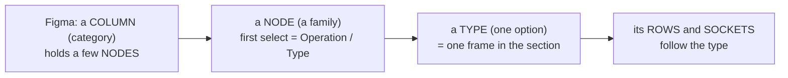
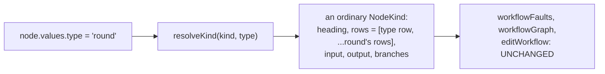
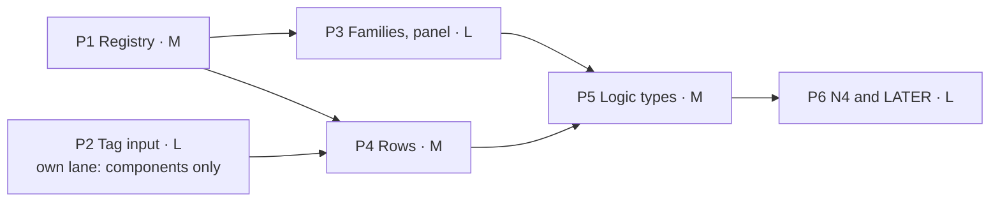

# Plan 749 — node families, and the tag input

Will, 2026-11-05 (TODO 749): read the node types and variants in Figma; see how he meant data types,
math, logical checks to work; one node per category whose FIRST select picks what it does; tag inputs
for comma-separated text. "Let's make a plan to improve what we have with ideas from the designs."

**Status: PLAN, 2026-11-05.** Nothing here is built until Will answers §7. It builds on
[plan 713](plan-713-node-model.md) (types, Condition, panel, Custom Nodes) and
[plan 740](plan-740-node-look.md) (the look). Run (`runWorkflow`, N4, TODO 616) is still held: every
phase below DRAWS, CHECKS and EDITS; what RUNS waits.

## 0. What I read, and what I could not

Read from Figma `ACP Module`, page "Node Graph Exploration", section `2872:32139` "Nodes", by script
(every frame's rows, labels, default values, hint lines, sockets) and by screenshot (the whole
section, Tag, Notify, Duration). Nothing was changed.

- **44 frames, 10 columns:** Sources 4, Groups 1, Variables 4, Math 10, Logic 8, Time 3,
  Collections 4, Utils 5, Output 2, AI 3. A frame is ONE node showing ONE option of its first select.
- **Components behind them:** `node` (20 `Template` variants: Number, Math, Compare, Group, Prompt,
  Source, Output, 3rd Party, Source Simple, Collection, Model, String, Tool, Listen, Date, Property,
  Await User, Expert, Permissions, Template20) and its parts `Property 1 = header | input | footer`;
  `input-socket` (`single | multiple | step-single | step-multiple`); `output-socket`
  (`default | true | false` x `Connected | Disconnected`); `socket` (Data Type `String | Numerical |
  Object` x Condition `Default | False | True`); `Input Field` (State `Default | Read only |
  Inactive | Validation`; Label, Actions, Fixed help, Dynamic help); `Chip` (`Outline | Solid`).
- **Could NOT read:** (1) a select's option LIST: Figma draws it closed, so a type's list here is
  the union of the frames I found; options with no frame (Not, Is empty, Contains...) are not in
  Figma. (2) **No `+N` overflow tag, no menu button, no multi-select menu exists in this file.**
  A tag input is an `Input Field` holding `Chip` instances (Outline, neutral, with an x): Tag >
  Value (1 tag), Notify > Recipients (1), Method (2). Will's overflow and menu ideas are his words
  only. (3) The 7 `Template` variants with no frame (Date, Permissions, Expert, 3rd Party, Await
  User, Tool, Prompt), the "Legacy Node Variants" and "Strata?" sections (named, not read in depth).
  (4) Each variant was read by script; I looked at only 4 as pictures.



The thing to see: **a column is a category; a node is a family; a frame is a type.** 44 frames are
about **16 nodes**. That is what keeps the floating panel light.

## 1. What Figma shows

Marks: **HAVE** (Sherpa has it: where), **PARTLY**, **NEW**, **LATER** (needs N4, the runner).
Sockets: header in/out, then rows. "True / False" = header True, footer False (D6). A Figma row
with a D socket takes a value in; a tall D takes many (D4).

### Sources, Groups, Variables

| Node > type | Rows | Sockets | Mark |
|---|---|---|---|
| Source > Unified agent, API, File, Model | none (Model: a "Large Language Model" field, Claude Opus 4.6) | out | **LATER** (an app's own kinds); `store` is the one HAVE |
| Check (Groups; the folder, opens with a button) > Category, Field | Category, Field (both picks) | out | HAVE: a Custom Node (M9, M10) |
| Number > Integer, Decimal | Type, Value (`0`, `0.00`) | out value | PARTLY: `value` has Type (text, number, date, boolean); Integer / Decimal is **NEW** |
| Text | Value ("Enter some text") | out value | HAVE: `value`, Text |
| Property | Category, Field | in header, out value | HAVE: `pick` (Field); Category is **NEW** (a pick that narrows Field) |

### Math (one node, 10 types: the first select is "Operation")

| Type | Hint line (as Figma) | Rows | Mark |
|---|---|---|---|
| Add | Add Value B to Value A | Value A, Value B | **NEW** |
| Subtract | Subtract Value B from Value A | A, B | **NEW** |
| Multiply | Multiply 2 values together | A, B | **NEW** |
| Divide | Divide Value A by Value B | A, B | **NEW** |
| Ratio | Decimal ratio between 0 and 1 | A, B | **NEW** |
| Round | Rounds a decimal to a set number of places | **Places**, A, B | **NEW** |
| Increment | (Figma's line is Round's copy) | **Places**, A, B | **NEW** |
| Floor | Lowest value from the range | A, B; header takes MANY (pill, tall) | **NEW** |
| Ceiling | Highest value from the range | the same | **NEW** |
| Average | Average value of the range | the same | **NEW** |

All: every row a value in; header out a value. Notes: Floor and Ceiling are worded as min and max
of a list, not rounding: ask before naming them. Floor, Ceiling and Average read a LIST: model as
one `Values` row (an object, `multiple`, D17), not A and B. Round shows B but needs only A.
Increment has no definition yet.

### Logic ("Compare": the Condition node, Will's words) and Time

| Type | Rows | Sockets | Mark |
|---|---|---|---|
| And ("true if all values are positive") | none; the Operation row takes MANY booleans | True / False | **NEW** (today: Condition's Join, All of, a row of a node) |
| Or | the same | True / False | **NEW** (Join, Any of) |
| Greater than, Greater than or equal, Less than, Less than or equal, Equals, Does not equal | Value A, Value B | True / False | PARTLY: operators `gt gte lt lte eq ne` in `OPS_FOR_TYPE`, but only as field-versus-value over ROWS; **A against B over two values is NEW** |
| Time > Between | Start, End (date and time, with a calendar) | True / False | PARTLY: `between` on a date (`OPS_FOR_TYPE.date`) |
| Time > Duration | Condition ("Within"), Value (7), Division ("Days") | True / False | PARTLY: `last` and `next` ("In the last", `{ n, unit }`, `DATE_OP_LABELS`) |
| Time > Schedule | Frequency (Weekly), On (Mon, Wed, Fri: a TAG row), At (HH:mm) | out | **LATER** (a trigger) |
| Listen > Frequency | Value (1), Division (Hour) | True / False | **LATER** (once an hour at most) |
| Listen > Status | Status (Complete) | True / False | **LATER** |

Figma says "Value B is greater than Value A" (B first). Sherpa says "field, operator, value".
Keep Sherpa's order in words ("A is greater than B"); a copy fix to tell Will.

Logic types **in Sherpa and not in Figma** (the data layer's `FilterOp`, `OP_LABELS`): Contains, Does
not contain, Starts with, Ends with, Is one of, Is not one of, Between, Not between, In the next.
And two checks Figma implies but does not draw: Not, Is empty (`truthy()`, D2). They join the
Logic family as types **after** the Figma eight (P5).

### Collections, Utils, Output, AI

| Node > type | Rows | Sockets | Mark |
|---|---|---|---|
| Collection > Property | Property (pick), Value, "+ Add property" | a Value per row in; out an object | **NEW**: Object (an object made of values). "+ Add property" = a `repeat` row (as Condition's parts) |
| Collection > Users, Groups, Roles | Type, Value (a search field, or a pick for Roles) | out | PARTLY: the app's stores through `store` (the Store row lists them); not a type of ours |
| (ours) Sort, Group by, Count | Field, Direction / Field / Count | rows in and out | HAVE: `sort`, `group`, `count` (category Collections) |
| Tag > Includes ("filters out objects that have the selected tags") | Value: a **tag input** | in header, out | **NEW** (a rows check by tags: `in` over a tags column) |
| Modify text > Append | Value A, Value B (text) | out | **NEW**; with Split by, Join, Prepend as ours (not in Figma) |
| Action | Module (Vulnerabilities), Action (Scan asset) | out | **LATER**: an app's kinds |
| Outcome > Return value | Type | in | HAVE: `output` |
| Outcome > Notify | Type (Critical), **Recipients** (tags), **Method** (tags: Email, SMS), Message | rows in, tall many | **LATER** (it acts); tag rows are the P2 test case |
| Ask N-zo > Preset, Custom | Type, Value, Response | out Response | **LATER**; style is built (plan 740) |
| Delegate | Agent (Big N-zo) | out | **LATER** |

**Data types** are handled by the SOCKET (value, object, boolean: M1) and by a Value node's Type
(Text, Number, Date, True/false: M6). Figma's three `socket` Data Types (String, Numerical, Object)
are the same idea, with no boolean (its True and False are separate output sockets). New: Integer,
Decimal, List (§4, a tag input giving a list: an object, D17).

## 2. The family node

**Rule: one `NODE_KINDS` entry per FAMILY. Its first row is the TYPE (Figma's "Operation" or
"Type"). The rest of the node is a function of (family, type).**



**The registry shape** (`node-kinds.ts`; it stays the one registry, T-one-node-registry):

```ts
interface NodeKind { /* today's, plus: */
  typeLabel?: string;                  // "Operation", "Type": the first row's label
  types?: Record<string, NodeType>;    // absent: a one-type kind, today's shape, no type row
  defaultType?: string;
}
interface NodeType {
  label: string; help?: string;        // the hint line under the select
  rows: readonly RowKind[];            // after the type row
  input?: SocketType; many?: true; output?: SocketType; branches?: true;
  graphs?: readonly NodeGraph[];       // 'rows' of Logic is in both graphs
}
```

- `resolveKind(kind, node.values?.type)` returns a plain `NodeKind`. Readers call it once per
  node, so **nothing else learns about types**. A kind with ONE type shows no type select (the
  Query's `condition` is `rows` only).
- The type row is a picklist read by `rowChoices` (control `'type'`, today's name for a Value's
  Type: it widens to "this kind's types"). It has an input like any picklist (a Value node
  overrides it, D7).
- **Rows follow the type.** Add: A, B. Round: Places, A, B. Between: Start, End. A row's input
  and output types, `many` and `multiple` are the TYPE's: Floor takes a list in; Compare ends in
  a boolean; Add ends in a value. Typed sockets (M1) need nothing new.

**How today's kinds fold in:**

| Today | Becomes | Why |
|---|---|---|
| `value` | **stays**: types Text, Integer, Decimal, Date, True/false, List | its Type row becomes the first row |
| `pick` | **stays** (one type) | Figma's Property is its own node |
| `condition` | **stays**: types `rows` (today's tree: Join, Field, Operator, Value, Group, Matches), then Equals ... Or | Logic = Condition. `rows` is the only type in the Query |
| `sort`, `group`, `count` | **one `collection`** kind: types Sort, Group by, Count, then Object | they are Collections already (category); three panel items become one |
| `store`, `output` | stay (one type now; Source types and Notify come later) | |
| Query-only: `status source scope preset saved arrange presentation component` | **stay**, no types | the Query editor is derived from a definition; it never had a family |
| NEW `math`, `time`, `text`, `tag` | families | |
| Custom Node (M9) | its **own family of one**: no `types`, its sockets come from its definition | `nodeKindOf` already makes a plain kind; `resolveKind` passes it through |

**What the file keeps.** The type is a row's value, so it lives where a row's value lives:
`node.values.type`. **No schema change; workflow stays v2** (`values` is free, `kind` is a string;
`schemas/workflow.v2.json` and the Custom Node body `nodes.v1.json` are untouched). `value`
already keeps `values.type` today.

**When the type changes (a reader picks another):**

- The node's **rows are redrawn** from the new type. A value of a row the new type lacks (Places,
  once Add is picked) is **kept in `values`, drawn nowhere** and comes back when the old type
  does ("off is not gone"). One journal step: Undo restores type and rows.
- A **route into a row that is gone** is **kept and drawn greyed to the node's header**, with a
  named fault in words: "Round's Places was routed from Value; Add has no Places". The reader
  cuts it (cut is one click; Delete works). Never silently dropped, never silently kept live.
- The header's input and output types change with the type, so a route that no longer joins
  (`accepts`) is the same kind of fault: it is kept and named, not cut.
- A **Custom Node use** that holds a family node inside is checked by `workflowFaultsDeep` through
  the same resolver.

**The panel** lists FAMILIES, one item each, in Figma's categories (`paletteOf` is unchanged: the
category is the family's). **Today 8 workflow items** (Store, Value, Pick, Condition, Sort, Group,
Count, Output). **After P3: 10** (Store, Value, Pick, Math, Condition, Time, Collection, Text,
Tag, Output), **16 when the LATER ones come** (Listen, Action, Notify as an Output type, AI x2,
more Sources). "Add a node" (D16) lists families that FIT the socket; each item's description
names its types ("Add, Subtract, Round..."); the search matches a TYPE name too ("round" finds
Math), and placing it from a type match sets that type.

**Conversion, as M3 did v1 to v2.** `readWorkflow` reads a saved `sort`, `group` or `count` once as
`collection` with `values.type` set; a Value's `number` reads as `decimal`; a v2 stays v2. The old
names are gone from `NODE_KINDS` in the same change (no aliases: T-a-rename-drops-the-old-name);
the one read-once function is the only place that knows them. Demos' `active-customers.json` and the
test graphs are rewritten once (D8's rule: no old kind left). A node test reads every old file and
asserts the same faults and the same drawing.

## 3. Names

| Word | Where it shows | Recommendation |
|---|---|---|
| **Collections** | the panel's category and the `collection` family's heading | Use it as Figma does. It is already a category. It names a family of nodes that work on a set of rows or an object |
| **Field** | the row label ("Field"), the data layer, the grid, filters, `source.fields` | **Keep.** Renaming a data-layer word is a bulk rename across 30+ files for a word the Query editor, the grid and the filters all use. A Collection node's row that picks one says "Field" (Figma says "Property": ours for Object) |
| **Logic** | the panel's category | Keep (already so) |
| **Condition** | the kind id `condition`; the node's heading; the Query graph's node | Keep. A Condition's first select names the check: "Rows that hold", "Equals", "And" |
| Operation / Type | the first select's label | The kind says it (`typeLabel`): Math, Logic, Time say "Operation"; Value, Collection say "Type" |

PRINCIPLES 19 has four words (Section, Area, Context, View). None is "Collection" or "Logic": no
fifth meaning is added, so long as **Collection never means a store or a nav row**. If Will wants
"Collections" for fields everywhere, that is a lexicon move (`LEXICON.md`), its own TODO, not this plan.

## 4. The tag input

**What Will described:** a text field whose comma-separated entries become tags with a simple
add / remove UI; when they do not fit the last tag shows "+2"; then maybe it is a select with a menu
button and a multi-select menu of the entered values.

**Answer to "maybe it is all along?": yes, one behaviour.** The field is ALWAYS a text field with
tags AND a menu button at its end (the chevron an Input Field select already draws). Overflow only
adds the "+N" tag in front of the button. The menu is the same either way: no mode change under the
reader's hands, no layout jump, and a pointer-free path (rule 21: the button is a tab stop).

```text
  fits:      [ Email x ][ SMS x ] typing here...                      v
  overflows: [ Email x ][ SMS x ][ Push x ][ +2 ] typing...           v   (the +2 and v open the SAME menu)
  the menu:  [ search or add a value ]      (Enter adds what is typed)
             [x] Email  [x] SMS  [x] Push  [x] Slack  [x] Teams       (untick = remove)
             Clear all
```

**Where it lives: `data-type="tags"` on `sherpa-input-text`**, its job in a module beside it
(`input-tags.ts`), as the quick filter's jobs are. Reasons: PRINCIPLES 15 makes `data-type` the
component's Figma Type axis and the Figma tag field IS an Input Field with chips (label, help,
states Default / Read only / Inactive / Validation, clear, disabled, locked all come with it: no
second copy of the chrome). It COMPOSES, never re-implements: each tag is `sherpa-chip
data-dismissible` (`chip-dismiss`), the menu is `sherpa-menu data-select="multiple" data-search`
(the quick filter's menu: ticks, Select all, search), the button is `sherpa-button`. If the module
makes `check:weight` grow `sherpa-input-text`'s import (it will for every plain text field), load it
on first use of `data-type="tags"`, or take the alternative, a thin `sherpa-input-tags` host (D2).

| API | |
|---|---|
| `value` (attribute) | the comma-separated string: the HTML-native form, `"a, b, c"` |
| `.tags` (property) | the array: `string[]`. An array is an object (D17), so a node row sends an OBJECT |
| `data-unique` (default on), `data-max` | no duplicates (case-insensitive); the most tags |
| `.suggestions` (property) | `{ value, label }[]`: the menu offers them too; with `data-closed` ONLY these are accepted (a closed list: Method = Email, SMS; Schedule's On = Mon...Sun) |
| event `tags-change` | `{ tags: string[], added?, removed? }`: noun-verb (rule 18); a typed `change` is NOT sent. A locked field (`data-locked`) still emits (rule 21) |
| `data-label`, `data-description`, `data-state`, `data-clearable`... | input-text's own |

**Behaviour.** Enter or comma commits the text as a tag (trim, drop empty, drop duplicate). Blur
commits what is typed (no loss). Paste splits on commas and new lines. Backspace on an empty field
removes the last tag and says so. Each tag's x removes it. In the menu, tick and untick keep or
remove; typing in the menu's search filters, Enter adds a value that is not listed ("Add 'x'").

**Overflow, CSS first.** The tags sit in one `flex-wrap: wrap` row with a one-row height and
`overflow: hidden`, in a grid `[tags area | +N | text | button]`: a tag that does not fit wraps to a
second, clipped row, so it is never cut in half. The `container-type: inline-size` host decides the
width, no viewport `@media` (rule 5). JS does ONE thing: a `ResizeObserver` (`this.onFrame`) counts
the tags whose `offsetTop` is on a later row, sets `data-overflow="2"` on the host, and sets `inert`
on those tags. CSS shows the "+N" (`content: "+" attr(data-overflow)`) only under
`:host([data-overflow])`. That is the smallest JS that can exist: CSS cannot count.

**a11y.** The field is a `role="group"` labelled by its label; each tag a button (the chip), arrows
move focus between tags (roving tabindex), Delete or Backspace on a focused tag removes it and moves
focus to its neighbour; "+N" is a button `aria-haspopup="menu"` `aria-expanded`, named "Show 2 more
values"; one polite live region says "Added Email. 3 values" or "Removed SMS"; clipped tags are
`inert` so they are not tab stops; forced colours keep the chip border. a11y gate at or under baseline.

**Obligations.** `.component.json` regenerated (`spec:check`: `data-type` gains `tags`); `.example.json`
with a plain, a prefilled, an overflowing and a closed example; `npm run manifest` and `reference`;
`static props` for each new `data-*` (rule 9); a TRAP for "the overflow count is JS because CSS cannot
count"; the header `Map:`; Figma: Will draws it (the `+N` and the menu are not in Figma yet); the
Figma `Input Field` gains a `tags` Type there, not here.

**Where the node editor uses it** (rows that take several words):

| Row | Today | With the tag input |
|---|---|---|
| Logic > Is one of, Is not one of (values not known) | text | tags (free); a picklist's ticks where the values ARE known (`valuesFor`) |
| Logic > Contains any of (NEW type) | none | tags |
| Tag > Includes > Value | none | tags, closed to the store's tags where known |
| Value > List (NEW type) | none | tags: the output is a list (an object) |
| Text > Split by (NEW) | none | a single text; its OUTPUT is the list a Value > List or "Is one of" reads |
| Source > Search fields (Query) | `multiple` field list (ticks) | the same list drawn as tags (read only in the Query) |
| Notify > Recipients, Method; Schedule > On | none | tags, closed (LATER) |

**Elsewhere:** not now. The filter toolbar's value menus already tick KNOWN values (`OP_TAKES`
`list`); a free comma list there needs a new `FilterOp` ("contains any of"), which this plan does
not ask for. The grid and quick filter stay as they are.

## 5. The rest of the designs

| Figma does | Sherpa | |
|---|---|---|
| A hint line under the type select, one per type (Figma's "Add Value B to Value A") | none: a kind has one description | **NEW**: `NodeType.help` under the type row; also the panel item's text |
| A tall many-input on a row (And, Or, Notify's lists) and on the header (Floor, Average) | `many` (D4); the double-height D (plan 740) | HAVE |
| Header True and footer False on every Logic, Time, Listen frame | `branches` (M1, M2) | HAVE |
| Input Field states: Read only, Inactive, **Validation** | read only while routed (D7); faults are listed in the inspector | PARTLY: draw a row's own fault in its row (red, in words) |
| A row that takes a date and time, with a calendar (Between: DD-MMM-YYYY, HH:mm) | `typedValue`; the filter menu's date picker | **NEW**: a `datetime` row control (Temporal, dates in plain words) |
| "+ Add property" under Collection | a Condition's `repeat` parts, "+ Condition" in the footer | **NEW**: the same mechanism for Object |
| A search field row (Users: "Search user names") | `sherpa-menu data-search` | HAVE (the picklist's menu) |
| An approval badge on 231 nodes, run-progress markers (28), Await User | N2's `traceStep` lights; no badge | LATER (N4, plan 671) |
| Template variants with no frame (Date, Permissions, Expert, Tool, Prompt, 3rd Party) | none | SKIP until Will draws them |
| Section column labels ("Math", "Logic") | `NODE_CATEGORIES` | HAVE (plan 740: no label on a node) |
| Sources and AI colours, corner shapes | plan 740 | HAVE (built) |

## 6. Phases

| Phase | Builds | Proves | Size | After |
|---|---|---|---|---|
| **P1** Family registry | `NodeKind.types`, `typeLabel`, `NodeType`, `resolveKind`; the type row (control `type` widened) first; `help`; the vanished-row rules (kept value, kept route, named fault); `rowChoices` for a kind's types; `value` and `condition` made family kinds as the proof (no new family) | node tests: each type draws its rows; Round then Add keeps Places; a route into a gone row is a fault and survives a round trip; a one-type kind shows no select; `accepts` follows the type; the Query's `condition` unchanged | M | none |
| **P2** Tag input | `data-type="tags"`, `input-tags.ts`, the overflow, the menu, spec, example, docs, a11y | specs in 3 engines by real keys: Enter, comma, paste, Backspace, arrows, overflow at three widths (`data-overflow` counts), menu tick, `tags-change`; pixel read of the +N; a11y gate; `check:weight` | L | none (own lane) |
| **P3** Families and the panel | `collection` (Sort, Group by, Count), `value` types (Integer, Decimal, List), `time` (Between, Duration), `math`, `text`; panel items per family; read-once conversion; Demos' graphs rewritten | node tests: every old file reads with the same drawing and faults; `paletteOf` lists 10 items in order; search "round" finds Math; Demos Node Editor draws as before | L | P1 |
| **P4** Rows | `tags` row control (P2), `datetime`, `unit`, `Places`; the row's own fault drawn | Demos: Is one of takes tags; a Value > List into it overrides (D7); a closed list refuses a stranger | M | P1, P2 |
| **P5** Logic and the Compare types | Equals ... Or, Not, Is empty, then the Sherpa operators as types; the two-value Compare; Tag > Includes | node tests: And of two booleans draws True and False; Compare A against B is a boolean out; a Query's `condition` reads back the same tree | M | P3 |
| **P6** After N4 | run every type; Schedule, Listen, Notify, Action, AI, API/File/Model sources | the runner's own | L | N4 (616) |



**Lanes.** P1 (data layer: `node-kinds.ts`, `workflow.ts`, `query-graph.ts`, `node-graph.ts`) and P2
(components: `sherpa-input-text`) share no file: build them at the same time, each in its own
worktree pair. P3 and P4 follow in different files (the data kinds against the rows), then P5. I
integrate, own TODO, traps and baselines.

## 7. Decisions for Will

| # | Question | A (my pick) | B |
|---|---|---|---|
| D1 | A node | **One family node**, first select = the type (the Figma way) | One node per type, as now: the panel grows past 40 |
| D2 | Tag input's home | **`data-type="tags"` on `sherpa-input-text`**: one chrome, composes chip and menu | A new `sherpa-input-tags`, if weight says so |
| D3 | A row the new type lacks | **Keep its value; keep a routed line, greyed, with a named fault** (off is not gone) | Cut the routes on the change (Undo brings them back) |
| D4 | Panel items | **One per family: 10 now, 16 later** | One per Figma column: 8; the type select also picks the family |
| D5 | Schema | **Stay workflow v2**: the type is `values.type`; old kinds read once | A v3 with a top-level `type` on a node |
| D6 | Names | **Collections** for the family; **Field** stays for the data layer's word | Rename Field to Collection everywhere (a lexicon move, its own TODO) |
| D7 | Families first | **Value types, Math, Logic (Compare, And, Or), Collection fold**: P1 to P5 | Time and Text first; Math later |
| D8 | The overflow behaviour | **Menu button always there; "+N" only on overflow** | The button only when "+N" shows |
| D9 | Floor, Ceiling, Average | **Take a LIST in** (one `Values` row), A and B go | Keep A and B as Figma draws them |
