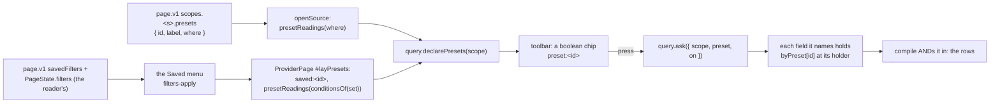
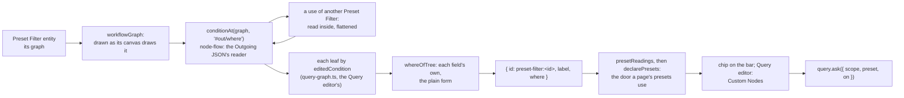

# Plan 776 — Preset Filters in the data

Will, 2026-11-05 (TODO 776): "Preset filters will be custom nodes when we are specifically creating or
working with filter type graphs. Let's keep them but also make sure they work in the new architecture
for nodes & data."

**Status: PLAN, then BUILT in the lane with the picks in section 3.** Will may change a pick; section 6
has the two he should look at. It builds on [plan 746](plan-746-entities-and-graph-views.md) (entities,
E5: a use is an instance) and [plan 749](plan-749-node-families.md) (Logic is the Condition family).

## 1. Audit: how a preset reaches the data today

- **A page's own preset** (`scopes.<s>.presets`, TODO 493): `{ id, label, where }`, the plain form.
  `openSource` types it (`presetReadings`) and declares it on its scope. Its chip leads the scope's bar.
- **A saved filter** (page.v1 `savedFilters`, the reader's `PageState.filters`, TODO 605): every scope's
  filters under one name. It is listed in the Saved menu; "applied", it is a preset `saved:<id>` on a
  bar, its conditions flattened to ONE plain form (`conditionsOf`).
- **The toggle** is `query.ask({ scope, preset, on })`, the Query's one door: on, each field it names
  holds `byPreset[id]` at the scope that holds the field, ANDed with the reader's own answer.
- **The Query editor** draws each declared preset as a node (`preset` or `saved`), and each condition it
  writes, read only. Its On row asks the same request. Its panel lists Logic, Presets, Saved filters and
  Status; placing a Preset switches on the next one that is off.
- **A Preset Filter entity** (Demos: "Active customers", Store › Condition › Where) is on the shelf,
  drawn on its own canvas, and offered as a Custom Node in every workflow's panel. **Nothing reads it as a
  condition.** No page lists it, no Query declares it, and the Query editor does not offer it.

### Gaps

| # | Gap |
|---|---|
| G1 | No code compiles a Preset Filter's graph. It never reaches a Query. |
| G2 | Its source is only `settings.source`. "New graph…" makes one with no settings, so no page could list it. |
| G3 | The Outgoing JSON (`nodeFlow`) reads a Condition's own rows and its nested groups. Logic And and Or say nothing; a use says nothing. |
| G4 | A use of a Preset Filter cannot join an outer Condition: a Group row takes only the True of a Condition. (780, since: a Group row takes any boolean; a use's True still said nothing of its tree.) |
| G5 | The outlet tells the keeper the app's entities AFTER `provider.open`: the first page sees none. |
| G6 | The Query editor's panel has no Custom Nodes. |
| G7 | A preset holds each FIELD's own condition. "Any" across two fields has no preset form. |
| G8 | How an edited leaf is typed (`editedCondition`) is the Query editor's (query-graph.ts). A compile that typed it again would drift from it. |

## 2. The one path

ONE reader of a graph as a condition (`conditionAt`, node-flow.ts): the Outgoing JSON shows what it reads,
and the data takes what it reads. ONE leaf reader (`editedCondition`, query-graph.ts): the Query editor
types an edited row by it, and the compile types a graph's rows by it. The compile (`preset-filter.ts`) is
loaded only where a page's store has a Preset Filter. ONE door for a preset
(`presetReadings`, then `declarePresets`): a page's own presets, the saved filters and the Preset Filters
go through it. No second compiler.

## 3. Decisions (the lane's picks)

| # | Question | Pick (A) | B |
|---|---|---|---|
| D1 | What a Preset Filter compiles to | **The plain form (`Where`), each field's own: the shape a page's preset already has** | A new `condition` key on the preset, a whole tree |
| D2 | Its id in the Query | **Its use's kind, `preset-filter:<id>`: the chip `preset:preset-filter:<id>`, the Query editor's node and its panel item say the same id** | A new id scheme, `entity:<id>` |
| D3 | Which bar its chip leads | **The one scope that holds every field it names; else the View** (as a saved filter's chip goes) | Always the View |
| D4 | Which a page lists | **Those whose source is the page's store: `settings.source`, else the store its graph's Store names (G2). The app's, read only, then the reader's** | `settings.source` only |
| D5 | How one composes inside another | **Its use's True goes into a Condition's Group row, as a nested group does; or into Logic And or Or. The compile reads it inside and flattens it (G3, G4)** | Only And and Or |
| D6 | "Any" across two fields (G7) | **Said in words, once, and left off the bar: a preset holds each field's own** | A whole-row tree in the Query (a new reading kind: large) |
| D7 | page.v1 `savedFilters`, the reader's saved filters | **Kept as they are: every scope's filters under a name, the reader's data. They are not entities. Both go through the one preset door already** | Read once into Preset Filter entities, one per scope |
| D8 | page.v1 `scopes.<s>.presets` | **Kept: a page that ships no entities still has presets. Same door** | Moved into entities.json; page.v1 `presets` deleted |
| D9 | The Query editor | **Its panel lists the page's Preset Filters under Custom Nodes; a click asks `{ scope, preset, on: true }`. Each is drawn as a Preset node with its own name; its conditions are read only, "its own graph changes it"** | A Custom Node use drawn inside the Query graph |
| D10 | A Preset Filter changed in another tab | **The provider hears the shelf, and the bars are drawn again** | Only at the next open |
| D11 | A Preset Filter that says no condition | **Reported once per open, in the reader's words, and left off. Save still keeps it: the draft keeps, Save writes final** | Refused at Save |
| D12 | A constant in its graph (780: a Group row takes any boolean) | **It folds as `nodeFlow` folds it; a condition a constant decides, always or never, or a boolean only a run gives, has no preset form: said, and left off** | "Always" as a preset that filters nothing |

## 4. Deleted, so there is no second path

- node-flow.ts's own `whereOf` and `tagWhere`: `conditionAt` is the one reader, and `nodeFlow` shows what
  it reads.
- The outlet's late hand-over of the entities: the keeper has them before the page opens (G5).

## 5. Tests

- node: an entity's graph compiles to the readings the Query editor reads back for the same condition
  (`graphRequest` on its drawn node); a nested Preset Filter flattens (Group row, and And); "Any" across
  two fields is a fault in words; a page lists only its store's Preset Filters, the app's then the
  reader's; a toggle on and off through `query.ask` gives the same rows as the Status chip's Active.
- sherpa-ui e2e: the toolbar lists the page store's Preset Filters; a press asks the Query once; the
  Query editor's panel lists them under Custom Nodes, and a click asks `{ scope, preset, on }`.
- Demos e2e: the Records bar has "Active customers"; on, `debugState().total` is the Status chip's
  Active total; a Preset Filter placed in another filter graph shows the joined condition in its
  Outgoing JSON.
- Each is proved by a planted fault.

## 6. For Will

1. **D8: a page's own presets.** A (pick, later lane): move Records' three into entities.json and delete
   page.v1 `scopes.<s>.presets`, so a preset is ONE thing, a Preset Filter. B: keep both doors.
2. **D7: saved filters.** A (pick): keep them as saved filters, the reader's data, beside the Preset
   Filters. B: "Save filters" writes a Preset Filter entity (one scope's filters as Condition nodes),
   and a saved filter is read once into one.
