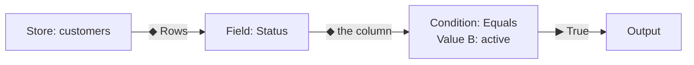
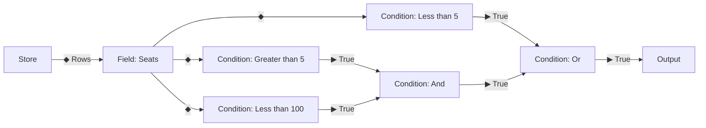
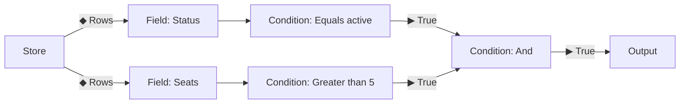
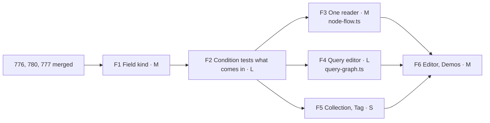

# Plan 783 — Field is a standalone node

**Status: PLAN, 2026-11-05.** Nothing here is built until Will answers §5. It builds on
[plan 713](plan-713-node-model.md) (sockets, True and False, the Condition), [plan 749](plan-749-node-families.md)
(families: Logic is the Condition family) and [plan 746](plan-746-entities-and-graph-views.md) (entities: a
Preset Filter's graph is a Query graph). The build waits for 776 and 780 (TODO 783). Run (N4, TODO 616) is
still held: every phase below DRAWS, CHECKS and EDITS.

## 1. What Will asked

Will, 2026-11-05 (TODO 783):

> "I think that 'Field' is common enough to be a standalone node rather than part of 'Condition' nodes. The
> Graph chain would, at it's simplest, would then be Source>Field>Condition>Output. This will also allow
> users to route the same field to several conditions or branches of the graph."

## 2. Today

Measured 2026-11-05 on the lane's tip (`c898d6fa`), in Node, against `dist/`.

### 2.1 Where "Field" lives now

| Where | The row | What it does |
|---|---|---|
| Condition › Rows that hold | `field`, `field-2`, … (one per part: `repeat`) | picks the field one part tests. It also SENDS the field's name, a value |
| Collection › Sort, Group by | `FIELD` (control `field`, a value in) | the field to sort or group by |
| Tag › Includes | `FIELD` | the field that holds the tags |
| Pick (Variables) | Field (a value in, a value out) | "One field of the input" (`readField`). Header: any in, `needs: 'object'`; True and False |
| Query only: Arrange (Sort, Group), Presentation (Primary, Secondary, Group) | field picklists | the reader's settings for the rows. Not a flow. Not in this plan |

Two facts measured:

- **Pick sends the field's NAME today.** Pick › Field routed into Equals › Value A brings `"status"`, the name,
  not a value of a row (713 §3: "a Field row sends the field name"). The real value waits for N4.
- **Pick is in no Demos graph.** It is in about 9 unit tests and 2 e2e specs of sherpa-ui.

### 2.2 How the Query graph draws a reading's tree

A scope holds one READING per field. A reading is one condition tree over that one field
(`T-one-condition-tree`). `queryGraph` draws each reading as **one Condition node per group** of its tree.
Each part draws its own Field row, and every one of them says the reading's own field.

A test page with four readings (Health, Seats, Open tickets, Status), Seats being `A or (B and C)`:

| Node | Rows |
|---|---|
| `when-view-health` | Field health, Operator eq, Value At risk |
| `when-view-seats` | Join or, Field seats, Operator lt, Value 5, Group-2 "All of 2 conditions" |
| `when-view-seats.2` | Join and, Field seats, Operator gt, Value 5, Field-2 seats, Operator-2 lt, Value-2 100 |
| `when-data-openTickets` | Field openTickets, Operator gt, Value 2 |
| `when-data-status` | Field status, Operator ne, Value churned |

So: **4 readings, 5 Condition nodes, 6 Field rows, each one a copy of its reading's field.** A nested group's
True goes into its parent's Group row. The root's True goes into the scope's row for the field.

- An edit is one `ask` (`graphRequest`, `T-one-command-one-door`). The node's `ref` keeps the whole tree and
  its path; the edit changes the tree at that path and asks it as one reading.
- An edit of a Field row MOVES the whole reading to the other field: `[{ field, reading: null }, { field: to, reading }]`.
- The root's id, `when-<scope>-<field>`, is the one a load's trace lights (`T-a-step-names-its-node`).

### 2.3 How a graph becomes a condition today

`nodeFlow` reads a Condition node as a tree (`whereOf`): its Join, its parts, and a nested Condition through
its Group row. 780 (built in its lane) lets the Group row take any boolean: a constant folds into its group.
776 (planned in its lane) replaces `whereOf` with ONE reader, `conditionAt(graph, '#out/where')`, which the
Outgoing JSON and the Preset Filter compile both use.

## 3. The new chain



**One Field into several Conditions**, joined by And and Or. This is `A or (B and C)` on Seats:



**Two fields into one And:**



The two nodes, as this plan draws them (D1 to D4 at their picks):

```text
      any ■ ┌──────────────────────────────┐ ▶ True      the rows that come in have the field
            │  Field                       │
            ├──────────────────────────────┤
          ● │  Field  [ Seats          ▾ ] │ ◆           the column: the rows, with Seats named
            ├──────────────────────────────┤
            │                              │ ▶ False     they do not have it
            └──────────────────────────────┘

      any ■ ┌──────────────────────────────┐ ▶ True      what holds
            │  Condition                   │
            ├──────────────────────────────┤
            │  Operation [ Greater than ▾ ]│
            │  Rows                        │ ◆           the rows that hold, for a Sort, a Count, a Field
          ● │  Value B   [ 5             ] │
            ├──────────────────────────────┤
            │                              │ ▶ False     the rest
            └──────────────────────────────┘
```

## 4. Decisions

Each has two options at most. A is my pick.

### D1. Pick becomes Field, or a new Field beside Pick

- **A (pick): Pick becomes Field.** One node, heading "Field", kind id `field`, in Variables. `pick` is deleted
  in the same change (no alias, `T-a-rename-drops-the-old-name`).
- B: a new Field kind beside Pick. Field sends a column; Pick keeps "one field of one record".
- **Why A.** Two nodes that both pick a field would confuse a reader. Figma's Property node (Variables: one
  field, in on the header, out a value) is this same node. One rule covers both jobs: **rows in, a column
  out; one record in, that field's value out** (D2).

### D2. What a Field sends

- **A (pick): the column, `{ rows, field }`.** Its Field row sends it. The socket is an object (◆). A finer
  "given" says it is a field, as `rows` and `list` do today (`Given = 'field'`), and carries the field's name
  and type. Where one record comes in (an object that is not rows), the row sends that one value instead.
  Its header's True and False say whether the field is there (D2 of plan 713).
- B: a new socket type, `field`, with its own shape and colour.
- **Why A.** A new socket type is M2-sized work: a fifth shape, a colour pin, forced colours, Figma, every tip.
  A finer given needs none of it, and the warnings already speak it. The column's VALUES alone were ruled out:
  they lose the rows and the field's name, and the Query and the compile both need the name.
- **What fits a column** (one table in `readInput`): a need for a field, rows, an object or a list; a list of
  numbers where the field is a number; a date where the field is a date. A need for ONE value (Math › Add's
  Value A) reads null and warns, unless one record came in.

### D3. Where a Condition reads the Field

- **A (pick): on its header.** The header is what is tested. A comparison's Value A row goes. Its other rows
  stay: Value B, or Values, or Start and End (`OP_TAKES`).
- B: on Value A, as Figma draws the compare node (Value A, Value B).
- **Why A.** Not, Is empty, Time, Tag and Collection already take what they test on the header (D1 of plan
  713: the header is the data input). A then makes one rule for all of them. A value test still works: a
  Value node goes into the header.

### D4. The Condition without Field rows

- **A (pick): one test per Condition, and And and Or join tests.** The Condition's first select is the
  operator: Equals, Greater than, Is one of, and the rest. "Rows that hold" is deleted, with its Join, Field,
  Operator, Value and Group rows (`conditionRows`, `partsOf`, `repeat`, `PartKind`). A many-part tree is
  And and Or nodes. 780's rule moves to And and Or: they take any boolean; a Condition's True brings its
  tree; true, false, 0 and 1 fold; anything else reads null and warns. Every Logic type leads with a Rows
  row: the rows it lets through, for a node that needs rows. It sends nothing when no rows came in.
- B: keep "Rows that hold" as ONE field's group: Join, then per part an Operator and a Value, no Field row.
  The Field goes into its header. A nested group keeps the Group row (780 as built). And and Or join
  different fields.
- **Why A.** B has two ways to say "and": a Join row, and an And node. A has one. A also IS Will's chain,
  and "route the same field to several conditions" is how every tree is made.
- **The cost of A.** `A or (B and C)` is 2 nodes today. With A it is 6: 1 Field, 3 Conditions, 1 And, 1 Or.
  With B it is 3: 1 Field and the 2 group nodes.

### D5. Collection and Tag

- **A (pick): Sort, Group by and Tag › Includes take a Field on their header, and lose their own Field
  row.** Count takes rows or a Field (it counts the rows). Rows with no Field into a Sort read null and warn:
  "Sort takes a field; it was given rows: route a Field in".
- B: they keep their own Field row. The Field node is only for Conditions.
- **Why A.** One rule everywhere: a node that works on one field takes a Field. Then a Tag's closed list,
  a Sort's field and a Condition's operators are all read from the same place: the Field that comes in
  (one helper, `fieldReaching`, in place of today's `fieldOf`). Math's Floor, Ceiling and Average take a
  Field as their list too, with no change.

### D6. The Query editor

- **A (pick): the Query editor draws the same shapes.** Per reading: one Field node, a Condition per leaf of
  its tree, an And or Or per group. Each edit is one `ask`, and it reads back the same tree:
  - the Field node's Field: the reading MOVES to that field (as the Field row does today);
  - a leaf's Operation: its `op`; its Value B, Values or Start and End: its value (`editedCondition`);
  - an And or Or's Operation: the group's join;
  - an off part: drawn with "Off: kept, not applied", as now.
  Ids: the Field is `field-<scope>-<field>`; the tree's ROOT keeps `when-<scope>-<field>`, so the trace still
  lights it; a part is `….<path>`, as now. A leaf's select lists its field's operators; an And or Or lists
  And and Or. Where the field's values are known, Equals still reads back as Is one of with one tick.
  Placing a Field holds the scope's next field (today a placed Condition does this). A Condition placed
  with no Field is refused in words: "A Condition tests a Field: route one in". Status chains, presets and
  saved filters draw the same way, read only. A status `when` can name several fields: it draws one Field
  per field, and the False of one value goes into the next value's Field nodes.
- B: the Query editor keeps one node per group (Rows that hold); only workflows use Field nodes.
- **Why A.** A Preset Filter's graph IS a Query graph (plan 746). Two shapes would need two readers, and they
  would drift. **The cost:** the test page of §2.2 goes from 5 Condition nodes to 12 nodes (4 Field,
  6 Condition, 1 And, 1 Or). The layout gains a Field column and a column per group depth.

### D7. The Preset Filter compile (776), and an Or across two fields

The path is 776's, and it stays: the graph → `conditionAt` → each leaf by `editedCondition` →
`whereOfTree`, each field's own → `presetReadings` → `declarePresets` → the toggle is
`query.ask({ scope, preset, on })`, the Query's one door. What 783 changes is only how `conditionAt` reads a
leaf and a group: a leaf is a Condition, its field the Field on its header, its `op` its Operation, its
value its Value B; a group is an And or an Or. Time › Between and Duration, and Tag › Includes, are leaves
too. A use of another Preset Filter is read inside and flattened, as 776 plans. A Condition with no Field
says no condition: reported once, in words, and left off (776 D11).

The question this raises: **an Or across two fields.** A Query holds one tree per FIELD. "Status is churned OR
Score under 40" has no form on a bar.

- **A (pick, for now): as 776 D6. It is said in words, once, and left off the bar.** An And across fields is
  fine: it is two readings, and a scope ANDs its readings.
- B: a whole-row reading in the Query: a new reading kind, its compile, its chip. L, its own TODO.
- **The fact:** with Field nodes this graph is easy to build, so readers will meet the words more often.

### D8. What a Field node shows, and when it warns

- **A (pick): an open list, and a warning.** Its Field row is a picklist of the source's fields (the graph's
  `fields` fact; in the Query, the fields the scope may hold). A Value routed into it drives the pick, marked
  Custom (D7 of plan 713). Its output's tip says the field and its type: "Seats: a number field". A field the
  input does not have is a warning on the row, and the row sends null: "Status is not a field of the rows
  that come in". A Value (not an object) into its header reads null and warns: "Field takes an object; it was
  given "active"". No fault: Save does not wait.
- B: a closed list: a field the facts do not know is a red row fault that holds Save.
- **Why A.** Will's rule: any route joins any input; a mismatch reads null and warns. A graph stays OPEN.
- **The fact:** the fields are ONE list per graph today (`WorkflowFacts.fields`). A list per store is a
  later fact (§7).

### D9. Old graphs

- **A (pick): rebuild, convert nothing.** No read-once for `pick` or "Rows that hold". An old graph reads
  with today's faults, in words ("of the kind "pick", which is not one"; ""rows" as its Operation, which is
  none of its choices"). Demos' graphs and the test graphs are rebuilt by hand.
- B: a read-once conversion of `pick` and Rows that hold.
- **Why A.** Will: "We're building a clean system from the ground up so I'm not precious about legacy stuff."
- **The fact:** Demos has 2 graph files (`app/workflows/active-customers.json`, the Preset Filter in
  `app/entities.json`) and 5 specs that build graphs. The reader's own saved graphs in the keeper show faults
  until they are rebuilt, or the demo is reset.

## 5. Decisions for Will

| # | Question | A (my pick) | B |
|---|---|---|---|
| D1 | Pick or Field | **Pick becomes Field**: one node; rows in, a column out; one record in, a value out | A new Field beside Pick |
| D2 | What a Field sends | **The column, `{ rows, field }`: an object, a finer given `field`** | A new socket type, its own shape and colour |
| D3 | Where a Condition reads it | **On its header**: Value A goes; one rule with Not, Is empty, Time, Tag | On Value A, as Figma draws it |
| D4 | The Condition's shape | **One test per Condition; And and Or join tests**; Rows that hold, Join and Group go | Rows that hold kept, as one field's group, without Field rows |
| D5 | Collection and Tag | **Sort, Group by, Tag › Includes take a Field**, and lose their Field row | They keep their own Field row |
| D6 | The Query editor | **The same shapes**: a Field, a Condition per leaf, And and Or; same tree read back | One node per group in the Query only |
| D7 | An Or across two fields | **Said in words, left off the bar** (776 D6) | A whole-row reading in the Query, its own TODO |
| D8 | A Field's list | **Open; a stranger warns and reads null** | Closed; a stranger is a fault that holds Save |
| D9 | Old graphs | **Rebuild Demos' and the tests'; convert nothing** | A read-once conversion |

## 6. Phases

Before F1: 776 and 780 are merged (TODO 783 says so), and 777 is merged (it and F2 both edit
`workflow.ts`).

| Phase | Builds | Proves | Size |
|---|---|---|---|
| **F1** The Field kind | `field` in `NODE_KINDS` (Variables, both graphs); `pick` deleted; `Given 'field'` with the field's name and type; the fits table of D2; one record in gives a value; the warnings of D8; the tip words; `schemas/defs.v1.json`'s `kind` words (they still say pick, filter, sort, group, count) | new `a-field-is-a-node.test.mjs`: Store → Field sends a column; it fits a Condition, Time (a date field), Count, Average (a number field); it does not fit Add's Value A unless one record came in; a Value into its header warns; a stranger field warns and reads null; a saved `pick` is a fault in words. A planted fault (a column fits a number) fails it | M |
| **F2** The Condition tests what comes in | comparisons test the header (D3): Value A goes; "Rows that hold" goes (D4), with `conditionRows`, `partsOf`, `PartKind`, `repeat`, `listedRow`'s part rule; every Logic type leads with Rows; comparisons and And and Or draw in both graphs; 780's fold moves to And and Or; `fieldReaching` in place of `fieldOf` (operators, values, a closed list, a typed Value B); an operator the field's type does not take is a warning, not a fault | rewritten: `a-logic-type-is-an-operator`, `a-condition-is-a-tree-of-nodes` (its workflow half), `any-route-joins-any-input`, `a-node-reads-null-from-what-it-cannot-use` (rows with no Field into Equals warns), `a-node-row-says-its-own-fault`; 780's `a-group-row-takes-any-boolean` becomes `and-or-take-any-boolean`. `npm run map` lists none of the deleted names; `check:traps` passes with `T-a-condition-is-a-tree-of-nodes` and `T-a-logic-type-is-an-operator` rewritten | L |
| **F3** One reader | 776's `conditionAt` reads Field, Condition, And, Or, Time, Tag, a use and a constant (D7); the Rows-that-hold branch deleted | 776's compile tests, graphs rebuilt, give the SAME readings; `A or (B and C)` on Seats is one reading; And over Status and Seats is two readings; Or over two fields is said in words and left off; `a-node-shows-its-flow-as-json` shows the same tree | M |
| **F4** The Query editor | `queryGraph` draws D6; `graphRequest` takes the Field, a leaf's Operation and value, and an And or Or's Operation; `placeRequest`: a Field holds the next field; `QUERY_NODE` names the Field; the Query's panel gains Variables (Field) | `a-condition-is-a-tree-of-nodes` (its Query half): the Seats tree draws 1 Field, 3 Conditions, 1 And, 1 Or, root `when-view-seats`; every edit reads back the same tree through one `ask`; a moved Field moves the reading; `a-status-is-a-chain-of-conditions`: Health draws a Field per field and False chains into the next value's Fields; `reforged-a-node-lights-by-its-step` lights the roots | L |
| **F5** Collection and Tag | Sort, Group by and Tag › Includes take a Field on the header and lose their Field row (D5); Count takes rows or a Field | node tests per type: each takes a Field; rows with no Field warn; Tag's closed list is the Field's values | S |
| **F6** The editor and Demos | `node-graph.ts` drops the part grouping (`partOf`); "Add a node" from a Field lists the kinds that take a field; Demos' 2 graphs rebuilt; Demos' 5 graph specs and the sherpa-ui e2e specs that place a Condition or a Pick (about 20) rewritten | Demos: Store → Field → Condition → Output draws; one Field into two Conditions into Or; the Records bar's "Active customers" still gives the Status chip's Active total (`debugState().total`); the a11y gate at or under its baseline; `check:weight`; the full suites in three engines | M |



**Lanes.** F1, F2 and F5 are one lane: they share `node-kinds.ts`, `node-input.ts` and `workflow.ts`. After F2,
F3 (`node-flow.ts`) and F4 (`query-graph.ts`) share no file: they can build at the same time. F6 is last.
Per change: type-check, the gates, and the one spec in Chromium; the full suites only at the end of F6.

### How this touches the running lanes

| Lane | What changes for it |
|---|---|
| **776** Preset Filters in the data | Build it as planned. One ask: write the leaf read inside `conditionAt` as ONE function, so F3 swaps one function. Its test graphs are rebuilt in F3 (Store → Field → Condition), and must give the same readings. Its D6 (an Or across fields) is asked again here, as D7 |
| **780** the Group row takes any boolean | Merge it as built. F2 deletes the Group row with Rows that hold. `truthOf` stays in `node-input.ts`; the fold (true drops out of All of and ends Any of) moves to And and Or. Its unit test and `reforged-node-group-row.spec.ts` are rewritten for And and Or. 781's coercion table covers And and Or's boolean need as it is |
| **777** delete legacy node reads | Merge it before F2: both edit `workflow.ts`. 783 adds NO read-once entry, so 777's deletion of `FOLDED`, `RETYPED` and `asList` stays whole |

## 7. Risks, and what is not in scope

**Risks**

- **More nodes.** A tree of N leaves and G groups is 1 + N + G nodes in place of G. The Query editor needs two
  more columns. Arrange (752) and zip ties help; a reader moves what overlaps.
- **One tree per field.** The Query cannot hold an Or across fields (D7). The editor says so in words.
- **A column into a one-value node** (Add, Append) warns before N4. What a run does with it, per row or not,
  is N4's question, not this plan's.
- **Churn.** About 22 unit tests and 20 e2e specs in sherpa-ui place a Condition; about 9 and 2 place a Pick. Each
  is rewritten, not converted. A planted fault proves each new test.
- **The trace.** The root keeps its id, so a load still lights it. A Field node lights nothing.
- **Figma.** There is no Field frame. Figma's Property (Category, Field) is the nearest: Will draws or
  approves the Field node. A comparison with no Value A differs from Figma's compare frame (D3).

**Not in scope**

- N4: running a graph, and what a column does in a run.
- A Category row that narrows the Field list (plan 749 §1).
- A field list per store (`fields` stays one list per graph).
- Building a NEW tree shape in the Query editor (a route from a Field to a new Condition as a new leaf). Today
  the Query editor edits a tree's rows, and that stays.
- A whole-row reading in the Query (D7 B).
- Tag › Includes folding into Condition › Is one of.
- A Sort on several fields.
- The Query's own field rows: Arrange and Presentation.
- The MCP (parked).
