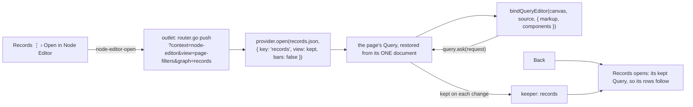

# Plan 822 — one Node Editor

Will, 2026-11-05 (TODO 822, from 810): "The node editor for a filter, from a demo view, and the
actual Node Editor view from the nav are 2 different views. The former has no app header etc."
His pick, for now: ONE view. A page's filter graph opens in the Node Editor Context, with the app
header, the View and graph chips, the header Save and the banners. The dialog goes.

**Status: BUILT on `lane/one-editor-822`, 2026-11-05.** The picks below are the lane's; section 8
holds what Will may still change.

## 1. What there was

| | The Query editor (the dialog) | The Node Editor Context |
|---|---|---|
| Opened by | a filter toolbar's ⋮, "Node Editor (beta)", `node-editor-open`; Demos' `index.html` answered | a nav row, `?context=node-editor` |
| Draws | the page's Query, `bindQueryEditor` | an entity's graph, `bindWorkflow` |
| Lives in | `#query-editor`, a maximised overlay panel over the page, with its own canvas, panel, toolbar, inspector and banners | the outlet, with the app header, the View chip and the graph chip |
| Header, crumbs, URL, Back | none | yes |

Two canvases, two panels, two inspectors, two sets of banners, and two places a node is kept
floating: the same editor drawn twice.

## 2. The picks

| # | Question | Pick | Why |
|---|---|---|---|
| P1 | How a page's filter graph is a graph the Context can open | **A graph TYPE, `query` (`PAGE_QUERY`)**: its graphs are the app's pages, every Context with a `definition`, read live from each page's Query, never stored as entities. The app ships ONE View of it, `{ "label": "Page filters", "graph": { "type": "query" } }` | It is plan 746's own model: a View per type, and the graph chip picks which one. No new chip, no new URL key, no fifth word |
| P2 | The URL | **`?context=node-editor&view=page-filters&graph=records`**: the graph is the page's Context name. The first page (Home) is left out, as a type's first is. Opened from a page, it is a PUSH, so Back returns to the page, on its View | The graph View's URL already says `?view=&graph=` (746 D10) |
| P3 | What the header shows | **The Context's name, "Node Editor"; the crumb is the page, a link back to it on its View; the View chip; the graph chip "Page: Records", its rows the pages, with no New graph…; Save OFF** (`data-readonly`) **with no copy or delete offered** (`data-query`) | Each edit IS the page's, as a chip's is, and the page keeps it (its ONE document). There is nothing to save, and a page is no entity to copy |
| P4 | How the editor reaches the page's Query and source | **The outlet opens the page's definition in the provider, under the page's own key, with `bars: false`**: its data, its Query and its kept state, and no filter bar, panel or View chip of its own | ONE path to the data: the provider's `open()`, the page's ONE kept document. The header row stays the outlet's; reach, news, settings and the keeper work as on the page |
| P5 | `bindQueryEditor` | **ONE binding, used by the Context.** It gains `markup`: where a component node's live copy is copied from (the page's markup, not the document) | The dialog was its only other caller. `pageComponents(root, definition)` moves from Demos into sherpa-ui |
| P6 | The entry point | **The ⋮ row reads "Open in Node Editor"**, still `node-editor-open`; the OUTLET answers it where the app has a `query` View: it goes there, the asking page the graph | An app with no `query` View gets no answer, as before. No app glue |
| P7 | Keyboard parity | The ⋮ row by Tab, Enter and the arrows; Back by the browser's Back or the crumb (Tab, Enter); the graph chip by its menu keys; Undo and Redo by ⌘/Ctrl+Z and +Y in the canvas | Every act has its keys |
| P8 | What goes | **The dialog, whole**: `#query-editor`, its canvas, panel, toolbar, inspector and banners; Demos' `node-editor-open` listener, `pageComponents`, `pageDefinition`, and the four `keepFloat`/`keepCardWidth` lines for them | Will: a clean system, no legacy |

## 3. The path of one edit

## 4. What a `bars: false` page is

`provider.open(definition, { …, bars: false })` opens a page for its data alone, for a view of its
Query that is not the page. No filter bar or panel is drawn or answered, no View chip is heard, and
no component is configured by id (`ui`). Its components (an inspector's live copy) are answered,
and its Query is restored and kept under its key as the page's is. The next page opened, with its
bars, answers them again. Leaving a page writes what waited for its frame, so an edit made just
before Back is kept.

## 5. What the Context is handed

On a `query` graph, `init` is handed `source` and `query` (the page's) and `page`: `{ id, label,
href, definition, components, markup }`. `graph-change` carries the new `page` with the graph. The
Context binds `bindQueryEditor(canvas, page.source, { definition, components, markup, inspector,
panel, toolbar, session })` and puts the page's crumb in the header.

## 6. Tests

- sherpa-ui, the graph-views harness: a `query` View lists the pages, opens one headless (its bars
  untouched), the URL and Back; `node-editor-open` from the page goes there. Node: the page rows.
- Demos, by pointer and keys, three engines: Records ⋮ › Open in Node Editor; the Context opens with
  its header and chips; an edit there changes Records' rows on Back (`source.debugState().total`);
  the URL; the dialog is gone. Every spec that drove the dialog drives the Context.

## 7. Not done

- A page's Query is never written as its definition (`editor.save()`'s `definition-save`): Save is off.
- The page's own filter panel is not shown beside the canvas.

## 8. Decisions for Will

| # | Question | A (the lane's pick) | B |
|---|---|---|---|
| D1 | Save on a page's filter graph | **Off**: each edit is the page's as it is made; what waits for Apply waits, kept, for the page's own Apply on Back | Save applies what waits, as the page's Apply does |
| D2 | The filter panel beside a page's graph | **Shut**: the canvas has the room | The page's panel, open beside the canvas, editing the same Query |
