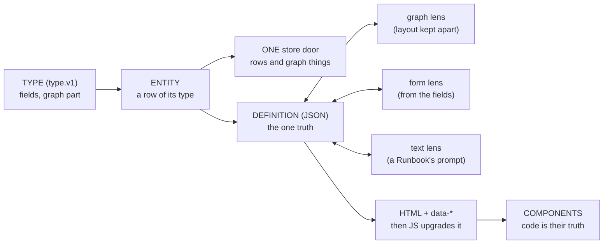
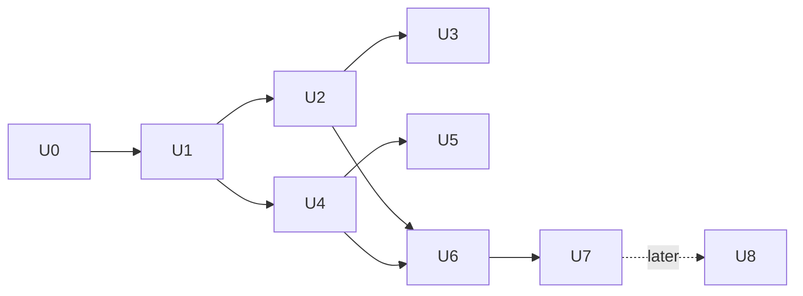

# Plan 960: One system for types, definitions and their graphs

Will, 2026-11-13: "As we've developed Nodes & Node Editing we have created a bunch of graphs, and custom node
sub-graphs, that are either outdated or just wrong. It's probably a good time to start unifying the node system with
other systems in the data layer and either clearing out old node content or refactoring it to work with the new
system. … I'd like to get us closer to a place where a node graph can be used to build a view definition, content
presentation, filter query stuff (axes, grouping, sorting, filter conditions etc.), as well as entities like Coworkers,
Runbooks, etc. and workflows or processes. … JSON could generate the graph but a Graph can also be converted to JSON.
Both can be kept in sync if edited and saved. … any contributor to, or user of, sherpa should be able to provide a
definition for an entity (device, coworker, user, whatever) and data to populate them with and then use them in a
sherpa app. … unified, core, systems across the data, utility, and presentation layers … as agnostically as possible.
Consistency across naming conventions, mechanisms, common standards etc. as well as keeping Sherpa-UI's progressive
enhancement with HTML & CSS before TS/JS core to the project. … we could possibly unify everything around components
and definitions. I'm not 100% sure though so let's investigate and plan."

It continues [vision-entities](vision-entities.md) (2026-11-05) and [plan 746](plan-746-entities-and-graph-views.md),
whose E1 to E5 are built. It takes in 956 to 959 (Demos parts that move into the library).

**Status: PLAN, 2026-11-13.** Nothing is built until Will answers section 7. Facts from five reads, each read only:
sherpa-ui-e8 (nodes, graphs, entities), sherpa-ui-a9 (the data layer), sherpa-ui-bd (component, page and View
definitions), acp-module-91 (how Harness keeps its definitions), and a check of every graph in Demos (sherpa-demos-67).
Paths are sherpa-ui's unless they say Demos.

## 0. The idea in one picture

Yes, it makes sense, and half of it is built. Four words do the work:

- A **type** says what a kind of thing is, once, in JSON: its fields and, if it has one, its graph part. Device, User,
  Coworker, Runbook, Filter, View.
- An **entity** is one thing of a type: a Device row, a Coworker.
- A **definition** is an entity the app builds something from: a page, a View, a filter, a Coworker's graph. It is
  JSON, checked by a schema, and it is the ONE truth.
- A **lens** is one way to show and edit a definition: its JSON, a form, a graph, a text (a Runbook's prompt), the HTML
  it makes. Each lens reads the definition and writes it back through one door. No lens is a second truth.



Components stay as they are: their code is the truth and their spec is made from it (PRINCIPLES 12). Definitions are
what USE components. So "unify everything around components and definitions" holds: a definition makes HTML that
names components, and the components upgrade it.

## 1. What exists

| Thing | Kept as | Graph form today | Graph → JSON? |
|---|---|---|---|
| Workflow | `workflow.v3` (workflow.ts:73) | the JSON drawn as is | yes, lossless (T-a-workflow-is-its-definition) |
| Entity: Coworker, Runbook, Expert, Custom Node, Preset Filter | `entity.v2` (entity.ts:41), `graph` inside | the same | yes, lossless |
| A page's filters | the live Query (query.ts:63) | `queryGraph` (query-graph.ts:352), made each time | **to the live state only** (`reconcileQuery`, query-document.ts:134); nothing writes page.v1 or a View back |
| Preset Filter → a page preset | `presetOfEntity` (preset-filter.ts:77) | the entity's graph | one way only |
| Runbook prompt | Demos: `settings.prompt` beside the graph | Demos `writePrompt` (graph → text); N-zo (text → graph) | by an agent, on Save |
| View, card presentation, layout | `views.v1`, HTML templates, `data-*` | none | none |
| Row type (Device) | no file of its own | none | n/a |
| Component | its code; spec made from it | none, and none wanted | n/a |

**What is wrong today** (each one measured by a peer):

1. **Two directions.** A page's filters: JSON is the truth, the graph a view of it. A Preset Filter and a Coworker:
   the graph is the truth, and other forms are made from it by hand (a9).
2. **One field said three times.** In the store's rules (JS functions, validate.ts:246), in the page's `source.fields`
   (page-definition.ts:60) and in the grid's columns (Demos devices.json:66). Two pages over one store say it again. A
   new row type "user" touches 6 to 8 files in 9 places (a9).
3. **Two doors for "a keyed set of things".** A Store (store.ts:346) and the entity shelf (entity-shelf.ts:34). Demos
   copies the shelf into a store by hand to list Coworkers in a grid (Demos coworkers-data.js:274 `followShelf`) (a9).
4. **A value kept twice.** A Coworker's schedule and customers in its settings AND its graph; an Expert's provider and
   model; a Preset Filter's `source` beside its Source node (Demos check).
5. **Four shapes for "a name and its filters".** A View's `query`, a `savedFilter`, a `preset` `{id, label, where}`, a
   Preset Filter entity (bd, a9). Five condition forms (a9). Three ways to say a View (a9).
6. **Words.** "entity" means a saved graph in the code and a row type in Will's words. "View" names 4 things, "preset"
   4, "node" 2 (a DOM anatomy node and a graph node), "template" 3. Two exports named `definitionOf` (entity.ts:157,
   query-edits.ts:335). Envelopes disagree: `v` or none, `$schema`/`$type`, `use`/`description` (bd, e8, a9).
7. **Old files.** `entity-node.v2.json` and `entity-preset-filter.v2.json` copy their v1 (e8). `entity.v1`,
   `entities.v1`, `workflow.v2` and their readers stay only to read old saves. The graph body's 7 keys are said in 3
   places in defs.v1 (e8).
8. **Demos parts that are systems.** References `{{kind:id}}` (956), stage colours (957), "not laid out yet" (958),
   read a graph as steps (959), the shelf as a store (`followShelf`), a second seed path (`SEED_VERSION`), the Workflow
   type in JS (Demos entity-types.js:28), and N-zo's own node schema (Demos tools.js:34).

**Every graph in Demos passes today's checks** (0 faults; the check script ran ajv, `checkEntity`, `workflowFaults`,
`startFaults`, the stage, lane and frame checks, `startLoops` and `queryGraphFaults`). What is wrong is what some MEAN:
section 5.

## 2. The model

### 2.1 One type file: `type.v1` (sherpa-ui-a9; sherpa-ui-e8 agrees)

```json
{ "$schema": "https://sherpa-ui.dev/schemas/type.v1.json", "v": 1,
  "id": "device", "label": "Device", "icon": "computer", "key": "id", "category": "Records",
  "fields": {
    "name":   { "type": "text", "label": "Name", "required": true },
    "status": { "type": "status", "label": "Status",
                "values": [{ "value": "online", "status": "success" }, { "value": "offline", "status": "danger" }] }
  },
  "data": "data/devices.json" }
```

A type with a graph adds `graph: { families, inputs, outputs, runs, reusable }` (today's `node-type.v1`, folded in).

- `fields` say only what the DATA is: type, label, the domain (required, values, min, max) and statuses. The controls
  (`select`, `op`, `advanced`, `section`, `range`) stay in a page's `source.fields`, which NAMES a type field and says
  only what differs (e8's condition a).
- The store's rules are made from `fields` (the MCP's `fromSchema`, describe.js:192, moves into the data layer). The
  page's default fields and the grid's default columns too. A field is said once.
- A field the graph holds is READ from the graph, never kept beside it: `"schedule": { "from": "when/schedule" }`
  (PRINCIPLES 10, one owner per value). This ends wrong-thing 4.
- `settingsFaults` stays as an optional code check, for settings JSON cannot say (a Custom Node's socket lists) (e8's
  condition b). `category` stays at the top (e8's condition c).
- `data` names seed rows (a file or a URL). One seed path, versioned as `localRecords` does (idb-store.ts:58), for rows
  and entities both.

### 2.2 One store door

An entity of any type is a row of its type. Rows stay in a Store; graph things stay on the shelf, which keeps its own
jobs (check, versions, refuse a remove in use). The shelf is READ through the Store door by an `EntityStore` adapter, so
a grid lists Coworkers as it lists Devices, with filters and sort. Two doors inside, one door outside (a9).

**A contributor's path:** one type file, one data file, one line in `app.json`. The app makes the store and a default
page (a grid of the fields, a Details form). A template and Views are optional. The MCP's `describe_data` writes a type
file, not JS (a9).

### 2.3 One envelope

Every definition a shelf keeps opens with the same keys: `{ $schema, v, type, id, label, description?, tags? }` (the
`entity.v2` header, entity.v2.json:8) (bd). Its body is one typed part:

| Part | Is | Holds |
|---|---|---|
| `graph` | a flow | a workflow, a Coworker, a Runbook, a Custom Node |
| `query` | a Query or a `where` | a filter, a View's filters, sort, group, search |
| `layout` | a tree of anatomy nodes (`component.v1 #/$defs/nodeParts`, as pattern.v1 has) | a View's cards, spans and slots |

One graph body (`defs.v1 #/graph`) that `workflow.v3`, `entity.v2.graph` and `nodeDefinition` all `$ref` (e8).

A component spec takes no envelope: it describes a kind of element, made from code (bd).

Later, from Harness (acp-module-91): an owner, a version record, a state (draft, checked, active, archived), and each
`uses` pinned with a health check. Not now: there are no accounts (plan 746 D6).

### 2.4 One lens door

In the data layer, DOM free, registered per type as a type is (e8):

```ts
registerLens(type, {
  toGraph(def, facts): WorkflowDefinition,                                   // draw it
  fromGraph(before, after, facts): { def } | { faults },                    // write it back, or say why not
})
```

- The editor and the MCP tools call ONLY this door. N-zo's tools call the MCP's.
- Graph types (workflow, Coworker, Runbook, Expert, Custom Node): the identity. They are graphs.
- A filter, a View's `query`, a page's presets: `queryDefinition` and `reconcileQuery`, wrapped, PLUS the missing half
  that writes the definition (a reader's View or saved filter through the keeper; a page file through the MCP, for an
  author). What the Query cannot say is refused in words, as today.
- The graph's layout is a side record, never in the definition (the Query does this today, query-editor.ts:59).
- A text lens is the same door with `toText` and `fromText`: a Runbook's prompt (959, with 956's references). Its
  `fromText` is an agent's, so an app gives it (Demos: Claude, or the app's own writer). The stored prompt is a copy
  that the lens makes again on each Save.
- A form lens is made from the type's `fields`: the Details panel edits a definition as the graph does. Harness has
  this: a Policy has "Form view AND Graph view, same thing" (acp-module-91).

### 2.5 Presentation: the graph makes the definition, the definition makes HTML

- A card's data part (its query, presentation, axes, sort, group, segments) is data, so it maps to nodes. The Query
  graph already draws it, read only (query-graph.ts header).
- A View's layout is a tree, not a flow (bd). Its graph lens places Card nodes into one Layout node, in order, each with
  its spans; `fromGraph` writes the `layout` tree (D5).
- The definition makes plain HTML and `data-*` (the MCP's `writeLayout`, mcp-server/lib/pattern.js:327, moves into
  the library); then the components upgrade it. **A graph never draws DOM.** It keeps PRINCIPLES 12, 17 and "can HTML
  or CSS do it?" (bd).
- A component is never a node (e8, bd).

## 3. Words (a LEXICON section, for Will's yes)

| Today | Proposed |
|---|---|
| "entity" for a saved graph only | an entity is one thing of a type (D3) |
| entity type (JS or `node-type.v1`) and a page's fields | a **type** (`type.v1`) |
| graph form, codec, Query view | a **lens** |
| "node" for a DOM anatomy node and a graph node | a graph keeps "node"; the tree's is an **anatomy part** |
| View: the VIEW scope, a saved View, a graph View, view markup | a **View** is the definition; the others take their own names |
| preset: a scope's chips, a shipped entity, the Preset Filter type, the Preset Nodes tab | a shipped thing is **shipped** (`origin`); Preset Filter, savedFilter and preset become one **Filter** type |
| template: a Context's file, a View's `file.html#id`, a component's `<template>` | a View's `template` and `content` become one field |
| `definitionOf` twice | `nodeDefinitionOf` and `queryOf` |
| Demos `app/view-schemas/` (holds page.v1) | `app/pages/` |

## 4. What we will not do

- Keep two truths: no graph stored in `page.v1` or `views.v1` beside its JSON (e8).
- Convert old saves: delete them (Will, 2026-11-05: "delete, never convert") (D4).
- Make a component a node, or write a component spec from a graph (bd, e8).
- Give a type a JS class: a type is JSON, and a lens is a registered function (e8).
- Build accounts, versions or approval states now (plan 746 D6).

## 5. The clear-out (U0)

**sherpa-ui (sherpa-ui-e8):**
- Delete `entity-node.v2.json`, `entity-preset-filter.v2.json` (copies; nothing names them).
- With D4 A: delete `entity.v1`, `entities.v1`, `workflow.v2` and their readers (`inNewWords` entity.ts:85, the v1
  `readEntity` entity.ts:98, the v2 branch of `readWorkflow` workflow.ts:115, entity-files.ts:22) and their trap.
- Stale words: workflow.ts:3, app-definition.ts:33, entity-files.ts:2 and :18, entity.ts:104, the descriptions of
  `entity.v2` and `entities.v2`, APP-GUIDE.md:159, :719, :732; view-markup.ts:16, :140 (`checkView` is gone);
  docs/traps/data-layer.md:7566, :7658, :7750 (942's removed names).

**Demos (sherpa-demos-67):**

| Item | Fault | Do |
|---|---|---|
| `customer-rows-flow` (workflows/customer-rows.json:13) | its Field's Count row is gone since 944; the text says "connections them on" | a Math Count; new words (and reforged-node-portal.spec.ts:7) |
| Runbooks `patch-review`, `device-health`, `backup-check` (entities.json:52, :70, :88) | not the standard form: no stages, no Checks, an old prompt; a Condition named "check" | made again in `patch-rollout`'s form |
| `active-customers` workflow and Preset Filter | the same filter twice | one stays; the specs move to it |
| Coworker seeds (coworkers-data.js:54) | a Math `count` that goes nowhere; `when` joined to a `#start` it does not keep; schedule and customers kept twice | the Start kept (955); the dead node out; fields `from` the graph (U2) |
| Experts (entities.json:169 to :247) | provider and model kept twice; four graphs the same but the prompt | one Model node (951); fields `from` the graph |
| Test fixtures (10 inline graphs in 8 specs) | copies of one another | one fixtures file |
| N-zo's node schema (tools.js:34) | its own, no `$ref` | the library's schema |
| Names | Sources with the id "start" beside `#start`; N-zo's words call a Trigger a "Start node" | new ids and words |

## 6. Phases

| Phase | Builds | Proves | Lane | After |
|---|---|---|---|---|
| **U0** Clear-out | section 5 | the suites pass; nothing reads a deleted shape | e8, demos | D4 |
| **U1** Words and one body | the LEXICON section; `defs.v1 #/graph`; the envelope | schemas `$ref` one body | e8 | Will's yes to section 3 |
| **U2** `type.v1` | the schema; rules from `fields`; `node-type.v1` folded in; `entities.v3`; `from` fields; `describe_data` writes a type | unit: a field said once makes rules, page fields and columns; a type file passes and fails in words | a9 (fields, rules), e8 (the graph part) | U1 |
| **U3** One store door | `EntityStore`; one seed path; a default page from a type | e2e: a "user" type from 3 files is a working page; Demos' `followShelf`, `coworkerStore`, `SEED_VERSION` deleted | a9, demos | U2 |
| **U4** The lens door | `registerLens`; identity lenses; the Query lens writes a View and a Filter back; the Filter type takes the four shapes | e2e: a page's filters edited in the graph and saved come back the same from the JSON; MCP tools through the door | e8 | U1 (beside U2) |
| **U5** Text lens | the Runbook prompt (959) and references (956) in the library | Demos' prompt-refs.js and runbook-prompt.js deleted | e8, demos | U4 |
| **U6** Form lens | a Details form from `fields` | a Coworker edited in the form and in the graph is one thing | bd | U2, U4 |
| **U7** Presentation | Card and View types (plan 746 E6, E7); the `layout` part; `writeLayout` in the library | e2e: a View built in the graph makes the same HTML as its template | bd, e8 | U4, U6 |
| **U8** Governance | owner, versions, state, pinned `uses` with health (Harness) | later | — | accounts |

957 and 958 are small and go in any free slot. 951 lands before the Expert clear-out.



## 7. Decisions for Will

| # | Question | A (my pick) | B |
|---|---|---|---|
| D1 | One truth | **The JSON is the truth; graph, form and text are lenses made from it and written back to it; the graph's layout is kept apart.** All four peers pick this, and the Query does it today | Keep the JSON and the graph both, and sync them on each Save: two truths that can drift |
| D2 | One type file | **One `type.v1` for rows (Device) and graph things (Coworker)**: one schema, one check, one MCP tool (a9, e8) | Two kinds of type file, and each field still said in two places |
| D3 | The word "entity" | **Any one thing of a type, a row or a graph thing**: your own use | "Record" for a row, "entity" only for a graph thing |
| D4 | Old saves | **Delete the old schemas and their readers now**: your rule, "delete, never convert" | Keep the readers one more round |
| D5 | A View's layout in a graph | **Card nodes into a Layout node, in order, with spans; the lens writes the layout tree; HTML is made from it** (plan 746 E7) | No graph for the layout: an outline only; graphs for the data and presentation |
