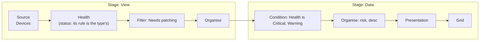

# Plan 960: a View's filter graph, its nodes made again for the new model

Will, 2026-11-13: "Nodes on existing filter graphs, for views, may need to be rethought to fit the new model when
recreating." Before Demos' View filters are rebuilt (TODO 960, Will's A), each node kind a page's Query graph draws is
mapped to the new model: a field said once by its type (U2), a named filter as a Filter entity (U4.4), one Organise
node (U4.2), a View written back through its lens (U4.6a). Owner sherpa-demos-67, reviewed by sherpa-ui-e8.

**Status: DRAFT, 2026-11-13; reviewed by sherpa-ui-e8 (its points are in).** Nothing changes until Will answers section
4. U4.6b (a page's Views in the graph chip) and U4.4b (D6) wait on it.

## 1. What a filter graph draws today (measured on Demos main, sherpa-ui 03698d639)

| Page, View | Nodes | Lines | Where most of them come from |
|---|---|---|---|
| Devices, Needs attention | 59 | 76 | Health's rule: each value's `when` drawn as Field and Condition nodes, chained by Checks (Critical's three tests, Warning's four, Healthy's one): about 33 nodes |
| Records, At risk | 48 | 49 | Health's rule (about 13 nodes); each preset and saved filter drawn inline, a Field and a Condition each (about 20) |

The kinds it draws: Source; Field (a column); Condition (a test); Check (a status value's chain); Time (a date test);
a scope node each ("View Context", the data scope, as "Devices"); a preset node each (star) with its own Field and
Condition; Organise (one per scope); Presentation; the grid or chart it feeds.

## 2. What fits the new model, and what does not

1. **A status field's rule is the TYPE's, not the View's.** Health is said once, in types/device.json (its values and
   each one's `when`). Drawing that rule in every View says it again, and a View cannot change it there anyway.
2. **A named filter is a Filter.** A preset, a saved filter and a Preset Filter are one Filter type now (U4.4a): one
   entity each, its graph its own, used as a Custom Node (Will: "a filter definition saved as a custom node and used in
   a wider view definition (filter toolbar for example)"). Drawn inline, each repeats its Field and Condition.
3. **A Field node before every Condition** made sense when a Condition had no way to name a column. A page's fields
   are its type's now (pageFields), so a Condition can name its field from them.
4. **A scope is a place, not a step.** "View Context" and the data scope say WHERE a filter applies; drawn as nodes in
   the flow, they read as steps.

## 3. The proposal: one node per idea

| Today | Proposed |
|---|---|
| A status field drawn as its whole rule (Field, Condition, Check per value) | ONE status node, headed by its label (Health), its values as its rows (At risk, Watch, Healthy); its rule opens by the drill-down button, read only here: the type's |
| A preset or saved filter drawn inline (a star, a Field, a Condition) | ONE Filter node each, a use of the Filter entity (`filter:<id>`); its graph opens by the drill-down button |
| A reading (a chip's pick) as a Field and a Condition | ONE Condition with a `field` row: in the Query graph the row names the field, read only (another field is another Condition); in a workflow a connected Field fills it, as a socket fills any row — one kind, one form, in both graphs |
| A scope as a node in the flow | Each scope a STAGE (View, then Data), and its scope node the stage's FIRST node, "the bar": its rows are its chips (with or without a pick, in their order), its filters Switch and its Organise; a field moves between scopes by its connection, as today; a Filter in the toolbar (U4.4d) sits on it |
| Organise, Presentation, the grid | as they are |

Measured guess for Devices' "Needs attention": 59 nodes to about 14 (Source, two bars, Health, Patch status, four
presets or Filters, a reading or two, Presentation, the grid; each Organise a row of its bar).

## 4. Decisions for Will

| # | Question | A (my pick) | B |
|---|---|---|---|
| D1 | A status field (Health) in a View's graph | **One node, its values as rows; its rule opens read only by the drill-down button (a small new door: today the button opens an entity, and a rule is a type's field)** | Its whole rule drawn, as today |
| D2 | A named filter (a preset, a saved filter) | **One node each: now its On row, its readings hidden; once it is a Filter entity (U4.4b), a use whose graph opens by drill-down** | Drawn inline, as today |
| D3 | A filter on one field | **One Condition with a `field` row (read only in the Query graph; a Field fills it in a workflow)** | A Field node and a Condition, as today |
| D4 | A scope (View, Data) | **A stage, its first node the bar: chips with or without a pick in their order, the filters Switch, Organise; a field still moves by connection** | A node in the flow, as today |

## 5. Steps, after Will's yes

1. sherpa-ui-e8: the Query graph draws D1 to D4 (query-graph.ts); each node's `ref` (scope, field, preset, kept) still
   maps to its request, so no edit is lost; D1's read-only door for a type's status rule; D3's `field` row on the
   Condition, in both graphs; the Query lens reads and writes them; U4.6b shows a page's Views in the graph chip.
2. sherpa-ui-e8: U4.4b to U4.4d (a Filter keeps a Where where it can, else its graph; temporary Filters; a Filter in a
   View's toolbar).
3. sherpa-demos-67: Demos' presets and saved filters become Filter entities, one per meaning (the clashes said in TODO
   960: "Needs attention" three ways, "At risk" twice, "Needs patching" as a threshold where Patch status says it); each
   View's query uses them; every View's graph opens, edits and saves back; the guard spec counts nodes too.
