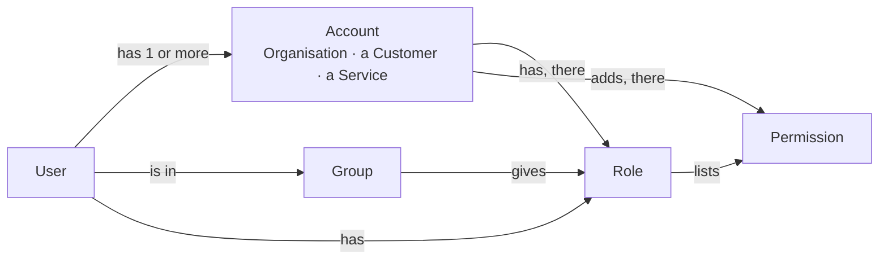

# Plan 963: Users, Accounts, Roles and Groups — the first types made the new way (plan 960)

Will, 2026-11-13: "Todo once we've finished refactoring the models: We need to support 'User' entities. Users can have
1 or more 'User Accounts' for distinct access to different Customers (Projects in Vertesia) or 3rd Party Services (e.g.
M365 Accounts). For example, User A can have a User Account in Customer A and Customer B. These User Accounts will have
different roles and permissions on each Customer. Note: Vertesia also has Organisation users. Organisation is the MSPs
Admin level above all Customer 'Projects'. So there will be some Users with a singular (for now) User Account at that
level. We won't go too deep into the details of accounts. Users will have Roles with Permissions. User Accounts will
have further permissions. We should also support User Groups. User Groups can be assigned Roles (with Permissions) and
any User in that Group gets that Role & Permissions. We will need a User Management screen in Sherpa Demos. Talk to the
acp-module agents, and project, to get an idea of what we have there so far. Improve upon it with the ideas in this
prompt as well as Sherpa capabilities. We'll need to plan for this to ensure it works with the new model."

**Status: PLAN, 2026-11-13.** Nothing is built until Will answers section 6. Owner: sherpa-demos-67 (Demos), on plan
960's types (U2) and store door (U3). UI/X only, from generated data, as the Coworkers are (plan 945).

## 1. What Harness has (acp-module-91, read only; Demos copies no code)

- **Code:** a read-only list. One model, `OrgUser {userId, name, email, createdAt, isCurrentUser}`
  (users/models/user-models.ts:1), one call, `GET /users`, one grid with a Refresh button and no actions, no select, no
  details (user-list.component.html:1-22). No Role, Permission, Group or Account in code.
- **Design** (Figma "Harness · Users & roles (concepts)", .working-notes/18-users-and-roles.md):
  - People has tabs People, Roles, Invitations, Sign-in. Its columns: name, email, roles, the customers they can see,
    sign-in (SSO or email), last active, status (Active, Invited, Suspended). Its action: Invite people.
  - A Role has a name, a description, a customer scope, a permissions grid (Area, Can do, Allowed, Limit) and its people.
  - Rules: a person has more than one role; the most open Allowed wins; the tightest limit for each customer wins; an
    organisation has its own copies of N-able's default roles. Approvers may be a person or a group.
  - A role also gates what a person may do with a Library item: none, see, use or edit.
- **Gaps:** Harness has no Group and no per-Customer Account: its person keeps a list of customer ids. Will's Account,
  with its own roles on each Customer, is new. Vertesia's Organisation and Project mapping is still open in Harness
  (09-harness-ontology.md:121); Will's words are the newest: a Customer is a Project.

## 2. The model, on plan 960

Five types, each a `type.v1` file with its data (plan 960 U2: fields once, rows of a type, one store door). None has a
graph: they are rows. A field that names another entity is a reference (`{{user:…}}`, `{{role:…}}`, plan 956).

| Type | Fields (data only) | Rows from |
|---|---|---|
| `user` | name, email, status (Active, Invited, Suspended: a look each), sign-in (SSO, Email), last active, roles, groups | `data/users.json` |
| `account` | user, scope (Organisation, Customer, Service), customer (where Customer), service (where Service: M365), roles, permissions, status | `data/accounts.json` |
| `role` | name, description, scope (Organisation, Customer, Any), permissions, shipped | `data/roles.json` |
| `permission` | area (Coworkers, Runbooks, Experts, Devices, Records, Users), action (See, Use, Edit, Run, Approve, Activate, Invite), description | `data/permissions.json`, shipped, read only |
| `group` | name, description, members (users), roles | `data/groups.json` |

**What a user may do, and where.** Their access is worked out, never kept: each Role on the User and on each Group they
are in counts everywhere they have an Account; each Account's own Roles and Permissions count only on its Customer or
Service. Most open wins (Harness's rule). One function in Demos (`accessOf(user)`), DOM free, gives each permission with
the place and the reason: "Edit Coworkers · Contoso · from the Account's Role Coworker builder".

**Organisation users:** an Account whose scope is Organisation, one per User for now (Will). It is the MSP's admin level.

**Not deep (Will):** an Account has no sign-in details, no keys, no sync state. A Service Account names its service and
its status only.

## 3. The screens (Sherpa conventions, not Harness's)

A **Users** Context in a new nav section, **Admin**, as Coworkers is a Context (plan 945 D1):

- **Users page:** a grid over the `user` store. Columns: Name and email, Status, Sign-in, Roles, Groups, Customers (from
  the Accounts), Last active. Views: All, Active, Invited, Suspended, Organisation users. Filters by status, role, group
  and customer. A metric bar: people, invited, suspended, with no Account. Header actions: Invite, and Ask N-zo.
- **A User's page** (its own URL, `?context=users&user=<id>`), with tabs:
  - Overview: who they are, status, sign-in, last active.
  - Accounts: a list, each its scope, its Roles and its added Permissions; Add account (Organisation, a Customer, a
    Service).
  - Roles and groups: the User's own Roles and Groups; Assign role, Add to group.
  - Access: what they may do, where, and why (`accessOf`), grouped by place. And the same as a read-only graph, through
    plan 960's lens door: User › Groups › Roles › Permissions, and User › Accounts › Customers. A reader sees why a
    person can approve a high-risk change at Contoso.
  - Activity: last sign-ins and changes (generated).
- **Groups page** and **Roles page:** the same Context, as Views of other types (plan 746: a View per type), each row's
  page with its members or permissions. A Role's page shows its permissions grid (Area, Can do) and who has it.
- **Actions:** Invite (a dialog: name, email, a first Account and its Roles), Suspend and Restore, Assign role, Add to
  group, Add account, Remove. Each asks first where it takes access away.

**N-zo:** its tools read these stores as they read the Coworkers; on_screen says the User shown. Asked "who can approve
high-risk changes at Contoso?", it answers from `accessOf`. A change (assign a role) is asked first, with Undo.

## 4. Generated data

About 40 Users across the eight customers (Northwind, Contoso, Fabrikam, Tailspin, Adventure Works, Litware, Proseware,
Wingtip Toys); 6 Organisation users; 10 M365 Service Accounts; 8 Roles (N-able's defaults: Organisation admin,
Technician, Coworker builder, Approver, Read only, Customer viewer — the Harness note's open idea — and two the reader
made); 5 Groups (Service desk, Patch team, Approvers, Night shift, Contoso team); about 20 Permissions. A fixed seed, as
the Coworkers' (plan 945 D3).

## 5. Steps

1. The five type files and their data, through U2 and U3; unit tests: each field said once, each row passes its type.
2. `accessOf` and its tests: roles from the User, its Groups and each Account; most open wins; the reason for each.
3. The Users Context: grid, Views, filters, metric bar; the User's page and its tabs; three engines.
4. Groups and Roles pages; the actions and their dialogs; Undo.
5. The Access graph, through the lens door (U4).
6. N-zo: its words and tools for Users.

## 6. Decisions for Will

| # | Question | A (my pick) | B |
|---|---|---|---|
| D1 | Where Roles sit | **On the User and on a Group (counting everywhere the User has an Account), and on an Account (counting on its Customer or Service only); an Account may add single Permissions** — your words | On Accounts and Groups only: a User has no Role of its own |
| D2 | A Permission | **An Area and an action ("Coworkers · Activate") from a shipped list; a Role lists them; no limits yet** — "We won't go too deep" | Harness's richer rule: each with a limit (customers, risk level) |
| D3 | Where the screens live | **A Users Context under a new Admin nav section, with its own pages, as Coworkers** | A Settings page |
| D4 | Why a user may do a thing | **An Access tab that says each permission, where, and why, and the same as a read-only graph** — a Sherpa capability Harness lacks | A plain list only |
| D5 | When | **After plan 960 U2 and U3, so these are the first types made the new way** | Now, the old way (stores in JS, fields said three times), moved later |
