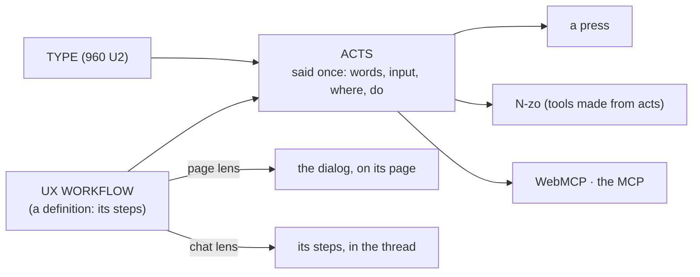

# Plan 964: N-zo works with anything — one way to say an act, and a UX workflow the chat can run

Will, 2026-11-13: "the AI chat in the app (N-zo w Claude for now) should let users work with anything in the app via
prompting. This goes for manipulating entities, performing actions, and steering UX workflows, on the current view, or
silently performing both of those things in other views by resurfacing UX workflow steps as chat interactions."

**Will, 2026-11-13: "your picks" — D1 A (acts said once, in the library), D2 A (a change elsewhere asked first, with Undo), D3 A (the first UX workflow: Invite a user), D4 A (after plan 960 U3, beside 963).**

**Status: PLAN, 2026-11-13; waits on plan 960 U3.** Owner: sherpa-demos-67 (Demos and N-zo);
the acts registry is a library part (owner to agree with sherpa-ui-e8, -a9, -bd). It builds on plan 960 (types,
definitions, lenses) and 946 (N-zo everywhere).

## 1. What exists

- **N-zo's tools** (Demos app/experiments/nzo-claude/tools.js), each written by hand: get_app, on_screen, open_page,
  describe_page, read_rows, summarize, filter, use_preset, arrange, clear_filters, add_rows, edit_rows, delete_rows,
  list_graphs, read_graph, node_kinds, save_graph, read_node, save_node, delete_node, save_coworker,
  schedule_coworker, offer_actions, undo. A change asks the reader first (Allow); each has an Undo.
- **The same tools by WebMCP** where the browser has it (`navigator.modelContext`, nzo-claude.js:434).
- **The app's acts are not said anywhere as data.** A button runs its page's code (Coworkers: Run now, Schedule, Edit
  graph; Records: Save View, Delete). N-zo can do only what a tool was written for. A new page, a new type (Users, plan
  963) or a new dialog needs new N-zo code.
- **A dialog is markup and code** (a `sherpa-dialog` and its page's handler). It can only be used on its page.

## 2. The idea

Three parts, each one system:

1. **Acts.** Every act the app can do — a button, a menu row, a dialog's submit — is said ONCE: its id, its words, its
   input (fields from a type, plan 960 U2), whether it changes data, where it applies (a Context, a View, a type), and
   the one function that does it. A press, N-zo, WebMCP and the MCP all go through that one door. N-zo's tools are made
   from the acts, never written one by one.
2. **Acts on any type, for free.** Each type (plan 960 U2) gives its acts by itself, through the one store door (U3):
   find, read, add, change, remove, and its own (a Coworker's Run now and Schedule, a User's Invite and Suspend). So N-zo
   works with every entity the app has, with no new N-zo code: a User the day the User type exists.
3. **UX workflows as definitions, with two lenses.** A UX workflow (a dialog, a form, a wizard: vision-entities' UI
   Pattern) is a definition: its steps (ask a field, choose one of, confirm, show), each from a type's fields, and the
   act it ends in. Plan 960's lens door draws it two ways:
   - the **page** lens: the dialog on its page, HTML and `data-*` first, as today;
   - the **chat** lens: each step resurfaced in the thread — a question, a set of choices to press, a short form card, a
     confirm — so N-zo runs it for another page **without leaving this one**.

**Here or there.** An act or a workflow on the page the reader is on runs where they can see it (the dialog opens, its
fields fill, the reader presses). One for another page runs silently through the chat lens: its steps in the thread,
its result said, and an "Open it" to go and see. A change is always asked first, as today, and has an Undo.

## 3. What it changes

- **The library (utility layer):** an acts registry, DOM free (`registerAct`, `actsOf(context, view, type)`, `runAct`),
  and acts made from a type (U3). The UX workflow definition (a schema) and its chat lens's shape: the steps a chat
  shows, not how. The page lens is the dialog component as today.
- **Demos:** each page's acts said once (Coworkers, Records, Devices, Users); its dialogs as workflow definitions; N-zo
  made from the acts (its hand-written tools go, but on_screen, offer_actions and undo, which are about the chat); the
  chat draws a workflow step (`sherpa-chat-message` with choices, a form card, a confirm).
- **N-zo's words:** shorter. It is told the acts the app has here and elsewhere, not a rule per tool.

## 4. Phases

| Phase | Builds | Proves | After |
|---|---|---|---|
| **N1** Acts | the registry; Demos' Coworkers acts (Run now, Schedule, Edit graph) said once; the buttons run them | a press and N-zo run the same act; nothing else changes | U3 |
| **N2** Type acts | find, read, add, change, remove for every type, through the store door | N-zo changes a Device or a Coworker with no tool written for it | N1, U3 |
| **N3** Tools from acts | N-zo's tools and WebMCP's made from the acts; the hand-written ones go | every N-zo spec passes on the made tools | N2 |
| **N4** UX workflow | the definition; one dialog first (963's Invite user, or a Coworker's Schedule) with its page and chat lenses | the same Invite done in the dialog and in the thread | N3, 963 |
| **N5** Silent elsewhere | an act or workflow for another page run in the chat, with "Open it" | Schedule a Coworker from the Devices page, in the thread | N4 |

## 5. What we will not do

- Write an N-zo tool per act or per type again.
- Let N-zo change data without the reader's Allow, or with no Undo.
- Draw a dialog from JS for the chat: the chat lens says the steps; components draw them, HTML first.

## 6. Decisions for Will

| # | Question | A (my pick) | B |
|---|---|---|---|
| D1 | Where acts are said | **In the library, one registry: the same door for a press, N-zo, WebMCP and the MCP** | In Demos only, for N-zo |
| D2 | A change N-zo makes on another page | **Asked first, as today (Allow), with Undo** | Done at once for small changes, with Undo only |
| D3 | The first UX workflow | **Invite a user (963): a dialog of three steps, new, so it is made the new way** | A Coworker's Schedule: it exists, so it is moved |
| D4 | When | **After plan 960 U3 (types and the one store door), beside 963** | Now: acts by hand first, made from types later |
