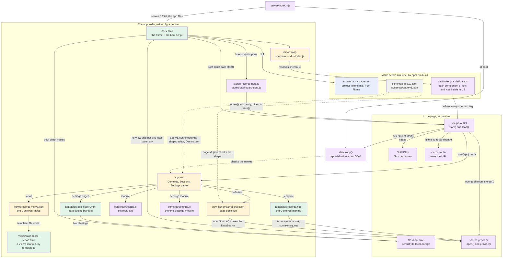
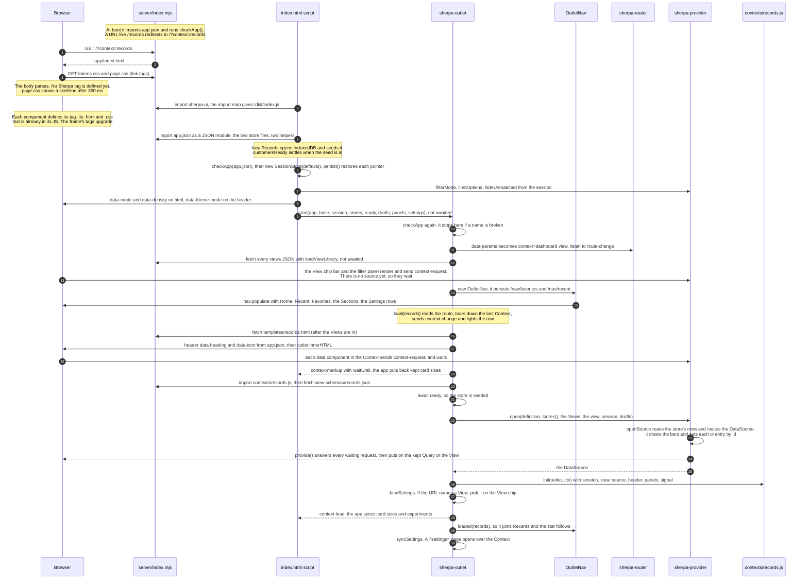

## Fixes made to the draft

- [FIXED] **344 status.** The draft said nothing in this topic was half-done. That was wrong. 344 is changing three components in the frame right now (uncommitted). With the change, a label that follows the state is written in each component's `.html` as `data-swap-*`, and `src/core/ui/swap.ts` (new) applies it. The three are the header's theme toggle, the View chip's star and the overlay panel's Maximise. The app's start-up order does not change.
- [FIXED] **`npm run build`.** The command is `scripts/build-reforged.mjs`. It runs `project-tokens.mjs` first, which writes `tokens.css` and `page.css`. Then it runs `tsc`. Then it copies the CSS and HTML through PostCSS, puts their text into the JS, deletes the copied files and minifies.
- [FIXED] **`report()`.** It writes `console.warn` only by default. If the app calls `onReport()`, the report goes there instead.
- [FIXED] **Flowchart: the stores.** `stores()` and `ready` go to the outlet through `start()`, not to the provider. The outlet waits for `ready`. Then it gives `stores()` to `provider.open()`.
- [FIXED] **A missing step: the frame asks first.** The View chip bar and the filter panel are in the frame. They send `context-request` at their first render, before any Context loads, and they wait. The provider can hear them because it listens from its constructor.
- [FIXED] **A missing step: Settings.** After the first load, `start()` calls `#syncSettings()`. So a `?settings=` page opens over the Context.
- [FIXED] **`provider.open()`.** `openSource()` reads the store's rows. That is why the outlet waits for `ready`. After `provide()` answers each request, it also puts on the kept Query or the start View.
- [FIXED] **Smaller steps that were missing.** The boot script sets `data-mode`, `data-density` and `data-theme-mode` before `start()`. A View is picked on the View chip only when the URL names one. `loaded()` also sets the star.
- [FIXED] **The `index.html` row.** It now lists the parts outside the shell: the notifications, the Reset dialog, and the assistant and details panels. It also says that the assistant reads `chat.html` and `chat.js` without the outlet.

---

## An app: from `index.html` to the first Context on screen

Paths that start with `app/` or `server/` are in `/Users/williammincher/Documents/My synced vault/Projects/Sherpa Demos`. Paths that start with `src/`, `schemas/` or `bin/` are in `/Users/williammincher/Documents/My synced vault/Projects/sherpa-ui`. The minimal app is in `/Users/williammincher/Documents/My synced vault/Projects/Sherpa Starter/template`.

**What 344 is changing here.**
- **Labels in the frame (344):** Three components in the frame are being changed. They are `sherpa-app-header`, `sherpa-quick-filter-toolbar` and `sherpa-overlay-panel`. Now, a label that follows the state (the theme toggle's icon, the star, Maximise) is in each one's `.html` as `data-swap-on` / `data-swap-*`. `SherpaElement` applies it, so the TS no longer writes it. The boot script still only sets `data-theme-mode`, and `OutletNav` still only sets `data-favourite`.
- **The nav's default rows (344):** `sherpa-nav.ts` still holds its own default rows (`DEFAULT_QUICK`). 344 group 3 moves them into the nav's template. An app with an outlet never shows those rows, because `OutletNav` gives every row from `app.json`.

### 1. The files and what each one is

| File | Kind | Who writes it | Who reads it, and when |
|---|---|---|---|
| `app/index.html` | TEMPLATE (the app frame) and CODE (its boot `<script type="module">`) | a person | The browser reads it at page load. The frame is parsed once and never swapped. **In the shell:** `sherpa-router` and `sherpa-provider`, then `sherpa-app-shell` with `sherpa-nav`, `sherpa-app-header` (with the View chip bar), the filter panel, `sherpa-outlet id="context-root"` and the Settings overlay dialog. **Outside the shell:** `sherpa-notifications`, the Save View, Save filters and Reset dialogs, and the `#assistant` and `#details` overlay panels. The boot script also imports `reset-prompt.js` and `experiments/sticky-metrics.js`. On the first `ai-click`, it reads `templates/chat.html` and runs `contexts/chat.js` itself, without the outlet. |
| The import map, inside `index.html` | DEFINITION | a person | The browser reads it before the first module loads. `sherpa-ui` maps to `/dist/index.js` and `sherpa-ui/data` maps to `/dist/data.js`. The boot script imports only `sherpa-ui`. `stores/dashboard-data.js` imports `sherpa-ui/data`. |
| `dist/styles/tokens/tokens.css` | SHEET | `scripts/project-tokens.mjs`, from `figma.tokens.json` and `figma.extensions.json`, as the first step of `npm run build` | The browser reads it at page load, through a `<link>`. Its custom properties inherit into every shadow root. It styles no page. |
| `dist/styles/tokens/page.css` | SHEET | the same generator (`project-tokens.mjs`) | The browser reads it at page load, through a `<link>`. It styles `html` and `body` and gives the shell its height. After 300 ms it draws a skeleton on each tag that is `:not(:defined)`. |
| The inline `<style>` in `index.html` | SHEET | a person | Read at page load. It is the app's own rule: green active chips under `html[data-chips-success]`. |
| `dist/index.js` (it re-exports `components.js`, `app.js` and `data.js`) | CODE | `npm run build` (`scripts/build-reforged.mjs`): `project-tokens.mjs`, then `tsc`, then it puts each component's `.html` and `.css` text inside its JS and deletes the copied files | The browser imports it at page load. Each component defines its tag when it is imported, and the tags already in the page upgrade. |
| `app/app.json` | DEFINITION | a person | 1. The server, at boot: `checkApp()`, and the `/:context` redirects. 2. The boot script, as a JSON module. 3. `outlet.start()`. 4. `OutletNav`, which makes the rows from it. 5. Demos' unit test. |
| `schemas/app.v1.json` | SCHEMA (checks the shape) | sherpa-ui; it ships as `sherpa-ui/schemas/*` | The editor, through `"$schema"`, and Demos' `test/unit/definitions.test.mjs` (Ajv). The browser never reads it. |
| `checkApp()` and `AppDefinition` in `src/core/data/app-definition.ts` | CONTRACT (checks the names; it has no DOM) | sherpa-ui | It runs at server boot, in the boot script, and in `start()`. **It checks that:** `v` is 1; the default is a Context; each Context has a `label` and a `template`; each Section names real Contexts; each Settings page has a `template`; and no name is both a Context and a Settings page. Each problem goes to `report()`, which writes `console.warn` unless the app set `onReport()`. |
| `server/index.mjs` | CODE | a person | Node runs it at `npm run serve` (port 4200). **It serves:** `/` (`index.html`), `/dist` (sherpa-ui's `dist/`, found with `createRequire(...).resolve('sherpa-ui')`), the `app/` files, `/live/alerts` (server-sent events) and `/live/files` (hot reload of built `.html` and `.css`). **Redirects:** `/records` redirects (302) to `/?context=records`. A name that is not a Context gets 404. |
| `app/stores/records-data.js`, `app/stores/dashboard-data.js` | CODE | a person | The boot script imports them at page load, and each Context module imports the same URL. **Records:** `localRecords({ database: 'sherpa-examples', seed, seedVersion })` gives `customerStore` and `customersReady`. The store is an `IdbStore`, or memory where there is no IndexedDB. **Dashboard:** `new ArrayStore(alerts())` gives `alertStore`. |
| `app/templates/<context>.html` | TEMPLATE (the Context's markup) | a person | At each Context load, the outlet calls `#file(template, 'text')` and then sets `outlet.innerHTML`. |
| `app/view-schemas/<context>.json` | DEFINITION (a page definition). It holds `id`, `source` (the `store` name, `fields`, `scopes` and `presets`) and `ui` (settings by element id). `schemas/page.v1.json` is its SCHEMA. | a person | At Context load, the outlet calls `#file(definition, 'json')`, after the module import. It gives the result to `provider.open()`. |
| `app/views/<context>-views.json` | DEFINITION (each View: `label`, `query`, `ui`, and an optional `template`) | a person | In `start()`, `loadViewLibrary()` reads the file of each Context. `start()` does not wait for them, but each `#load()` does. |
| `app/views/dashboard-views.html` | TEMPLATE (a View's own content, as `<template id="capacity">`) | a person | `loadViewLibrary()` reads it through `loadTemplates()` when a View names `"template": "dashboard-views.html#capacity"`. |
| `app/contexts/<context>.js` | CODE (`export init(root, ctx)`, which can give back a teardown) | a person | `import()` at Context load, after the markup is in and the `context-markup` work is done. |
| `app/templates/application.html` (and the other Settings pages), `app/contexts/settings.js` | TEMPLATE (controls with `data-setting="/pointer"`) and CODE | a person | Only when `?settings=` names a page: the markup goes into `#settings-root`, then `init`, then `bindSettings`, then `dialog.show()`. |
| A component's own `.html` and `.css` | TEMPLATE and SHEET | a person | At build time they go inside its JS, so a release build fetches nothing for them. A dev build fetches them, and `/live/files` reloads them through `SherpaElement.reload()`. |
| localStorage `sherpa:session:<pointer>` and IndexedDB `sherpa-examples` | stored state, not files | `SessionStore.persist()` and `localRecords()` | Read back at boot, written at each change. |

**The minimal app** (`Sherpa Starter/template`) has the same shape, with less in it:
- **Contexts:** one Context (`records`). There are no Settings pages, panels or drafts. The router has no `data-overlay`.
- **Import map:** only `sherpa-ui`, which maps to `./node_modules/sherpa-ui/dist/index.js`.
- **Mode:** `data-mode="auto"`.
- **Session:** the session holds only `/nav/*`.
- **Start call:** `start({ app, base, session, stores: () => ({ records }), ready: recordsReady })`.
- **Server:** `sherpa-ui serve .` (`bin/sherpa-ui.mjs`) only serves the files. The Starter has no `checkApp()` call of its own, so the only check is the one in `start()`.

### 2. Diagrams

How the files relate:

The order at run time, for the first Context:

### 3. Things that look odd but are on purpose

- **`checkApp()` runs three times, and the JSON Schema never runs in the browser.** It runs at server boot, in the boot script, and in `outlet.start()`.
  - **What it checks:** names only. It reports through `report()`.
  - **What happens on a problem:** the server and the boot script do not use the result, so they go on. `start()` returns, so no nav draws and no Context loads.
  - **The shape:** `schemas/app.v1.json` is checked only by the editor and the Demos unit test. That test also checks that every file `app.json` names exists.

  TRAP `T-an-app-is-its-definition`.
- **The markup has no default Context and no header title.** The router says `data-params="context view"`, and `start()` writes `context=<default>` from `app.json`. On each load, the outlet writes the header's `data-heading` and `data-icon` from the Context's `label` and `icon`. A value typed into the markup would go stale. TRAP `T-an-outlet-loads-the-context`, TRAP `T-the-router-owns-the-url`.
- **The nav is drawn before the first Context, and the Views are fetched without waiting.** `start()` waits for `nav.refresh()`, so a first click finds its rows. `start()` does not wait for the Views, but each `#load()` does. When the Views come in, the nav draws again. TRAP `T-the-outlet-keeps-the-nav`.
- **`stores` is a function, and the outlet waits for `ready` late.**
  - **Why a function:** the outlet calls `stores()` at each load, so `?remote` or `?fail` can wrap `customerStore` in `spoofRemote()`.
  - **Why late:** the outlet waits for `ready` just before `provider.open()`, because `openSource()` reads the store's rows. A source over an empty store has no values to offer.
  - **Same URL:** the boot script must import the stores by the same URL the Context modules use. If not, the page gets two stores.
  - **One data layer:** the import map's `sherpa-ui/data` is the same `/dist/data.js` that `index.js` re-exports.

  TRAP `T-two-urls-are-two-modules` (in `Sherpa Demos/docs/TRAPS.md`).
- **There are two CSS links, and no component CSS is linked.** `tokens.css` styles no page, so a host can embed one component. `page.css` is the page's sheet. Each component's sheet is inside its JS. TRAP `T-tokens-are-safe-to-embed`, TRAP `T-a-skeleton-is-the-pages`, TRAP `T-the-text-is-in-the-js`.
- **The Context goes into the outlet's light DOM through `innerHTML`, not into a shadow root.**
  - **Why:** `#context-root …` finds its parts, and each component's `context-request` reaches the `sherpa-provider` above it.
  - **Order:** a component asks before the provider has a source, and `provide()` answers it later. The provider listens from its constructor, so the frame's bars and panel are heard even before the provider renders.
  - **The session:** `SessionStore.persist()` uses localStorage by default and restores at once. But a restored value runs no subscriber, so the boot script sets `/theme/mode` again after it subscribes.
  - **The id:** a page definition's `id` must match its Context's name. If it does not, the outlet reports `outlet-view-key` and goes on (TODO 321).

  TRAP `T-a-component-asks-its-provider`, TRAP `T-session-persist-defaults-shared`.