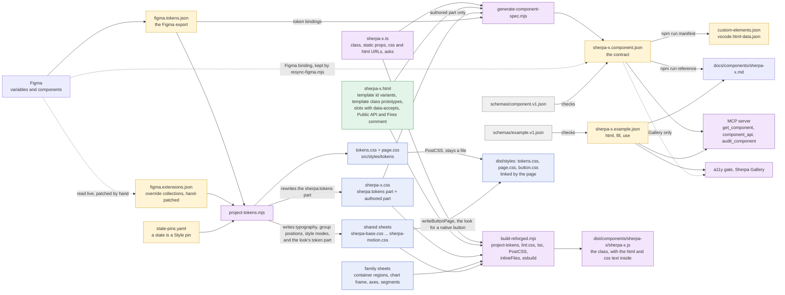
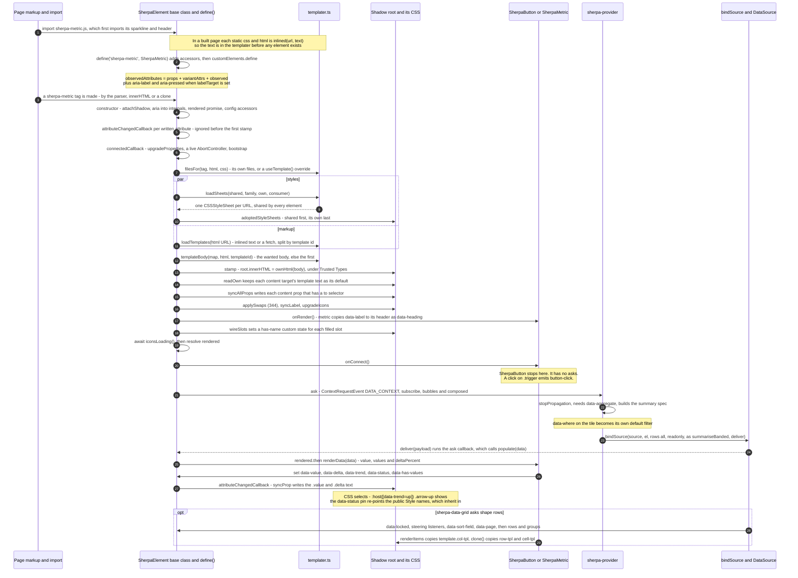

## A UI component: how it is made (checked against the code)

Fixes made to the draft:

- [FIXED] The 344 note was out of date. Group 3a is now committed (`97b29607`). `PropDef.default` is gone, and `#readOwn` in `sherpa-element.ts` keeps a content target's template text as its default. Swaps (`src/core/ui/swap.ts`) are half-done in the working tree.
- [FIXED] Styles and markup load at the same time (`Promise.all` in `#bootstrap`), not one after the other. The diagram now shows this with a `par` block.
- [FIXED] Four steps were missing: `inlined()` fills the templater when the module is imported; `attributeChangedCallback` is ignored before the first stamp; `#readOwn`; and `readSwaps` / `applySwaps` (344).
- [FIXED] Metric: `renderData` sets `data-label` only when the data has a label. It also sets `data-has-values` and feeds the sparkline. `onRender` / `onChange` copy `data-label` to the header as its `data-heading`.
- [FIXED] Provider: `bindSource` is called with `rows: 'all'`. A readonly bind adds no steering listeners and no `data-locked`. `data-where` becomes the tile's own default filter.
- [FIXED] Grid: `renderItems` copies `col-tpl`. `clone()` copies `row-tpl`, `cell-tpl`, `head-cell-tpl` and `group-row-tpl`.
- [FIXED] `observedAttributes` also holds `aria-label` and `aria-pressed` when `labelTarget` is set.
- [FIXED] `project-tokens.mjs` also writes the `sherpa:tokens` part of `sherpa-button-look.css`. The spec generator also reads `figma.tokens.json`, and `sherpa-button-look.css` for the button.
- [FIXED] "Never the browser" was wrong. The Gallery fetches both the spec and the example in the browser; an app never does. An example also has `show` and `anchor`.
- [FIXED] MCP: the tools that read the spec are `list_components`, `get_component`, `audit_component`, `check_bindings` and `component_api`. `validate_def` checks a def that the caller passes in.
- [FIXED] A chart lists two family sheets, not one.
- [FIXED] Only `npm run build` strips the comment and `data-accepts`. A dev build ships the `.html` as written.
- [FIXED] `sherpa-button.css` is not "almost empty". It has no face of its own, but it has layout, icon, badge and tip rules.
- [FIXED] Item prototypes: neither template parser reads a `<template id>` that is inside another template. Prototypes are nested inside the variant tree.
- [FIXED] The state-pin example is now a real state, `sherpa-button[aria-pressed="true"]`.
- [FIXED] A page tag's attributes are not its whole input. `populate()`, `data` and `config` properties are input too.
- [FIXED] `tokens.css` can also reach the page through `installTokens()`. `dist/styles/button.css` is a page sheet too.

Worked examples: `sherpa-button` is a control with no data. `sherpa-metric` is a data tile. `sherpa-data-grid` shows item prototypes.

> (344) is in progress today. These groups are committed:
>
> - group 2: no component writes a default variant
> - group 4: select-group's options are cloned from prototypes
> - group 5: no class list is written from TS
> - group 3a (`97b29607`): a `content` prop's default is its template's own text. `PropDef.default` is gone.
>
> Half-done in the working tree: **swaps**. A `.html` element carries `data-swap-on="data-x"` (or `="data-x=value"`) and `data-swap-text` / `data-swap-aria-*` / `data-swap-data-*`. The base class reads them with `readSwaps()` after each stamp. `applySwaps()` writes them after the props and on each attribute change. So a toggle's text, icon or ARIA follows a host attribute, with no string in TS. `checkOwnTemplate` reports a missing swap. The aim when 344 is done: every default text, variant and piece of markup lives in the `.html` and `.css`, and the base class carries it. Button and metric are not named on 344's list.

### The files and what each one is

| File | Kind | Written by | Read by, and when |
|---|---|---|---|
| `sherpa-x.ts` | CODE | a person | **Build time:** `tsc` compiles it. The spec generator reads it for props and `emit()` calls, typed by the checker. **Import:** the browser runs it. **What it holds:** the class, with `static css` / `static html` (URLs), `static props`, `observed`, `variantAttrs` + `templateId`, `labelTarget`, `commands`, `aria`, `asks` and `config`, and the hooks `onRender` / `onConnect` / `onChange` / `renderData`. It ends in `define('sherpa-x', Class)` |
| `sherpa-x.html` | TEMPLATE | a person | **Build time:** its text is put into the JS. **First connect of the tag:** `parseTemplates` splits it, cached per URL. **What it holds:** - A `<template id>` is a variant tree (button: `default`, `icon`). - A `<template class>` inside that tree is an item prototype. It is stamped with the tree and cloned once per item (grid: `col-tpl`, `row-tpl`, `cell-tpl`, `head-cell-tpl`, `group-row-tpl`; metric has none). - The text in a `content` target is that prop's default (344). - `data-swap-*` marks a value that follows a host attribute (344). - Each `<slot>` has `data-accepts`. Only the spec generator reads the `Public API:` / `Fires:` comment and `data-accepts` |
| `sherpa-x.css` | SHEET | **Above** `/* == end sherpa:tokens == */`: `project-tokens.mjs`, from Figma. Only 5 components have this part: button, input-text, nav, nav-item, switch. **Below** it: a person | **Build time:** PostCSS, then put into the JS. **Each element's first connect:** adopted after the shared and family sheets. One `CSSStyleSheet` per URL is shared by every element |
| Family sheets: `src/core/sherpa-container-regions.css`, `sherpa-chart-frame.css`, `sherpa-chart-axes.css`, `sherpa-chart-segments.css` | SHEET | a person | First in `static css = [family…, own]`, so the component's own sheet wins. A container lists one. A chart lists two: frame, then axes or segments |
| Shared sheets (`SherpaElement.sharedStyles`, 9 in `src/core/`) | SHEET | a person. `project-tokens.mjs` writes typography, group-positions and style-modes whole, and the token part of `sherpa-button-look.css` | Adopted into EVERY shadow root, before anything else |
| `tokens.css`, `page.css`, `dist/styles/button.css` | SHEET | `project-tokens.mjs`. `button.css` is written by `writeButtonPage` in the build | The PAGE, through a `<link>`. `installTokens()` from `sherpa-ui/components` can add the tokens link. These go through PostCSS but are never put into the JS. Their custom properties inherit into shadow roots. Their selectors do not reach them |
| `figma.tokens.json`, `figma.extensions.json`, `scripts/figma-data/state-pins.yaml` | DEFINITION | The Figma export. A person patches the extensions file (read live from Figma) and writes the state pins | `project-tokens.mjs`, the first step of every build. The spec generator also reads `figma.tokens.json`, for token bindings |
| `scripts/figma-data/element-map.yaml` | DEFINITION | a person | The spec generator: which element each Figma node maps to |
| `sherpa-x.component.json` | CONTRACT | `generate-component-spec.mjs`. It reads: - the `.html` - the authored `.css`, plus `sherpa-button-look.css` for a node that wears `.sherpa-button` - the `.ts` - `element-map.yaml` and `figma.tokens.json` `$extensions.sherpa` is kept as it is when the spec is made again, and `resync-figma.mjs` keeps it in line with Figma. Never edited by hand | - `spec:check` in the pre-commit hook: validate, round-trip, and fresh for the staged components - The MCP: `list_components`, `get_component`, `audit_component`, `check_bindings`, `component_api` - `write-manifest.mjs`, `write-reference.mjs`, `sherpa-ui check-usage` - The Gallery fetches it for its stories No component and no app reads it |
| `schemas/component.v1.json`, `schemas/example.v1.json` | SCHEMA | a person | Ajv in `spec:check`, and `test/unit/every-component-ships-an-example.test.mjs` |
| `sherpa-x.example.json` | DEFINITION | a person | **What it holds:** `html` (how a page writes the tag), `fill` (`[{ at, data }]`, each passed to `populate()`), `use` (when to pick it), and `show` / `anchor` (what to open). **Read by:** the a11y gate (`test/a11y/examples.mjs`), the MCP's `get_component`, `write-reference.mjs`, and `../Sherpa Gallery/lib/story.js`, which fetches it in the browser. Never by an app |
| `custom-elements.json`, `vscode.html-data.json`, `docs/components/sherpa-x.md` | CONTRACT (made from the specs) | `npm run manifest`, `npm run reference` | Editors and people. `check:manifest` and `check:reference` in the hook block a stale file |
| The page's tag, for example `<sherpa-metric data-label="Alerts" data-aggregate="count" data-over-field="day">` in Demos `app/templates/dashboard.html` | DEFINITION (the input) | the app author | The element itself. Its input is its attributes, plus `populate()` / `data` and any `config` property (the grid's `columns`) |

**The build, in order.** `npm run build` runs `scripts/build-reforged.mjs`:
1. `project-tokens.mjs` writes `tokens.css`, `page.css`, the 3 generated shared sheets, the look's token part, and each component's `sherpa:tokens` part.
2. `lint-css.mjs` runs. A failure stops the build.
3. `tsc -p tsconfig.reforged.json` writes `dist/**/*.js`.
4. `copyAssets` passes each `.css` through PostCSS (autoprefixer + cssnano, comments removed) and copies each `.html`.
5. `writeButtonPage` writes `dist/styles/button.css`, the `.sherpa-button` look for a page.
6. `inlineFiles` changes each `new URL('./x.css' | './x.html', import.meta.url)` in `dist/` into `inlined(new URL(…), "<the text>")`, and adds the import from `core/ui/templater.js`.
   - HTML goes in "lean": no comments, no indent, no `data-accepts`.
   - A URL that ends in `.href` (`installTokens()`'s link) stays a URL.
   - The files that were put into the JS are then deleted from `dist/`.
7. `minifyFiles` minifies each module with esbuild. Nothing is bundled.

`build:dev` stops after step 5. The URLs stay, and the templater fetches them. `build:watch` does the same, but runs `tsc --watch` in place of step 3, and copies a changed `.css` or `.html` again.

The spec is not part of `npm run build`. You make it with `node scripts/generate-component-spec.mjs <name>`, then run `npm run manifest` and `npm run reference`. The hook checks all three.

**Four other doors at run time:**
- **`useTemplate(tag, { html, css })`** (from `sherpa-ui/components`).
  - From then on, `filesFor()` uses the consumer's HTML in place of the component's own, and adds their CSS after its own.
  - `checkOwnTemplate()` reports each template id, part, slot, class and swap (344) that the component's own markup has and the new HTML lacks.
  - An element that is already drawn takes the change on the next `SherpaElement.reload(tag)`.
- **`SherpaElement.reload(tag?)`** calls `reloadFiles()`.
  - A sheet that is already adopted changes in place (`replaceSync`).
  - New sheets and all changed HTML go to `onReload`. Each live element drawn from them draws again (`#redraw`).
  - Files that were put into the JS are skipped.
- **A variant change.** A change to a `variantAttrs` attribute (the button's `data-type`) stamps the tree again from the cached map, after `onChange`. It fetches nothing.
- **No provider.** The page calls `el.populate(data)` or sets `el.data`. A component that overrides `childData()` reads its own children while no data was given.

### How the files relate (build time)

Key: yellow = JSON or YAML data, green = HTML, blue = CSS, purple = JS/TS, grey = JSON Schema. In an app, only `DIST` and `PCSS` reach the browser. The shared and family sheets travel inside the JS. Specs and examples reach a browser only in the Gallery, as story data.

### How one element is drawn (run time)

The base-class steps named here (`bootstrap`, `stamp`, `readOwn`, `syncAllProps`, `syncLabel`, `wireSlots`, `ask`, `syncProp`) are `#private` methods in `sherpa-element.ts`. The `#` is left out because Mermaid does not allow it in a message.

### Things that look odd but are on purpose

- **The source says `new URL('./sherpa-x.html', import.meta.url)`, but a built page fetches nothing.** The build wraps the URL in `inlined()` and deletes the file from `dist/`. A dev build keeps the fetch so live reload works. `reload()` skips files that are inside the JS. TRAP `T-the-text-is-in-the-js`, `T-a-templater-owns-the-files`.
- **The `Public API:` / `Fires:` comment and every `data-accepts` are only for the spec.**
  - `npm run build` strips them.
  - A dev build ships the `.html` as written, and nothing at run time reads them.
  - No component and no app reads `.component.json` or `.example.json`. Only tools do, and the Gallery fetches both as story data.
  
  TRAP `T-a-slot-says-what-it-accepts`, `T-a-component-ships-its-example`.
- **Most `static props` do nothing at run time.**
  - The base class writes only `kind: 'content'` props that have a `to` selector: metric's `.value` and `.delta`. When the attribute is absent, it writes back the target's own template text (344).
  - `style` and `visibility` props are declared so that the contract and `this.set()` know them.
  - The button's `data-label` has no `to`, so its own `#syncLabel` writes it.
  
  TRAP `T-declared-only-means-css-owns-it`, `T-the-templates-text-is-the-default`.
- **Style pins are written twice, and as tag rules.**
  - `[data-status]` and `[data-look][data-status]` pins go into `tokens.css` for the page and into `sherpa-style-modes.css`, which every shadow root adopts.
  - A document selector never reaches into a shadow root. Only custom properties inherit across it.
  - A host state pin is a plain rule like `sherpa-button[aria-pressed="true"]`, never `:host(…)`.
  
  TRAP `T-tokens-css-never-reaches-shadow`, `T-a-state-colour-binds-the-style-mode`.
- **`sherpa-button.css` has no face of its own.** Its colours and states are the shared `.sherpa-button` class in `sherpa-button-look.css`. The inner `.trigger` wears that class, and so does a native `<button class="sherpa-button">`. The button's own sheet holds only layout, icons, badge and tip. TRAP `T-a-native-wears-the-button-class`.
- **Item prototypes are `<template class>` with no `id`.**
  - They sit inside the variant tree and are stamped with it as inert `<template>` elements. The component then finds them in its own shadow root by class.
  - Only a top-level `<template id>` is a variant. Both parsers (`templater.ts` and `scripts/lib/html-structure.mjs`) read only those.
  - Clones are made with `document.importNode`, so a component inside them upgrades at once, and each clone's icons are drawn again.
  
  TRAP `T-cloning-prototypes-have-no-id`, `T-custom-element-upgrade`, `T-a-cloned-prototype-needs-its-icons-upgraded`.

Files read:
- `/Users/williammincher/Documents/My synced vault/Projects/sherpa-ui/src/core/ui/sherpa-element.ts`
- `/Users/williammincher/Documents/My synced vault/Projects/sherpa-ui/src/core/ui/templater.ts`
- `/Users/williammincher/Documents/My synced vault/Projects/sherpa-ui/src/core/ui/swap.ts` (344, uncommitted)
- `/Users/williammincher/Documents/My synced vault/Projects/sherpa-ui/src/core/ui/trusted-html.ts`
- `/Users/williammincher/Documents/My synced vault/Projects/sherpa-ui/src/core/ui/context.ts`
- `/Users/williammincher/Documents/My synced vault/Projects/sherpa-ui/src/core/ui/bind-source.ts`
- `/Users/williammincher/Documents/My synced vault/Projects/sherpa-ui/src/components.ts`
- `/Users/williammincher/Documents/My synced vault/Projects/sherpa-ui/src/components/sherpa-provider/sherpa-provider.ts`
- `/Users/williammincher/Documents/My synced vault/Projects/sherpa-ui/src/components/sherpa-button/` (all files)
- `/Users/williammincher/Documents/My synced vault/Projects/sherpa-ui/src/components/sherpa-metric/` (all files)
- `/Users/williammincher/Documents/My synced vault/Projects/sherpa-ui/src/components/sherpa-data-grid/sherpa-data-grid.ts` and `.html`
- `/Users/williammincher/Documents/My synced vault/Projects/sherpa-ui/scripts/build-reforged.mjs`
- `/Users/williammincher/Documents/My synced vault/Projects/sherpa-ui/scripts/project-tokens.mjs`
- `/Users/williammincher/Documents/My synced vault/Projects/sherpa-ui/scripts/generate-component-spec.mjs`
- `/Users/williammincher/Documents/My synced vault/Projects/sherpa-ui/scripts/lib/html-structure.mjs`
- `/Users/williammincher/Documents/My synced vault/Projects/sherpa-ui/scripts/lib/css-reader.mjs`
- `/Users/williammincher/Documents/My synced vault/Projects/sherpa-ui/.githooks/pre-commit`
- `/Users/williammincher/Documents/My synced vault/Projects/sherpa-ui/mcp-server/tools/` (discover, generate, drive, verify)
- `/Users/williammincher/Documents/My synced vault/Projects/sherpa-ui/docs/TRAPS.md`
- `/Users/williammincher/Documents/My synced vault/Projects/sherpa-ui/docs/TODO.md` (344)
- `/Users/williammincher/Documents/My synced vault/Projects/Sherpa Gallery/lib/story.js`
- `/Users/williammincher/Documents/My synced vault/Projects/Sherpa Demos/app/templates/dashboard.html`