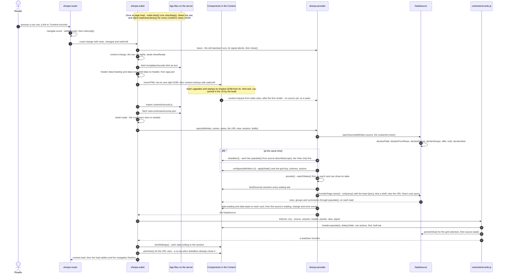
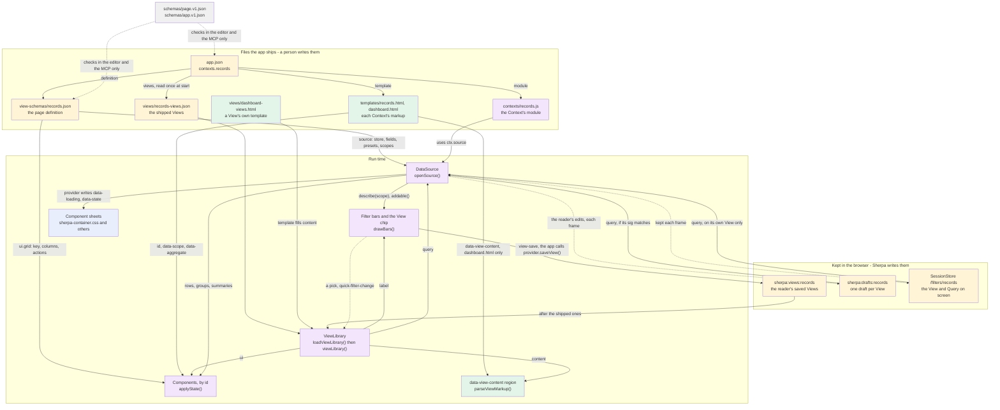

## Fixes made to the draft

- [FIXED] `app.json` row: the outlet reads `views` once, in `start()`. It is not read again on each navigation.
- [FIXED] 2a order: `settleRoute()` runs before `intercept()`. The outlet's own `leave` runs the teardown and aborts the signal, then it calls `provider.close()`. Next come `context-change` and `await viewsReady`, and only then the markup fetch.
- [FIXED] 2a: added `await ready` (the store seed). It runs after the definition fetch and before `open()`.
- [FIXED] 2a: `drawBars()` and `configure()` run at the same time, in one `Promise.all`. The bars are drawn from `source.describe(scope)`.
- [FIXED] 2a: `provide()` calls `watchStates()` before it answers any ask. `data-loading` and `data-state` come from the source's `loading`, `change` and `error` events.
- [FIXED] A component asks only after its first render. Its `.html` and `.css` are carried in the JS by the build. Only a dev build fetches them.
- [FIXED] The first View: a kept Query or a draft is still put back on it. Only the first View's own `query` is skipped. This was wrong in 2a, in "A link or a reload", and in part 3.
- [FIXED] A link or a reload does not apply a View's `ui`. The one exception is a View with content: the opening branch of `onViewPicked()` applies it.
- [FIXED] Sheets row: CSS reads only `data-custom-view` (it hides `.view-delete`). `data-at-default` and `data-nothing-to-reset` are read by `core/ui/more-menu.ts`, which disables rows in the ⋮ menu.
- [FIXED] Flowchart: `scopes` go to the source, and the bars are drawn from the source. Before, an arrow went straight from the definition to the bars.
- [FIXED] Flowchart: `data-view-content` is in `dashboard.html`, not in `records.html`. The schemas also check `app.json`. Added the arrow for a pick.
- [FIXED] Pick step 7: the outlet hears the pick FIRST. Its listener is on the header, and the provider is higher up. The draft said "at the same time".
- [FIXED] Saving: `view-save` on the reader's own View asks "Save over?" and calls `saveView()` with no name. On any other View it asks for a name. `view-save-as` always asks for a name.
- [FIXED] `ui` is not limited to `static config`. `applyState()` calls any public method or accessor.
- [FIXED] Storage row: the kept Query is in local storage, because `persist()` shares by default. Added `sherpa:filter-set-on:<page>`.
- [FIXED] Known gap: the kept Query has the same name-versus-id split as the saved Views.
- [FIXED] `index.html` row: the toolbar is the View bar. The View chip is its first chip, and `drawBars()` draws it.

## A Context page and a View: how they are made at run time

Worked example: Sherpa Demos' **Records** Context. Paths are relative to `Sherpa Demos/app/` and `sherpa-ui/src/`.

### 1. The files and what each one is

| File | Kind | Who writes it | Who reads it, and when |
|---|---|---|---|
| `app.json` | DEFINITION | a person | `index.html` imports it once, at page load (`with { type: 'json' }`). `checkApp()` checks its names, in `index.html` and again in `outlet.start()`. `OutletNav` draws the nav rows from it: Home, Recent, Favorites, each Section's Contexts, and the Settings pages. `start()` reads each Context's `views` once. On each navigation the outlet reads `contexts.records`: `template`, `definition`, `module`, `chrome`, `label`, `icon`. |
| `schemas/app.v1.json`, `schemas/page.v1.json` | SCHEMA | sherpa-ui | The editor (through `$schema`), the MCP's `validate_page`, and unit tests. **Never read at run time.** At run time a bad name is reported with `report()`, and the page shows less. |
| `index.html` | TEMPLATE + CODE | a person | Page load, once. It holds the parts that never swap: `sherpa-router data-params="context view" data-overlay="settings"` (`start()` adds `context=<default>`), `sherpa-provider`, `sherpa-app-shell`, `sherpa-nav`, the header with the View bar (`sherpa-quick-filter-toolbar data-type="view" data-scope="view"`, whose first chip `drawBars()` draws as the View chip), `sherpa-filter-panel data-scope="view data"`, and `sherpa-outlet`. Its script makes the `SessionStore` and persists its pointers. Then it calls `outlet.start({ app, base, session, stores, ready, drafts, panels, settings })`. |
| `templates/records.html` | TEMPLATE (plain markup, no `<template>` wrapper) | a person | The outlet, on each navigation to the Context. It is fetched as text and put into the outlet's own light DOM with `innerHTML`. Each element's `id`, `data-scope` and summary attributes (`data-aggregate`, `data-segment-field`, …) say what that element asks for. `data-view-content` (only in `dashboard.html`) marks where a View's own content goes. |
| `view-schemas/records.json` | DEFINITION: a page definition, `PageDefinition` in `core/data/page-definition.ts` | a person | The outlet, on each navigation. It fetches the JSON, then calls `provider.open()`. `source` goes to `openSource()` and becomes a `DataSource`. `ui` goes to each element by id, through `applyState()`. `id` names the source and the page's storage keys. |
| `views/records-views.json` | DEFINITION: a `ViewLibrary`, View id → `{ label, query, ui, template? }` | a person | `loadViewLibrary()` (`core/browser/view-files.ts`), from `outlet.start()`. It runs **once, for every Context**, not on each navigation. `#load` waits for it (`viewsReady`). No schema checks it. |
| `views/dashboard-views.html` | TEMPLATE: `<template id="capacity">` | a person | `loadViewLibrary()` at start, through the Templater's `loadTemplates()`, when a View says `"template": "dashboard-views.html#capacity"`. That template's markup becomes the View's `content` string. It goes through the allow-list only when the View is drawn. |
| `contexts/records.js` | CODE: a `ContextModule` | a person | The outlet, on each navigation. It is loaded with `import()` before the definition is fetched. Its `init(root, ctx)` runs **after** `provider.open()`. It does the page's own work: page size from the session, the CRUD dialog, row actions, the details panel, find and the bulk bar. It returns a teardown. |
| `stores/records-data.js` | CODE: the store | a person | `index.html`, at page load. `stores()` gives it the name `customers`, and the definition's `source.store: "customers"` picks it. `ready` (the seed) is awaited before `open()`. |
| `sherpa-router.ts` + `route.ts`, `sherpa-outlet.ts` + `outlet-nav.ts`, `sherpa-provider.ts` + `provider-page.ts`, `app-definition.ts`, `page-definition.ts`, `session.ts`, `view-files.ts`, `persist-view.ts`, `view-markup.ts`, `view-drafts.ts`, `apply-state.ts`, `bind-source.ts`, `bind-settings.ts`, `context.ts` | CODE | sherpa-ui | Imported once, at page load, through `sherpa-ui` (`/dist/index.js`). |
| Each component's `.ts` / `.html` / `.css` / `.component.json` | CODE / TEMPLATE / SHEET / CONTRACT | a person writes the first three. The spec generator writes `.component.json`. | The class is defined at page load. When its tag lands in the Context's markup, it upgrades, adopts its sheets and stamps its template. The build carries both in the JS. After the first render, `static asks` sends a `context-request`. `static config` declares the settings a page sets once (the grid: `key`, `columns`, `actions`). A definition's or a View's `ui` may also call any public method, such as `select`. `.component.json` is never read at run time: the MCP and the checks read it. (344) A `content` prop's default text is the template's own text, and a value that follows a host attribute is written in the markup as `data-swap-*`. |
| `sherpa-container.css`, `sherpa-quick-filter-toolbar.css`, `sherpa-app-shell.css` | SHEET | a person | The browser, always. They draw attributes that the provider and the outlet write. On each card: `data-loading`, `data-state` (empty / no matches / error), `data-keep-content`. On the View bar: `data-custom-view` (shows Delete view). On the shell: `data-no-header`, from `chrome.header: false`. The provider also writes `data-at-default` and `data-nothing-to-reset` on bars and the panel. `more-menu.ts` reads these two in JS, not CSS, and disables the Reset rows in the ⋮ menu. |
| Browser storage | Kept JSON | Sherpa | `localStorage sherpa:views:<page>` holds the reader's saved Views. `sherpa:drafts:<page>` holds one draft per View: session storage, and local storage too in `always` mode. `localStorage sherpa:session:/filters/<page>` holds the kept `{ view, query }`: Demos persists it, and `persist()` shares by default. `sessionStorage sherpa:view:records` holds a `ViewSnapshot` from `persistView()`. `localStorage sherpa:filter-sets:<page>` holds saved filter sets, and `sessionStorage sherpa:filter-set-on:<page>` holds the set on screen. |
| The URL | `?context=records&view=risk&settings=application` | `sherpa-router` only | The outlet reads it on each `route-change`, and `OutletNav` reads it to light a row. The first View is left out. |

### 2a. A Context opens (the reader picks the Records row)

A newer navigation abandons an older load. A token check after each step stops it. `?settings=` opens over the Context and never reloads it.

### 2b. A View: which JSON field drives what

**What each field does**

- **Page definition, `source`.** `store` picks the store. `pageSize`, `applyOn`, `debounce`, `holdRows` and `search` (as `searchFields`) go into `new DataSource()`. Each entry in `fields` goes to `declareField()`. No field lists its values: `declareFromRows()` reads them from the rows. Each entry in `presets` goes to `declarePreset()`, each one as a `where`.
- **Page definition, `scopes.view` / `scopes.data`.** These go to the SOURCE, not to a bar. `label` and `arranges` go to `declareScope()`. `offers` fills the Add list. `holds` sets the chips at the start. `sets` goes to `declareSets()` and makes grouped chips. `presets` are saved filters, shown off. A bar finds its scope through `data-scope` in the markup. `drawBars()` then draws it from `source.describe(scope)`.
- **Page definition, `ui.<id>`.** It goes to that element's own API, before the element gets data. A tag that is not defined yet is reported, and it is set once the tag is defined.
- **Page definition, `id`.** It names the source in the provider. It also names the keys `sherpa:views:<id>`, `sherpa:drafts:<id>`, `/filters/<id>`, `sherpa:filter-sets:<id>` and `sherpa:filter-set-on:<id>`.
- **View id (the JSON key).** It is the chip option's value and the value of `?view=`. A saved View's id is `labelId(label)`.
- **View `label`.** The chip option's text, and the nav row's text when "Show full view hierarchy" is on. Shipped Views go under "Presets". The reader's own go under "Custom views", at the bottom.
- **View `query`.** A `QueryDefaults`: `v`, plus `scopes.<scope>.where / presets / sort / group / search / holds`. On a pick it goes to `source.setQuery(query, { holds: 'keep' })`. A draft is put on instead when there is one.
- **View `ui.<id>`.** It goes to `applyState()` after the query lands, on a pick. For example, `"grid": {"select": [[]]}` calls `grid.select([])`.
- **View `template` / `content`.** `template` becomes `content` when the file loads. `content` goes through `parseViewMarkup()` into `[data-view-content]`.

**A View pick, in order** (the reader picks "At risk"):

1. The View chip reports the whole bar: `quick-filter-change` with `values.view = ["risk"]`.
2. The outlet hears it first, on the header. It calls `router.go({ view: 'risk' }, { replace: true })`, and sends `null` for the first View. The `route-change` comes back for the same Context. The chip already shows `risk`, so `pickView()` does nothing.
3. The event then reaches the provider. There `onViewPicked()` (`persist-view.ts`, wired by `provider-page.ts`) hears it. It ignores a pick of the View already on screen. It reads the library again: the shipped Views, then `sherpa:views:records`.
4. `before()` writes the old View's draft and kept Query now. Until the pick settles, the provider does not treat its own writes as the reader's.
5. If the View has `content`, it is parsed and put into the region. The page's own children are put aside once. A View with no content puts them back.
6. The query goes on. That is the draft if one exists and its `sig` matches. Otherwise it is `setQuery(view.query, { holds: 'keep' })`, onto a clean slate. Every bound bar and the grid redraw.
7. `ui` is applied, then `after()` runs. The View on screen is set and the session keeps `/filters/records`. The bar gets `data-custom-view`, and the provider emits `view-change`.

**A link or a reload with `?view=risk`.** The URL's View goes into `provider.open()`, and `drawBars(view)` selects it on the chip. Then `ProviderPage.views()` puts on the first of these that exists:

1. the kept Query, only if it was made on that View;
2. the draft;
3. the View's own `query`.

The first View can still get the kept Query or a draft. It skips only its own `query`, because the definition already is the first View. The View's `ui` is not applied on open. The one exception is a View with content: the opening branch of `onViewPicked()` draws that content and applies its `ui`.

**Saving a View.** The View bar sends `view-save` or `view-save-as`, and the app (`index.html`) answers it. If the View on screen is the reader's own, `view-save` asks "Save over?" and calls `provider.saveView()` with no name. Otherwise it asks for a name and calls `provider.saveView(name)`. `saveViewAs()` writes `{ label, query: viewQueryOf(source) }` to `sherpa:views:records`. The draft of the old View and the draft of the new one are both cleared. `drawBars(id)` lists the new View, and `report()` makes the URL and the nav follow. The app then calls `outlet.refreshNav()`. A name that is taken gets ` - Copy-001`. A shipped View is never written over or deleted.

**`ViewSnapshot` / `captureView` / `applyViewSnapshot`.** This is the older whole-snapshot shape, `{ v: 1, source?, elements? }`. The provider's Views do not use it now. It is still used in two places:
- In `persistView()`: `records.js` keeps only the grid's selection, in `sessionStorage sherpa:view:records`, with `source: false`.
- In `saveViewAs()`, which reads `ui` with `captureView()`. The provider passes no `reads`, so a View saved by a reader has no `ui`.

### 3. Things that look odd but are on purpose

- **The Context's markup goes in with plain `innerHTML`, but a View's markup goes through an allow-list.** The template ships with the app. A View's `content` can come from storage or a server. The allow-list keeps `sherpa-*` tags, layout and text tags, and `data-*`. It drops `on*`, `style`, `<a>`, `` and `<script>`. TRAP `T-an-outlet-loads-the-context`, TRAP `T-saved-markup-is-untrusted-input`.
- **`definition.ui` is set before any component gets data, through the component's own API, not through attributes.** The grid's ask reads its `columns` to learn which heading filters to ask for. TRAP `T-configuration-is-not-data`, TRAP `T-a-page-is-its-definition`.
- **The View chip owns the View, not the URL.** A pick goes to the URL by `replace`, so Back does not step through picks. The first View is left out of the URL. A URL change becomes a chip pick (`setChipValues()` + `report()`). A pick of the View already on screen is ignored, because the chip is persistent and sends `values.view` on every bar change. TRAP `T-the-router-owns-the-url`, TRAP `T-a-persistent-chip-reports-on-every-change`.
- **The first View's own query is not put on when the page opens: the page definition is that View.** A kept Query or a draft can still go on it. Every other View goes onto a clean slate with `holds: 'keep'`. Reset puts the page's first Query back, then the View's own. TRAP `T-a-provider-keeps-the-views`, TRAP `T-a-view-is-json`, TRAP `T-reset-to-default-is-the-views-own`.
- **Four keepers, each with its own key and its own lifetime:**
  - Saved Views are in local storage, shared across tabs.
  - Drafts live in the tab, and in local storage too in `always` mode. A `sig` drops a draft that was made over an older View definition.
  - The kept Query is in local storage, because `persist()` shares by default. It comes back only on the View it was made on.
  - `persistView({ source: false })` keeps only the grid's selection, in the tab. This means it cannot put an old sort over a View's sort.

  TRAP `T-a-view-keeps-a-draft`, TRAP `T-a-reload-replays-the-readers-answers`, TRAP `T-persist-defaults-per-tab`, TRAP `T-session-persist-defaults-shared`.
- **The views JSON loads once at start, for every Context, and a View region keeps its first children.** The nav's "Show full view hierarchy" lists every Context's Views as rows, so every library must be in before the nav draws them again (TRAP `T-the-outlet-keeps-the-nav`). The page's own children are put aside once. Later they are re-attached, not rebuilt, so every existing bind still points at them (TRAP `T-content-first-original-once`).

There is one known gap, and it is not on purpose. The outlet reads a Context's saved Views under the Context's name, but the provider saves them under the definition's `id`. The kept Query has the same split: Demos persists `/filters/<Context name>`, but the provider writes `/filters/<definition id>`. The two names are equal in Demos, but nothing makes them equal. If they differ, the outlet reports `outlet-view-key` (TODO 321, 🚧).

Read from `/Users/williammincher/Documents/My synced vault/Projects/sherpa-ui/src` and `/Users/williammincher/Documents/My synced vault/Projects/Sherpa Demos/app`, with no edits. The 344 work (`src/core/ui/swap.ts`, the `applySwaps` call in `src/core/ui/sherpa-element.ts`) is still in progress. It does not touch this flow.